<div dir="rtl">

<div align="center">

[English](README.md) · **فارسی**

<picture>
  <source media="(prefers-color-scheme: dark)" srcset="docs/images/readme/hero-dark.webp">
  
</picture>

### سایت، مدرسه و کسب‌وکار یک آکادمی، همه در یک کد.

[](https://github.com/farjadp/edvora/actions/workflows/ci.yml)


[ادورا چیست](#ادورا-چیست) · [امکانات](#امکانات) · [تصویرها](#تصویرها) · [راه‌اندازی سریع](#راهاندازی-سریع) · [ساختار پروژه](#ساختار-پروژه) · [مستندات](#مستندات) · [مشارکت](#مشارکت)

</div>

---

## ادورا چیست

ادورا پلتفرم **چندمستأجری و وایت‌لیبل** آکادمی است که AshaVid آن را می‌سازد. یک نصب، چند آکادمی را اداره می‌کند و هر
آکادمی دامنه، رنگ‌های برند، درگاه پرداخت، کارکنان، نقش‌ها و داده‌های خودش را دارد. آکادمیِ هر درخواست از روی نام
دامنه‌ای که باز شده تشخیص داده می‌شود.

مستأجر شمارهٔ ۱ **آکادمی برند ایران** (`iba`) است. مستأجر دوم، **`demo`**، فقط دادهٔ آزمایشی دارد و همهٔ تصویرهای
این صفحه از همان گرفته شده‌اند.

ادورا برای آکادمی‌های فارسی‌زبان ساخته شده است: چیدمان راست‌به‌چپ، تاریخ شمسی، اعداد فارسی، نگه‌داری مبلغ‌ها به
ریالِ صحیح، و درگاه پرداخت و پیامک ایرانی که پشت آداپتر قرار گرفته‌اند. هیچ وابستگی خارجی در زمان اجرا ندارد (نه CDN،
نه Google Fonts، نه ابزار آمار)، پس می‌شود آن را داخل ایران میزبانی کرد.

## امکانات

| | آنچه هر آکادمی می‌گیرد |
| --- | --- |
| 🏛️ **سایت آکادمی** | صفحهٔ اصلی با برند خود آکادمی، صفحهٔ دوره‌ها، اساتید، مجله، استعلام عمومی گواهی در `/verify`، پوستهٔ روشن و تیره |
| 💳 **فروش** | پرداخت یک‌جا یا قسطی، کد تخفیف، بازگشت از درگاه (زرین‌پال، یا درگاه آزمایشی برای تست) |
| 📞 **مدیریت سرنخ‌ها** | فرم درخواست مشاوره، صف پیگیری مشاور با نتیجه و قدم بعدی، قواعد مسیر فروش |
| 🎓 **آموزش** | پنل دانشجو، پخش جلسه و ثبت پیشرفت، آزمون (چهار نوع سؤال، بانک سؤال، چند بار شرکت، زمان‌سنج)، تکلیف با بارگذاری خصوصی، انتشار زمان‌بندی‌شدهٔ محتوا، گواهی |
| 🔴 **کلاس زنده** | BigBlueButton روی سرور خود آکادمی، پشت آداپتر: لینک ورود و میزبانی، حضور و غیاب، ضبط جلسه در فضای خصوصی |
| 🏅 **انگیزش و پیشرفت** | دفتر امتیاز، ریتم هفتگی، نشان و سطح، هدف روزانهٔ مشاوران؛ هر آکادمی می‌تواند آن را روشن یا خاموش کند |
| 🧑‍💼 **میز کار کارکنان** | میز جداگانه برای هر نقش در `/staff` (مشاور، مالی، پشتیبانی، مدرس)، صفحهٔ ۴۰۳ واقعی، تأیید دومرحله‌ای اختیاری |
| 🛠️ **بخش مدیریت** | Payload در `/admin` با پوستهٔ «مُهر»، فارسی به‌طور پیش‌فرض، ویرایشگر متن Lexical با بارگذاری تصویر |
| 🔐 **نقش‌ها** | فهرست دسترسی‌ها، نقش و الگوی نقش برای هر آکادمی، عضویت با دامنه و تاریخ انقضا، گزارش ممیزی |
| 🔁 **انتقال از وردپرس** | انتقال یک‌کلیکی از WooCommerce، LifterLMS و Tutor LMS، با اجرای آزمایشی و ریدایرکت |
| 📱 **اطلاع‌رسانی** | پیامک برای سرنخ، ورود و ثبت‌نام (کاوه‌نگار، یا سرویس آزمایشی) |

هر سرویس بیرونی (پرداخت، پیامک، کلاس زنده، فضای ذخیره‌سازی، وردپرس) پشت یک رابط قرار دارد که هم پیاده‌سازی واقعی
دارد و هم نسخهٔ آزمایشی؛ برای همین کل مسیر بدون اینترنت هم کار می‌کند.

## تصویرها

همهٔ تصویرها از مستأجر `demo` با دادهٔ نمونه و سرویس‌های آزمایشی گرفته شده‌اند.

**سایت عمومی**

<table>
  <tr>
    <td width="50%">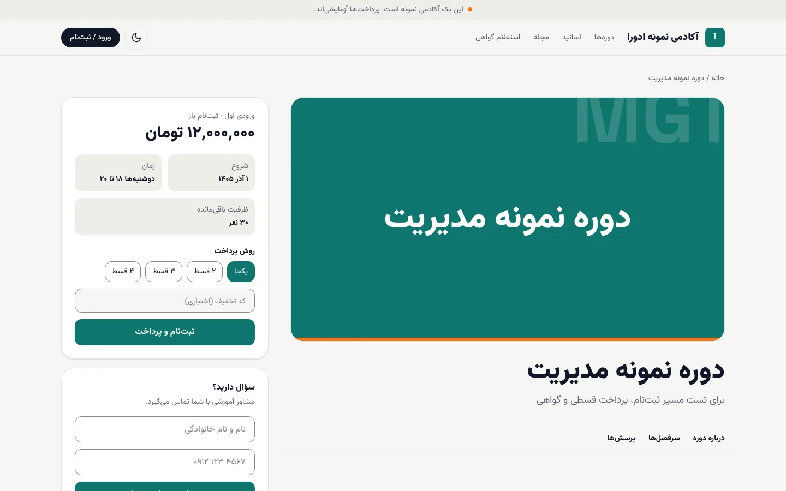<br><sub>صفحهٔ دوره با روش پرداخت و کد تخفیف</sub></td>
    <td width="50%">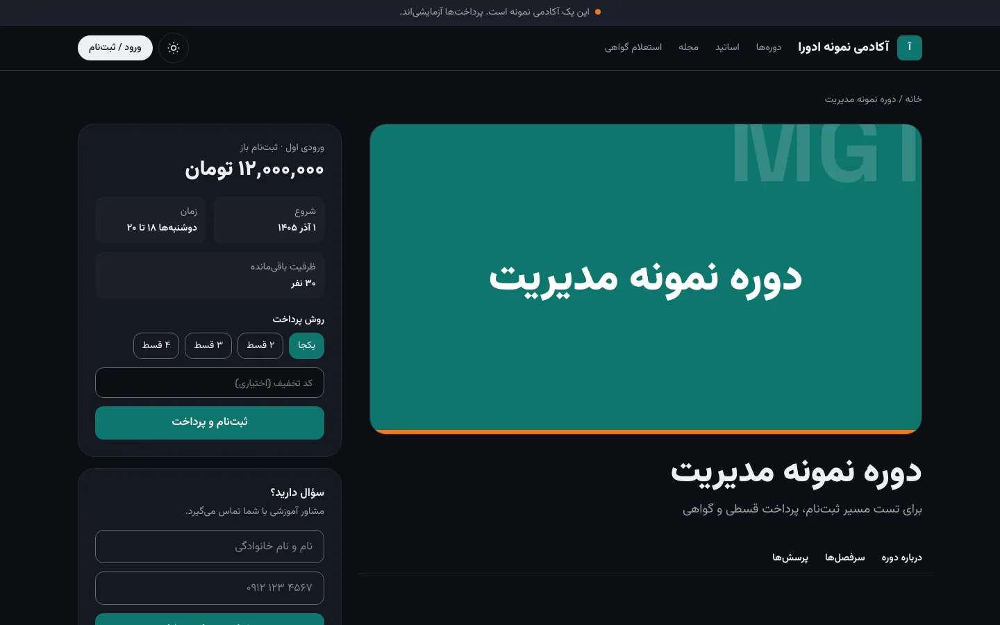<br><sub>پوستهٔ تیره</sub></td>
  </tr>
  <tr>
    <td>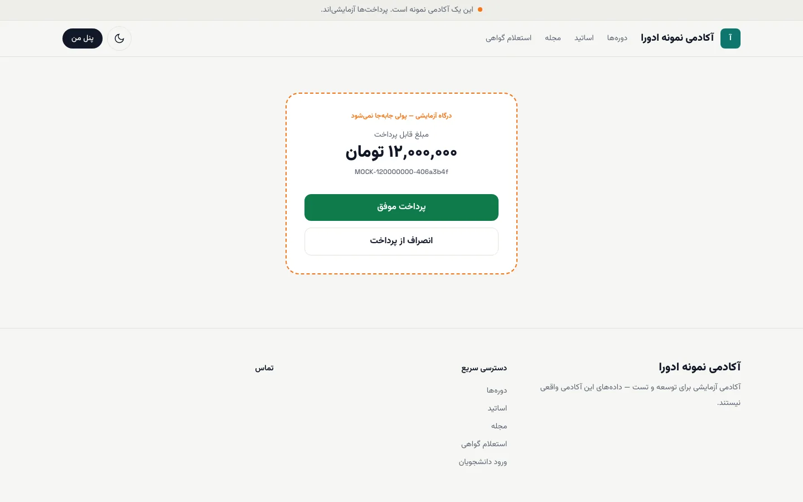<br><sub>پرداخت (درگاه آزمایشی)</sub></td>
    <td>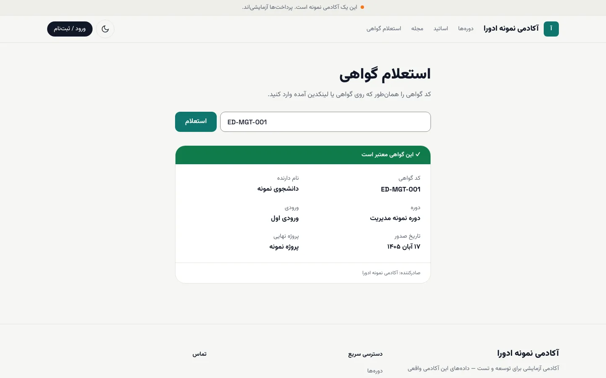<br><sub>استعلام گواهی</sub></td>
  </tr>
  <tr>
    <td colspan="2">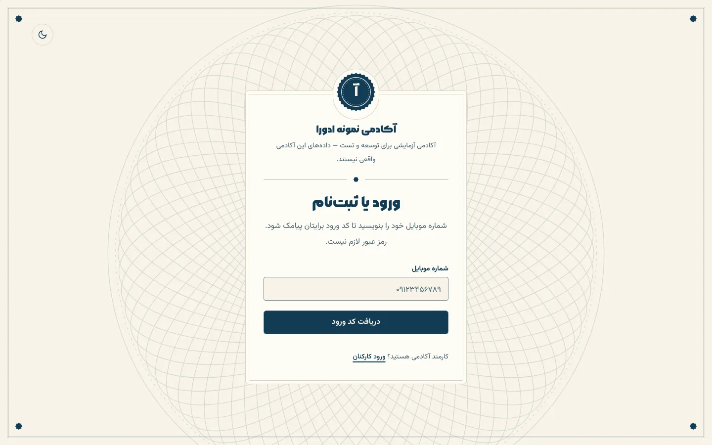<br><sub>ورود دانشجو (موبایل و کد پیامکی)</sub></td>
  </tr>
</table>

**پنل دانشجو**

<table>
  <tr>
    <td width="50%">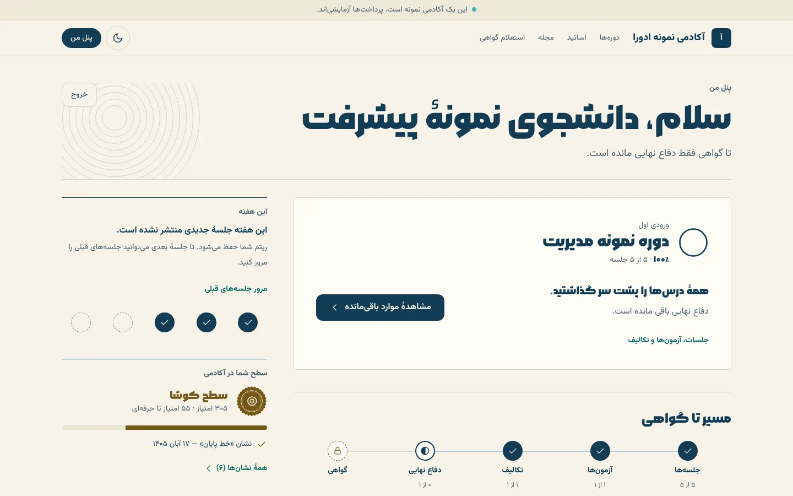<br><sub>پنل و مسیر تا گواهی</sub></td>
    <td width="50%">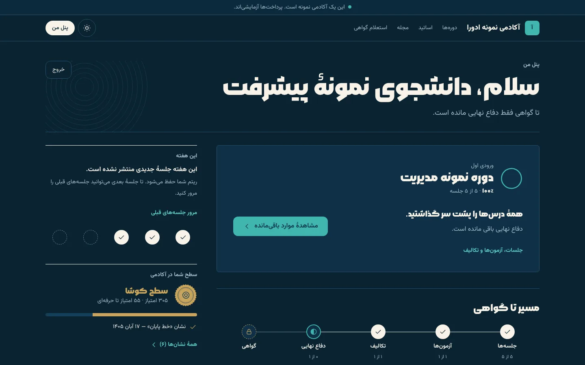<br><sub>پنل، پوستهٔ تیره</sub></td>
  </tr>
  <tr>
    <td colspan="2">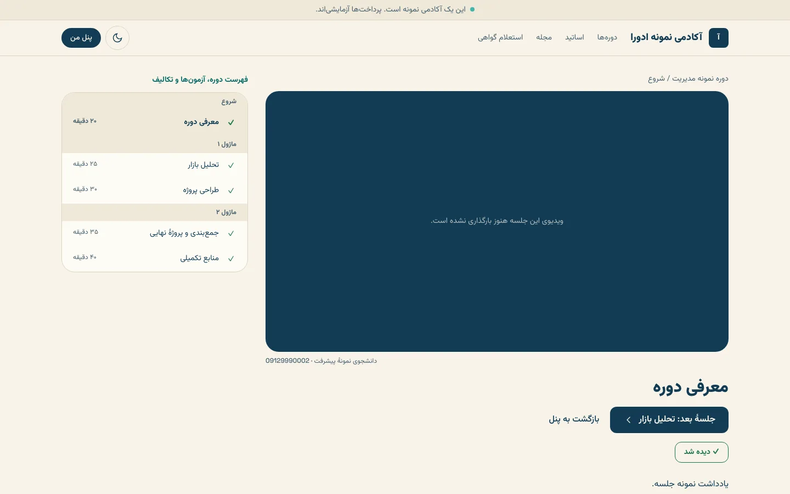<br><sub>پخش جلسه و فهرست دوره</sub></td>
  </tr>
</table>

**موبایل (عرض ۳۷۵ پیکسل)**

<table>
  <tr>
    <td width="33%">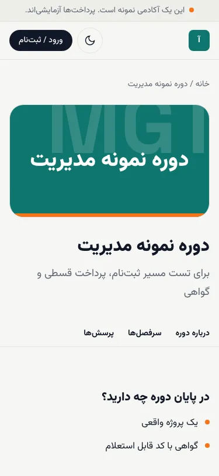<br><sub>دوره</sub></td>
    <td width="33%">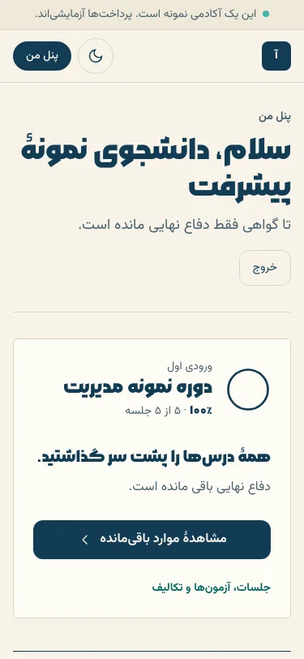<br><sub>پنل</sub></td>
    <td width="33%">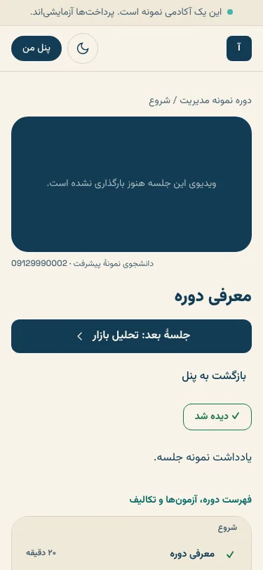<br><sub>جلسه</sub></td>
  </tr>
</table>

**میز کار کارکنان و بخش مدیریت**

<table>
  <tr>
    <td colspan="2">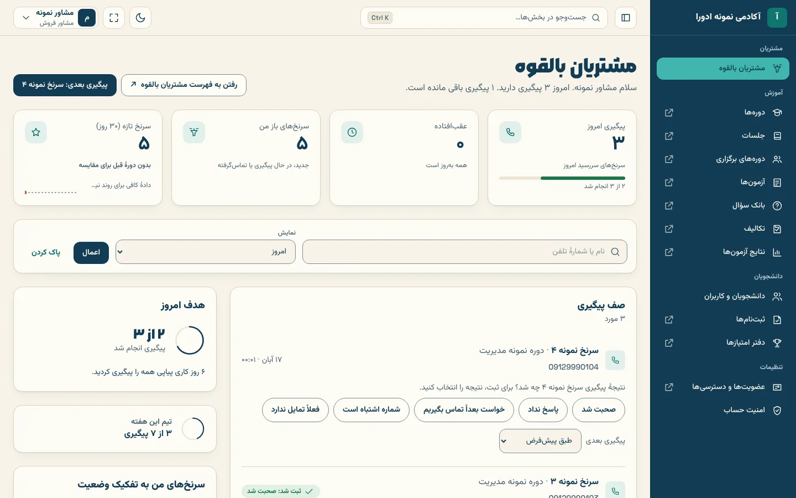<br><sub>میز مشاور در <code>/staff</code></sub></td>
  </tr>
  <tr>
    <td width="50%">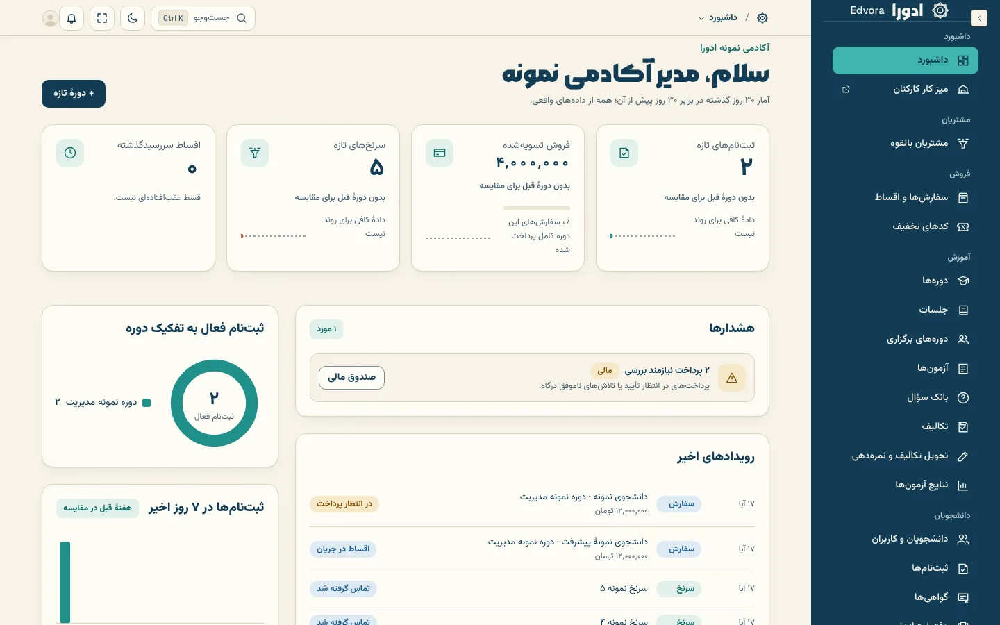<br><sub>داشبورد مدیریت (مُهر)</sub></td>
    <td width="50%">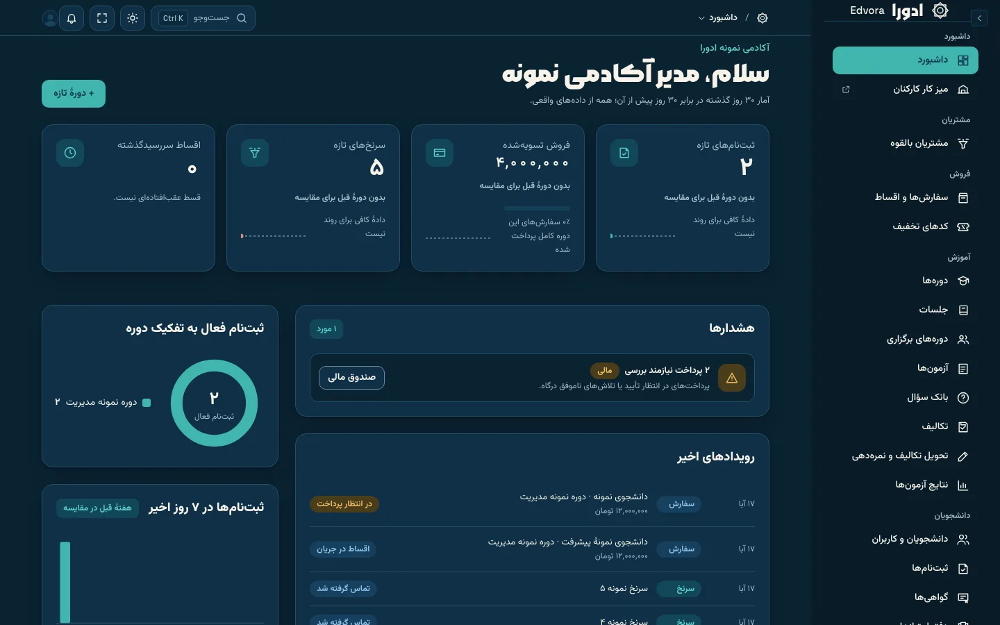<br><sub>مدیریت، پوستهٔ تیره</sub></td>
  </tr>
  <tr>
    <td colspan="2">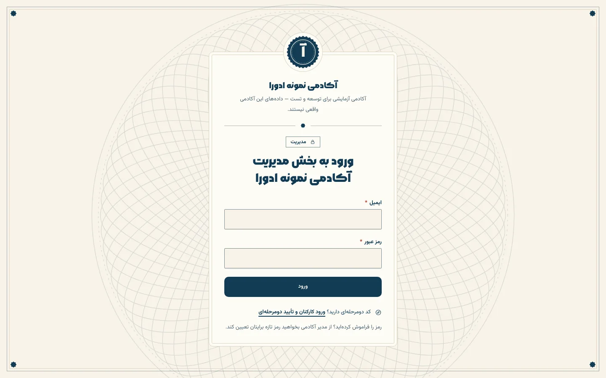<br><sub>ورود به بخش مدیریت</sub></td>
  </tr>
</table>

## فناوری‌ها

| لایه | انتخاب |
| --- | --- |
| اپلیکیشن | Next.js 16 (App Router، کامپوننت سمت سرور، Server Action) |
| CMS و مدیریت | Payload CMS 3 با افزونهٔ چندمستأجری |
| پایگاه داده | PostgreSQL 16 |
| زبان | TypeScript در حالت strict |
| ظاهر | Tailwind CSS 4، توکن‌های طراحی در `packages/ui` (سیستم طراحی «مُهر») |
| مونوریپو | pnpm 10 و Turborepo |
| تست | Vitest برای پکیج‌ها، Playwright برای تست سرتاسری و دسترس‌پذیری (axe) |
| فونت | وزیرمتن و مربع، روی سرور خود پروژه |

## راه‌اندازی سریع

به **Node 24.22 به بالا** (`nvm use`)، **pnpm 10** و **Docker** نیاز دارید.

</div>

```bash
pnpm install
cp apps/web/.env.example apps/web/.env   # set PAYLOAD_SECRET, SESSION_SECRET, SEED_ADMIN_EMAIL, SEED_ADMIN_PASSWORD
pnpm db:up && pnpm seed && pnpm dev
```

<div dir="rtl">

دستور `pnpm db:up` پستگرس (پورت 5442)، Redis، Mailpit و یک فضای ذخیره‌سازی سازگار با S3 (SeaweedFS) را بالا می‌آورد.
`pnpm seed` دو مستأجر `iba` و `demo` را می‌سازد. کلیدهای مخفی را با `openssl rand -hex 32` بسازید.

مستأجر از روی نام دامنه انتخاب می‌شود:

| آدرس | مستأجر |
| --- | --- |
| http://localhost:3000 | `iba` (مستأجر پیش‌فرض) |
| http://demo.localhost:3000 | `demo` (دادهٔ آزمایشی) |

| بخش | مسیر | چطور وارد شوید |
| --- | --- | --- |
| ورود دانشجو | `/login` | هر شماره‌ای که با `09` شروع شود. با `SMS_PROVIDER=mock` کد روی صفحه و در لاگ سرور نمایش داده می‌شود |
| پنل دانشجو | `/dashboard`، `/learn/<course>` | بعد از ورود |
| میز کار کارکنان | `/staff/login` و بعد `/staff` | با حساب کارمند؛ تأیید دومرحله‌ای برای هر نفر اختیاری است |
| مدیریت | `/admin` | با `SEED_ADMIN_EMAIL` و `SEED_ADMIN_PASSWORD` |
| درگاه آزمایشی | `/pay/mock` | با `PAYMENT_PROVIDER=mock` خودکار استفاده می‌شود |
| استعلام گواهی | `/verify` | عمومی. کد نمونه: `ED-MGT-001` |

در آکادمی نمونه، دوره یک طرح چهارقسطی دارد و کد تخفیف `TEST20` هم فعال است.

### متغیرهای محیطی

همهٔ تنظیمات از متغیرهای محیطی خوانده می‌شود. نمونه‌اش در [`apps/web/.env.example`](apps/web/.env.example) است.

| متغیر | کاربرد | پیش‌فرض |
| --- | --- | --- |
| `DATABASE_URL` | اتصال به پستگرس | داکر محلی |
| `PAYLOAD_SECRET`، `SESSION_SECRET` | کلیدهای امضا | **باید تنظیم شود** |
| `NEXT_PUBLIC_SITE_URL` | آدرس پایهٔ عمومی | `http://localhost:3000` |
| `DEFAULT_TENANT_SLUG` | مستأجر وقتی دامنه با هیچ‌کدام جور نیست | `iba` |
| `PAYMENT_PROVIDER` · `ZARINPAL_*` | `mock` یا `zarinpal` | `mock` |
| `SMS_PROVIDER` · `KAVENEGAR_*` | `mock` یا `kavenegar` | `mock` |
| `STAFF_2FA_REQUIRED` | اجباری‌کردن تأیید دومرحله‌ای برای همهٔ کارکنان | `false` |
| `PRIVATE_UPLOADS_DIR` | فایل تکلیف‌ها، هرگز عمومی نیست ([ADR 009](docs/adr/009-private-uploads.md)) | `private-uploads/submission-files` |
| `SEED_ADMIN_EMAIL`، `SEED_ADMIN_PASSWORD` | نخستین مدیر کل | **باید تنظیم شود** |

### بررسی‌ها و تست

</div>

```bash
pnpm typecheck && pnpm test && pnpm build
```

<div dir="rtl">

تست‌های سرتاسری با Playwright روی هر دو مستأجر و با سرویس‌های آزمایشی اجرا می‌شوند. پایگاه داده باید seed شده باشد و
خود تست‌ها `next dev` را بالا می‌آورند:

</div>

```bash
pnpm db:up && pnpm seed
pnpm e2e                    # E2E_PORT=3100 pnpm e2e if :3000 is busy
```

<div dir="rtl">

## ساختار پروژه

</div>

```
edvora/
├─ apps/web/                  Next.js 16 + Payload 3: public site, student panel, /staff, /admin
│  └─ src/
│     ├─ app/(frontend)/      Server components; actions.ts = Zod-validated server actions
│     ├─ app/(payload)/       Payload admin and its Seal theme
│     ├─ collections/         Data model (tenant-owned collections are registered with the multi-tenant plugin)
│     ├─ access/              Roles and permission checks, default deny
│     └─ seed/                iba + demo seed
├─ packages/core/             Business rules + Vitest: money, instalments, quizzes, drip, access, TOTP, Jalali dates
├─ packages/integrations/     Outside services: interface + real adapter + mock (payment, sms, live-class, storage, wordpress)
├─ packages/ui/               Design tokens and shared components (Seal), Tailwind 4
├─ e2e/                       Playwright specs
├─ infra/docker/              Local stack
└─ docs/                      ADRs, guides, runbooks, design, product, research
```

<div dir="rtl">

چهار اصل به کد شکل داده است:

۱. **هر درخواست، یک مستأجر.** مستأجر از روی دامنه مشخص می‌شود و هر کوئری عمومی صریحاً با `tenant` فیلتر می‌شود.
([ADR 004](docs/adr/004-multi-tenancy.md)، [005](docs/adr/005-tenant-resolution-and-redirects.md))

۲. **مدیریت دولایه.** `/admin` برای راه‌اندازی و محتواست و میزهای `/staff` برای کار روزانهٔ هر نقش.
([ADR 006](docs/adr/006-two-layer-admin.md))

۳. **دسترسی‌ها در پایگاه داده‌اند.** نقش‌ها برای هر آکادمی جداگانه‌اند و از فهرست دسترسی‌هایی که در کد تعریف شده ساخته
می‌شوند. عضویت‌ها دامنه و تاریخ انقضا دارند و هر تغییری در کارکنان در گزارش ممیزی ثبت می‌شود.

۴. **هر سرویس بیرونی آداپتر و نسخهٔ آزمایشی دارد.** می‌شود سرویس‌دهنده را عوض کرد بی‌آنکه به منطق کسب‌وکار دست زد.
([ADR 003](docs/adr/003-adapters-and-mocks.md))

## مستندات

| کجا | چه چیزی |
| --- | --- |
| [`AGENTS.md`](AGENTS.md) | قواعد کار برای هر کسی (آدم یا هوش مصنوعی) که کد را تغییر می‌دهد. اول این را بخوانید |
| [`docs/adr/`](docs/adr/) | تصمیم‌های معماری (فناوری، میزبانی، چندمستأجری، تأیید دومرحله‌ای، ویرایشگر متن، کلاس زنده و …) |
| [`docs/guide/`](docs/guide/README.md) | راهنمای فارسی برای مدیر آکادمی، کارکنان، مدرسان و دانشجویان |
| [`docs/runbooks/`](docs/runbooks/) | استقرار روی Railway، راه‌اندازی BigBlueButton و فضای ذخیره‌سازی |
| [`docs/design/system.md`](docs/design/system.md) | سیستم طراحی «مُهر»: توکن‌ها، کامپوننت‌ها، پوستهٔ تیره |
| [`docs/product/`](docs/product/) · [`docs/ux/`](docs/ux/) · [`docs/specs/`](docs/specs/) | داستان‌های کاربری، جریان‌ها، مشخصات فنی |
| [`docs/agents/`](docs/agents/) | تیم عامل‌های هوش مصنوعی: بورد، فهرست اعضا، تحویل کارها |

نسخهٔ نمایشی روی Railway در [web-production-39ee1.up.railway.app](https://web-production-39ee1.up.railway.app) در
دسترس است (مستأجر `demo`، سرویس‌های آزمایشی، بدون دانشجوی واقعی). نسخهٔ اصلی برای آکادمی‌های ایرانی قرار است روی
میزبان ایرانی راه بیفتد ([ADR 002](docs/adr/002-hosting-in-iran.md)).

## مشارکت

- **شاخه‌ها:** `feature/<module>-<short-name>` به `develop` (محیط آزمایشی) و از آنجا به `main` (محیط اصلی).
- **درخواست ادغام (PR)** همیشه به `develop` فرستاده می‌شود. CI بررسی نوع‌ها، تست‌های واحد، build و تست‌های Playwright
  را اجرا می‌کند. وقتی همهٔ بررسی‌ها سبز شد، گردش‌کار ادغام خودکار PR را در `develop` ادغام می‌کند. اگر نمی‌خواهید
  ادغام شود، برچسب `hold` بزنید یا PR را پیش‌نویس باز کنید. انتشار از `develop` به `main` دستی انجام می‌شود.
- **پیام کامیت** طبق [Conventional Commits](https://www.conventionalcommits.org/) نوشته می‌شود: `feat:`، `fix:`، `docs:`، `chore:`.
- **پیش از push:** `pnpm typecheck && pnpm test && pnpm build`.
- **مهم‌ترین قواعد** (فهرست کامل در [`AGENTS.md`](AGENTS.md)): اول بپرسید «آکادمی دوم هم این را می‌خواهد؟»؛ مبلغ
  فقط به ریال صحیح؛ تاریخ به UTC ذخیره و شمسی نمایش داده شود؛ فقط توکن‌های Tailwind و کلاس‌های منطقی راست‌به‌چپ؛ بدون
  وابستگی خارجی در زمان اجرا؛ هیچ ادعای ساختگی در متن‌ها و دادهٔ نمونه.

<div align="center"><sub>ساختهٔ <b>AshaVid</b></sub></div>

</div>
