<div align="center">

**English** · [فارسی](README.fa.md)

<picture>
  <source media="(prefers-color-scheme: dark)" srcset="docs/images/readme/hero-dark.webp">
  
</picture>

### Run a whole academy (public site, school and business) from one codebase.

[](https://github.com/farjadp/edvora/actions/workflows/ci.yml)


[What it is](#what-it-is) · [Features](#features) · [Screenshots](#screenshots) · [Quick start](#quick-start) · [Structure](#project-structure) · [Docs](#docs) · [Contributing](#contributing)

</div>

---

## What it is

Edvora is AshaVid's **multi-tenant, white-label academy platform**. One deployment serves many academies. Each one
gets its own domain, brand colours, payment gateway, staff, roles and data, and the tenant is picked from the host
name of every request.

Tenant #1 is **Iran Brand Academy** (`iba`). A second tenant, **`demo`**, holds test data only, and every screenshot
below comes from it.

It is built for Persian-speaking academies: right-to-left layout, Jalali dates, Persian digits, money stored as
integer rials, and Iranian payment and SMS providers behind adapters. There are no external runtime dependencies (no
CDN, Google Fonts or analytics), so it can be hosted inside Iran.

## Features

| | What an academy gets |
| --- | --- |
| 🏛️ **Academy site** | Branded homepage, course pages, faculty, journal, public certificate check at `/verify`, light and dark themes |
| 💳 **Sales** | Checkout with one-off or instalment plans and coupons, gateway callback (Zarinpal, or a mock gateway for testing) |
| 📞 **Lead CRM** | Lead form, advisor follow-up queue with outcomes and next steps, pipeline rules |
| 🎓 **Learning** | Student panel, lesson player with progress, quizzes (four question types, question bank, attempts, timer), assignments with private uploads, drip schedules, certificates |
| 🔴 **Live classes** | Self-hosted BigBlueButton behind an adapter: join and host links, attendance, recordings in private storage |
| 🏅 **Gamification** | XP ledger, weekly rhythm, badges and levels, advisor daily goals; each academy can switch it on or off |
| 🧑‍💼 **Staff console** | `/staff` desks per role (advisor, finance, support, instructor), real 403 pages, optional TOTP two-factor |
| 🛠️ **Admin** | Payload `/admin` in the Seal theme, Persian by default, Lexical rich-text editor with image upload |
| 🔐 **Roles** | Permission catalog, per-academy roles and templates, memberships with scope and expiry, audit log |
| 🔁 **WordPress import** | One-click import from WooCommerce, LifterLMS and Tutor LMS, with a dry run and redirects |
| 📱 **Notifications** | SMS on lead, login and enrolment (Kavenegar, or a mock provider) |

Every outside service (payment, SMS, live classes, object storage, WordPress) sits behind an interface with a real
adapter and a mock, so the whole flow runs offline.

## Screenshots

All shots are from the `demo` tenant with seed data and mock providers.

**Public site**

<table>
  <tr>
    <td width="50%">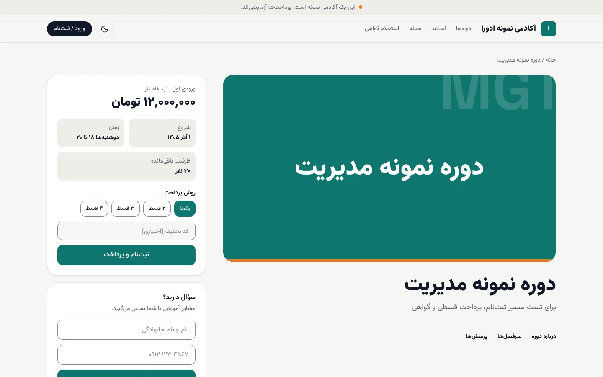<br><sub>Course page with plans and coupon</sub></td>
    <td width="50%">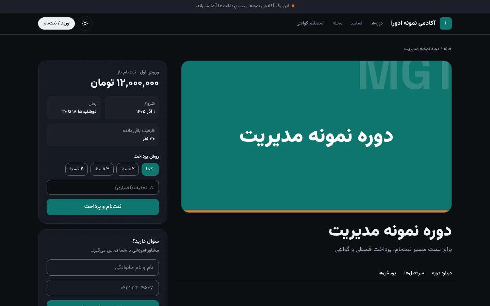<br><sub>Dark mode</sub></td>
  </tr>
  <tr>
    <td>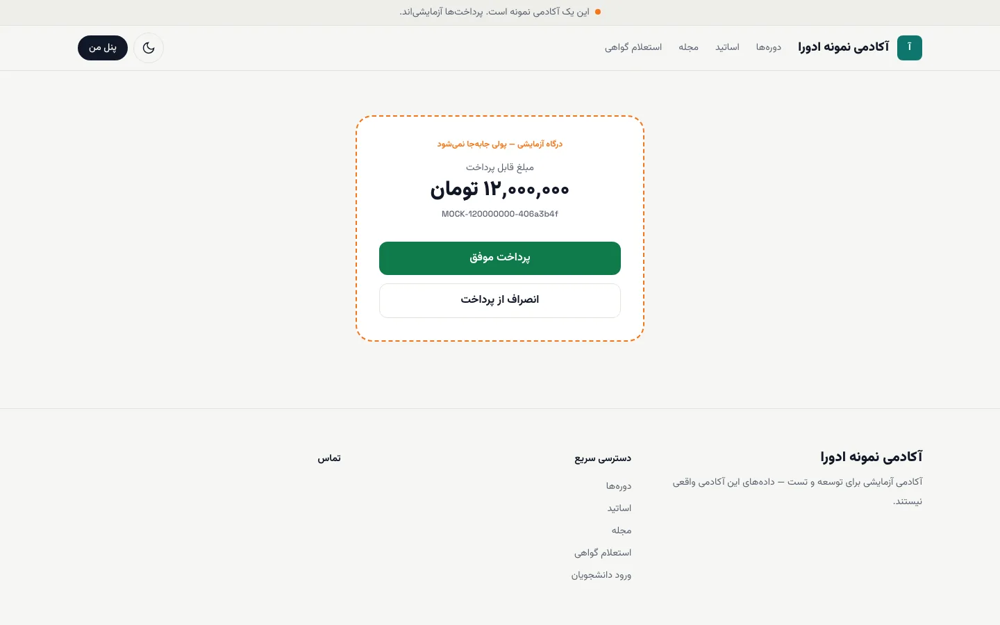<br><sub>Checkout (mock gateway)</sub></td>
    <td>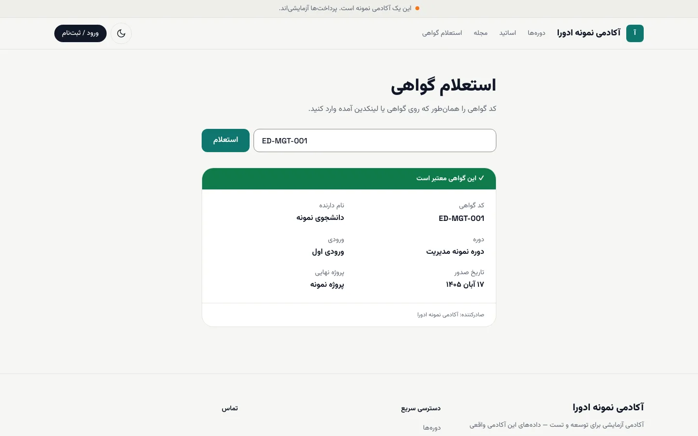<br><sub>Certificate verification</sub></td>
  </tr>
</table>

**Student panel**

<table>
  <tr>
    <td width="50%">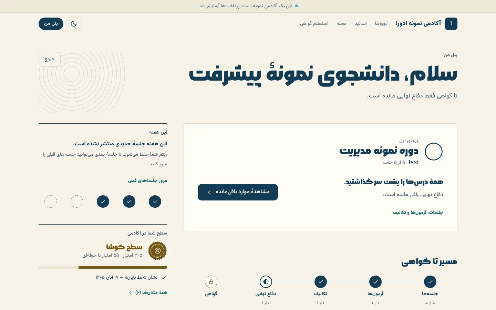<br><sub>Dashboard and path to the certificate</sub></td>
    <td width="50%">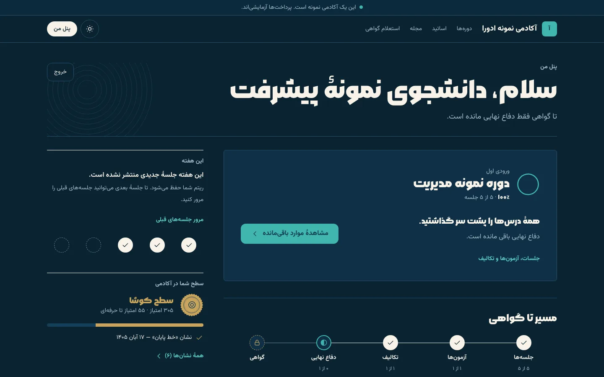<br><sub>Dashboard, dark</sub></td>
  </tr>
  <tr>
    <td colspan="2">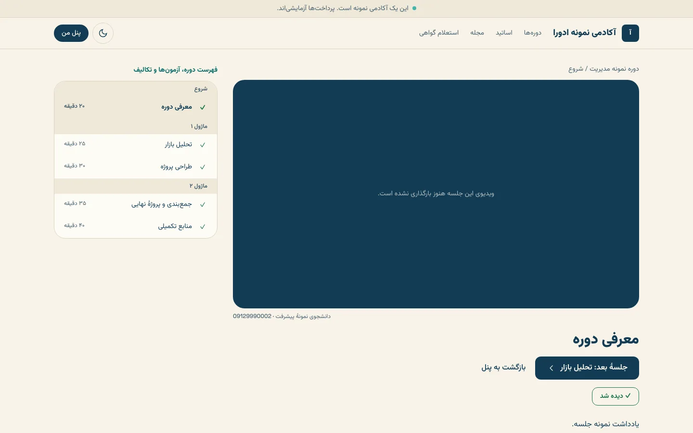<br><sub>Lesson player with outline</sub></td>
  </tr>
</table>

**Mobile (375 px)**

<table>
  <tr>
    <td width="33%">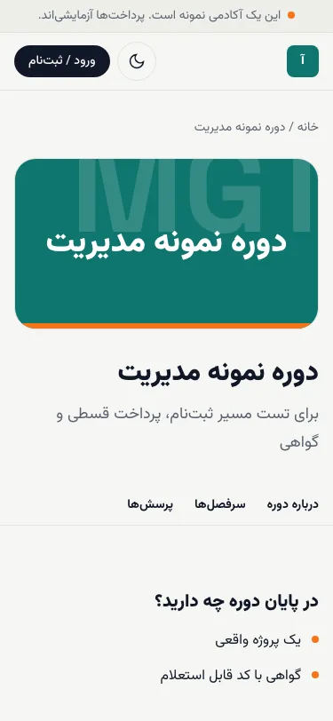<br><sub>Course</sub></td>
    <td width="33%">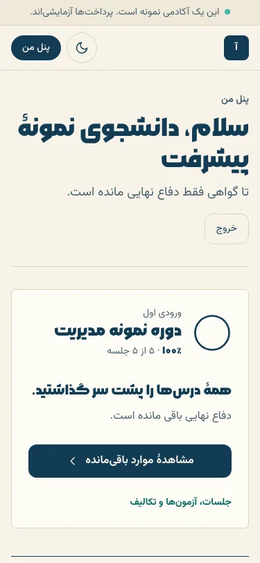<br><sub>Dashboard</sub></td>
    <td width="33%">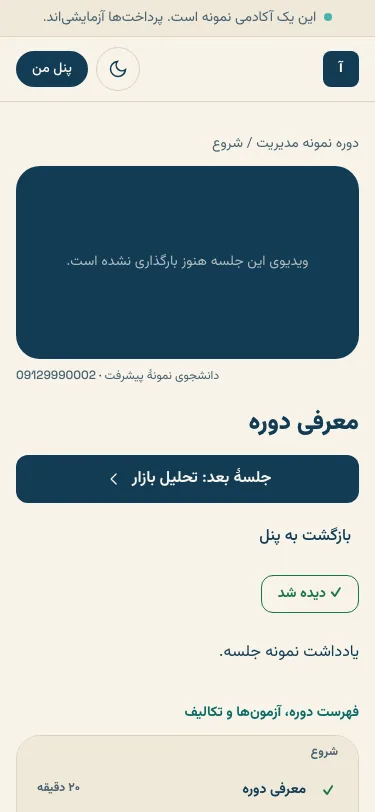<br><sub>Lesson</sub></td>
  </tr>
</table>

**Staff console, admin and sign-in**

<table>
  <tr>
    <td colspan="2">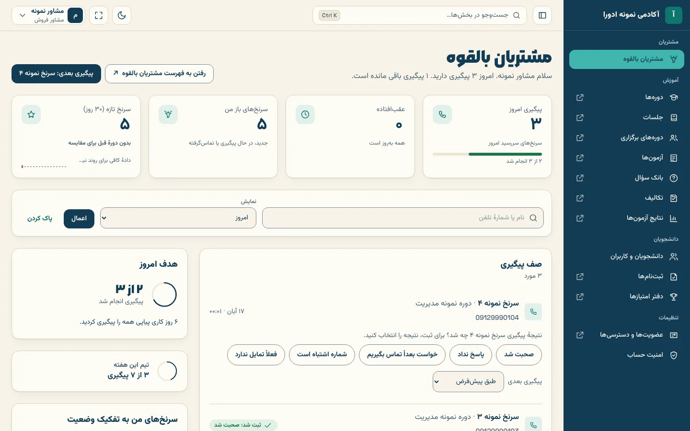<br><sub>Advisor desk in <code>/staff</code></sub></td>
  </tr>
  <tr>
    <td width="50%">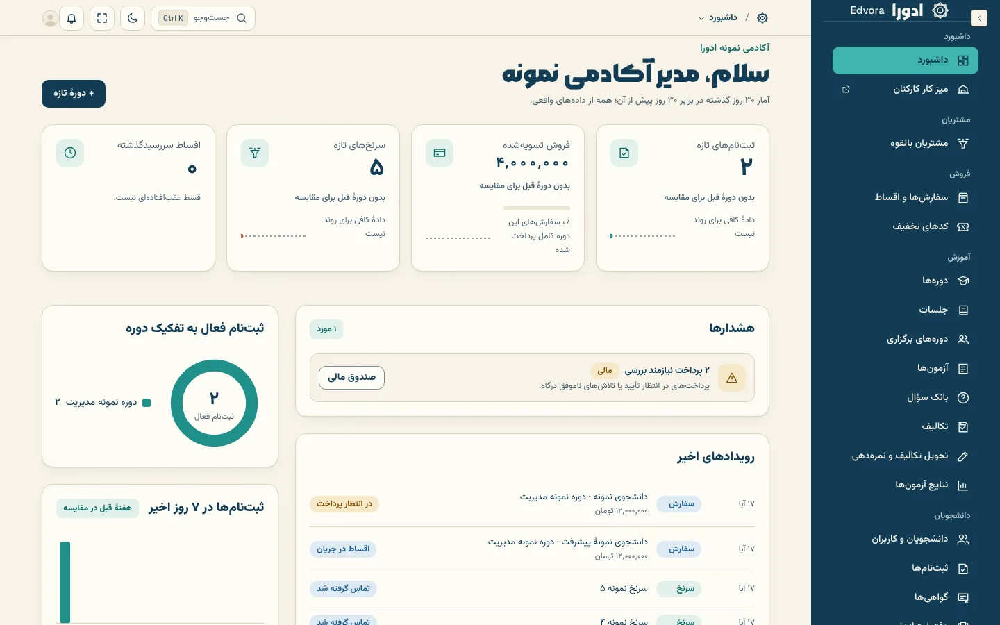<br><sub>Admin dashboard (Seal)</sub></td>
    <td width="50%">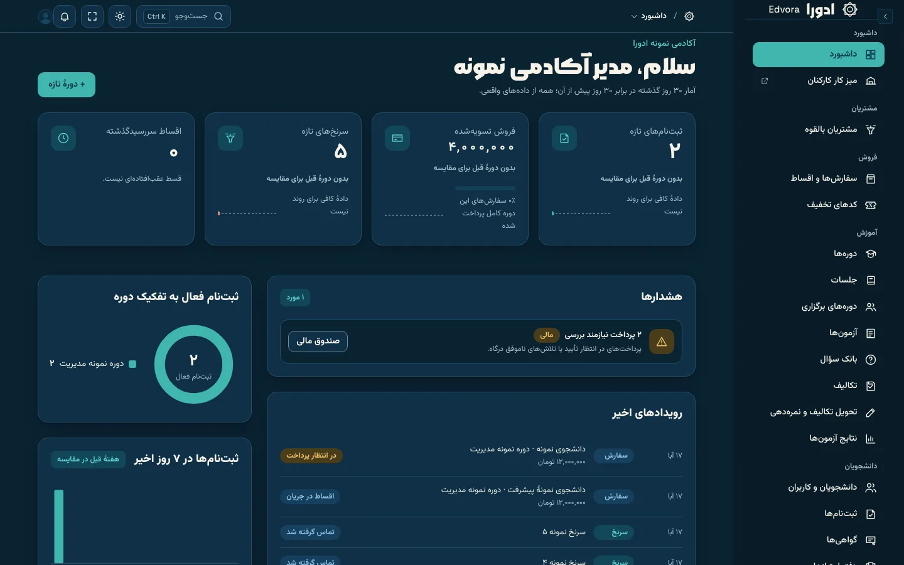<br><sub>Admin, dark</sub></td>
  </tr>
  <tr>
    <td width="50%">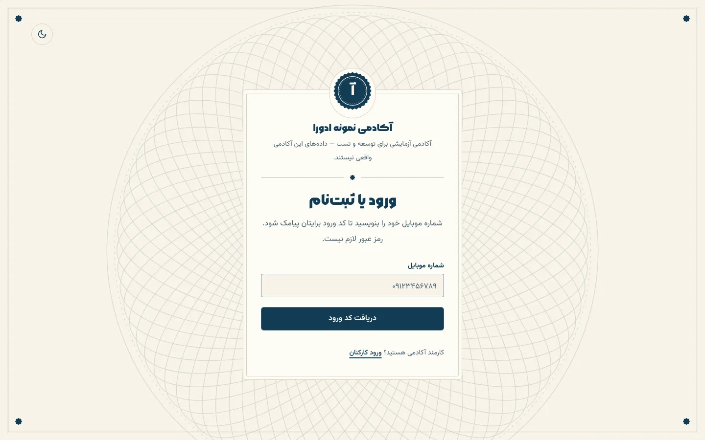<br><sub>Student login (phone + SMS code)</sub></td>
    <td width="50%">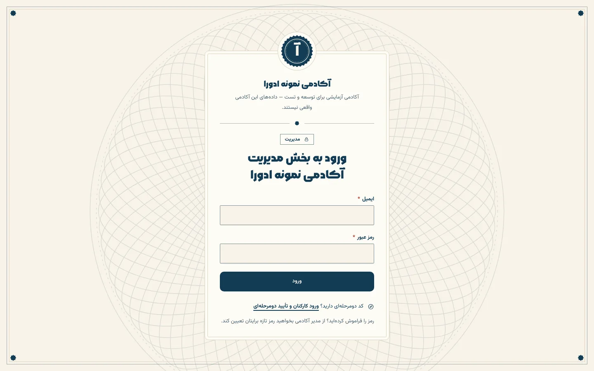<br><sub>Admin login</sub></td>
  </tr>
</table>

## Tech stack

| Layer | Choice |
| --- | --- |
| App | Next.js 16 (App Router, server components, server actions) |
| CMS and admin | Payload CMS 3 with the multi-tenant plugin |
| Database | PostgreSQL 16 |
| Language | TypeScript, strict |
| Styling | Tailwind CSS 4, design tokens in `packages/ui` (Seal design system) |
| Monorepo | pnpm 10 + Turborepo |
| Tests | Vitest (packages), Playwright (end-to-end, accessibility with axe) |
| Fonts | Vazirmatn and Morabba, self-hosted |

## Quick start

You need **Node 24.22+** (`nvm use`), **pnpm 10** and **Docker**.

```bash
pnpm install
cp apps/web/.env.example apps/web/.env   # set PAYLOAD_SECRET, SESSION_SECRET, SEED_ADMIN_EMAIL, SEED_ADMIN_PASSWORD
pnpm db:up && pnpm seed && pnpm dev
```

`pnpm db:up` starts Postgres (port 5442), Redis, Mailpit and an S3-compatible store (SeaweedFS). `pnpm seed` creates the `iba` and `demo` tenants.
Generate secrets with `openssl rand -hex 32`.

The tenant comes from the host name:

| Open | Tenant |
| --- | --- |
| http://localhost:3000 | `iba` (the default tenant) |
| http://demo.localhost:3000 | `demo` (test data) |

| Where | Path | How to get in |
| --- | --- | --- |
| Student login | `/login` | Any `09…` number. With `SMS_PROVIDER=mock` the code appears on screen and in the server log |
| Student panel | `/dashboard`, `/learn/<course>` | After logging in |
| Staff console | `/staff/login` → `/staff` | A staff account; 2FA is optional per person |
| Admin | `/admin` | `SEED_ADMIN_EMAIL` / `SEED_ADMIN_PASSWORD` |
| Mock gateway | `/pay/mock` | Used automatically with `PAYMENT_PROVIDER=mock` |
| Certificate check | `/verify` | Public. Demo code: `ED-MGT-001` |

In the demo academy, the course has a four-instalment plan and the coupon `TEST20`.

<details>
<summary><b>Environment variables</b></summary>

All config comes from env vars. See [`apps/web/.env.example`](apps/web/.env.example).

| Variable | Purpose | Default |
| --- | --- | --- |
| `DATABASE_URL` | Postgres connection | local Docker |
| `PAYLOAD_SECRET`, `SESSION_SECRET` | Signing secrets | **must set** |
| `NEXT_PUBLIC_SITE_URL` | Public base URL | `http://localhost:3000` |
| `DEFAULT_TENANT_SLUG` | Tenant when the host matches none | `iba` |
| `PAYMENT_PROVIDER` · `ZARINPAL_*` | `mock` or `zarinpal` | `mock` |
| `SMS_PROVIDER` · `KAVENEGAR_*` | `mock` or `kavenegar` | `mock` |
| `STAFF_2FA_REQUIRED` | Force 2FA for every staff member | `false` |
| `PRIVATE_UPLOADS_DIR` | Assignment files, never public ([ADR 009](docs/adr/009-private-uploads.md)) | `private-uploads/submission-files` |
| `SEED_ADMIN_EMAIL`, `SEED_ADMIN_PASSWORD` | First super admin | **must set** |

</details>

<details>
<summary><b>Checks</b></summary>

```bash
pnpm typecheck && pnpm test && pnpm build
```

End-to-end tests run with Playwright against both tenants and the mock providers. They need a seeded database and
start `next dev` themselves:

```bash
pnpm db:up && pnpm seed
pnpm e2e                    # E2E_PORT=3100 pnpm e2e if :3000 is busy
```

</details>

## Project structure

```
edvora/
├─ apps/web/                  Next.js 16 + Payload 3: public site, student panel, /staff, /admin
│  └─ src/
│     ├─ app/(frontend)/      Server components; actions.ts = Zod-validated server actions
│     ├─ app/(payload)/       Payload admin and its Seal theme
│     ├─ collections/         Data model (tenant-owned collections are registered with the multi-tenant plugin)
│     ├─ access/              Roles and permission checks, default deny
│     └─ seed/                iba + demo seed
├─ packages/core/             Business rules + Vitest: money, instalments, quizzes, drip, access, TOTP, Jalali dates
├─ packages/integrations/     Outside services: interface + real adapter + mock (payment, sms, live-class, storage, wordpress)
├─ packages/ui/               Design tokens and shared components (Seal), Tailwind 4
├─ e2e/                       Playwright specs
├─ infra/docker/              Local stack
└─ docs/                      ADRs, guides, runbooks, design, product, research
```

Four ideas shape the code:

1. **One request, one tenant.** The tenant comes from the host. Every public query filters by `tenant` explicitly.
   ([ADR 004](docs/adr/004-multi-tenancy.md), [005](docs/adr/005-tenant-resolution-and-redirects.md))
2. **Two layers of admin.** `/admin` is for setup and content; `/staff` desks are for daily work by role.
   ([ADR 006](docs/adr/006-two-layer-admin.md))
3. **Permissions live in the database.** Roles are per academy, built from a permission catalog in code. Memberships
   carry scope and expiry, and staff changes are audit-logged.
4. **Every outside service has an adapter and a mock.** Providers can be swapped without touching business code.
   ([ADR 003](docs/adr/003-adapters-and-mocks.md))

## Docs

| Where | What |
| --- | --- |
| [`AGENTS.md`](AGENTS.md) | House rules for anyone (human or AI) changing the code. Read this first |
| [`docs/adr/`](docs/adr/) | Architecture decisions (stack, hosting, multi-tenancy, 2FA, rich text, live classes, …) |
| [`docs/guide/`](docs/guide/README.md) | Persian user guides for academy admins, staff, instructors and students |
| [`docs/runbooks/`](docs/runbooks/) | Deploying to Railway, BigBlueButton, object storage |
| [`docs/design/system.md`](docs/design/system.md) | The Seal design system: tokens, components, dark mode |
| [`docs/product/`](docs/product/) · [`docs/ux/`](docs/ux/) · [`docs/specs/`](docs/specs/) | Stories, flows, technical specs |
| [`docs/agents/`](docs/agents/) | The AI agent team: board, roster, handoffs |

A demo runs on Railway at [web-production-39ee1.up.railway.app](https://web-production-39ee1.up.railway.app)
(`demo` tenant, mock providers, no real students). Production for Iranian academies is planned on an Iranian host
([ADR 002](docs/adr/002-hosting-in-iran.md)).

## Contributing

- **Branches:** `feature/<module>-<short-name>` → `develop` (staging) → `main` (production).
- **Pull requests** go into `develop`. CI runs typecheck, unit tests, build and the Playwright suite.
  When every check is green, the auto-merge workflow merges the PR into `develop`. Add the `hold` label, or open the
  PR as a draft, to keep it open. Releases from `develop` into `main` are merged by hand.
- **Commits** follow [Conventional Commits](https://www.conventionalcommits.org/): `feat:`, `fix:`, `docs:`, `chore:`.
- **Before you push:** `pnpm typecheck && pnpm test && pnpm build`.
- **Rules that matter most** (full list in [`AGENTS.md`](AGENTS.md)): ask "would a second academy want this?"; money
  in integer rials; dates stored in UTC and shown in Jalali; Tailwind tokens and logical RTL utilities; no external
  runtime dependencies; no invented facts in copy or seed data.

<div align="center"><sub>Built by <b>AshaVid</b></sub></div>
