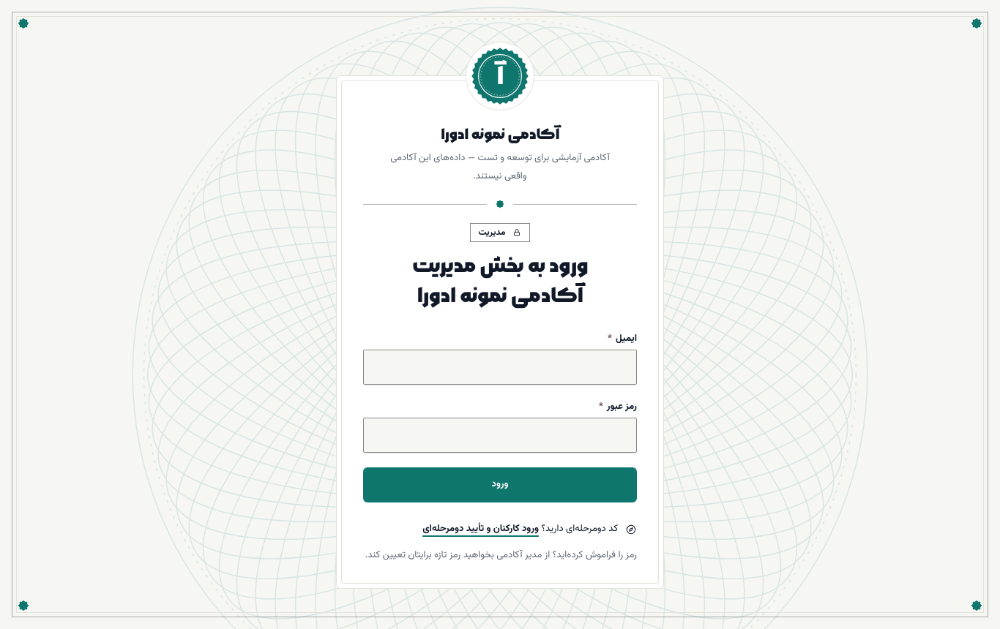
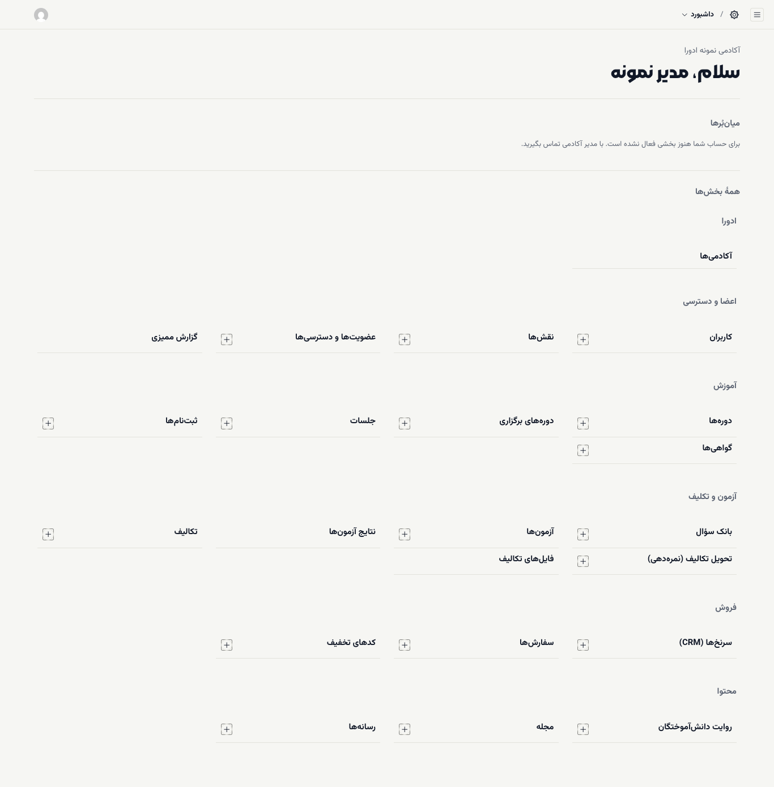

# شروع کار در بخش مدیریت

بخش مدیریت (`/admin`) جایی است که آکادمی را راه می‌اندازید: تنظیمات و ظاهر سایت، دوره‌ها و جلسه‌ها، قیمت‌ها، کارکنان و دسترسی‌ها، گواهی‌ها. این صفحه ورود و چیدمان بخش مدیریت را توضیح می‌دهد.

**پیش از شروع:** تیم ادورا برای شما حساب مدیر آکادمی ساخته و ایمیل و رمز اولیه را داده است. نشانی ورود: `/admin` روی دامنهٔ آکادمی.

## ورود

۱. به `/admin` بروید.

۲. **ایمیل** و **رمز عبور** را بنویسید و **ورود** را بزنید.

اگر تأیید دومرحله‌ای را برای حسابتان روشن کرده‌اید، از پیوند **ورود کارکنان و تأیید دومرحله‌ای** زیر همین فرم وارد شوید. ([تأیید دومرحله‌ای](../staff/02-two-factor.md))

## چیدمان صفحه

پس از ورود، صفحهٔ **داشبورد** باز می‌شود: نام آکادمی، خوشامد و زیر **همهٔ بخش‌ها** فهرست همهٔ بخش‌ها در شش گروه. کنار بخش‌هایی که می‌توانید در آن‌ها مورد تازه بسازید، دکمهٔ **+** هست.

| گروه | بخش‌ها | برای چه |
| --- | --- | --- |
| **ادورا** | **آکادمی‌ها** | تنظیمات، برند و محتوای صفحهٔ اصلی آکادمی |
| **اعضا و دسترسی** | **کاربران**، **نقش‌ها**، **عضویت‌ها و دسترسی‌ها**، **گزارش ممیزی** | کارکنان، دسترسی‌ها و تاریخچهٔ تغییرات |
| **آموزش** | **دوره‌ها**، **دوره‌های برگزاری**، **جلسات**، **ثبت‌نام‌ها**، **گواهی‌ها** | محتوای آموزشی و ثبت‌نام‌ها |
| **آزمون و تکلیف** | **بانک سؤال**، **آزمون‌ها**، **نتایج آزمون‌ها**، **تکالیف**، **تحویل تکالیف (نمره‌دهی)**، **فایل‌های تکالیف** | سنجش دانشجو |
| **فروش** | **سرنخ‌ها (CRM)**، **سفارش‌ها**، **کدهای تخفیف** | فروش و پیگیری متقاضیان |
| **محتوا** | **روایت دانش‌آموختگان**، **مجله**، **رسانه‌ها** | محتوای سایت و فایل‌ها |

منوی کناری (دکمهٔ ☰ بالای صفحه) همین بخش‌ها را دارد.

## چند نکته که از روز اول به کارتان می‌آید

- **برچسب‌های انگلیسی:** بعضی فیلدها هنوز برچسب انگلیسی دارند؛ مثل **Price** (قیمت) یا **Status** (وضعیت). معادل همهٔ آن‌ها در [واژه‌نامه](../glossary.md) آمده است.
- **مبلغ‌ها به ریال:** در بخش مدیریت مبلغ‌ها را به **ریال** وارد می‌کنید، اما سایت آن‌ها را به **تومان** نشان می‌دهد. ([قیمت و تخفیف](05-cohorts-pricing-coupons.md))
- **تاریخ‌ها:** در فهرست‌های بخش مدیریت، تاریخ‌ها فعلاً میلادی نمایش داده می‌شوند. سایت و پنل دانشجو تاریخ شمسی نشان می‌دهند.
- **ذخیره:** هیچ تغییری تا زدن **ذخیره** (بالای فرم) ثبت نمی‌شود. پس از ذخیره پیامی مثل «دوره با موفقیت ایجاد شد.» می‌بینید.
- **میان‌بُرها:** بخش **میان‌بُرها** بالای داشبورد ممکن است برای حساب مدیر آکادمی خالی باشد و بنویسد «برای حساب شما هنوز بخشی فعال نشده است». این پیام دسترسی شما را کم نمی‌کند؛ از فهرست **همهٔ بخش‌ها** استفاده کنید.

## فهرست کارهای ساعت اول

۱. [تنظیمات و برند آکادمی](02-academy-settings.md) را کامل کنید.

۲. [کارکنان را اضافه کنید و نقش بدهید](03-people-and-roles.md)؛ به‌ویژه مشاوران فروش.

۳. [اولین دوره و جلسه‌هایش را بسازید](04-courses-and-lessons.md).

۴. [ورودی، قیمت و کد تخفیف را تعیین کنید](05-cohorts-pricing-coupons.md).

۵. [سرنخ‌های تازه را به مشاوران بسپارید](06-sales-orders-leads.md).

> **اگر … چه کنم؟**
> - **پیام ایمیل یا رمز اشتباه** آمد: ایمیل را با حروف کوچک و بدون فاصله بنویسید. اگر رمز را فراموش کرده‌اید، از تیم ادورا یا مدیر دیگر آکادمی بخواهید رمز تازه برایتان تعیین کند.
> - **پیام «این حساب به دلیل تلاش‌های ناموفق متعدد برای ورود، قفل شده است.»** آمد: [رفع اشکال: حساب قفل شده](../troubleshooting.md#locked-account)
> - بخشی را باز کردید و فهرستش خالی است: یا هنوز موردی ساخته نشده، یا نقش شما به آن بخش دسترسی ندارد.
