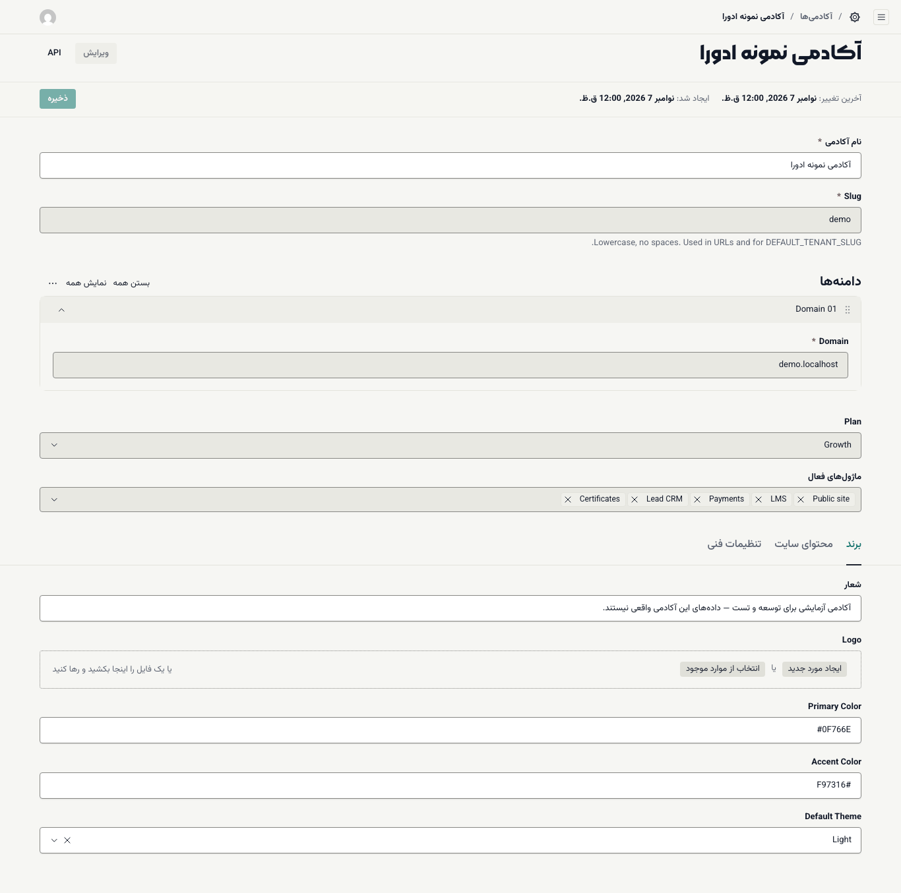
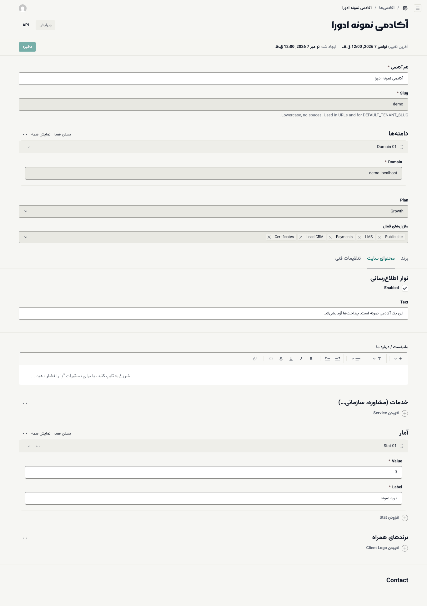
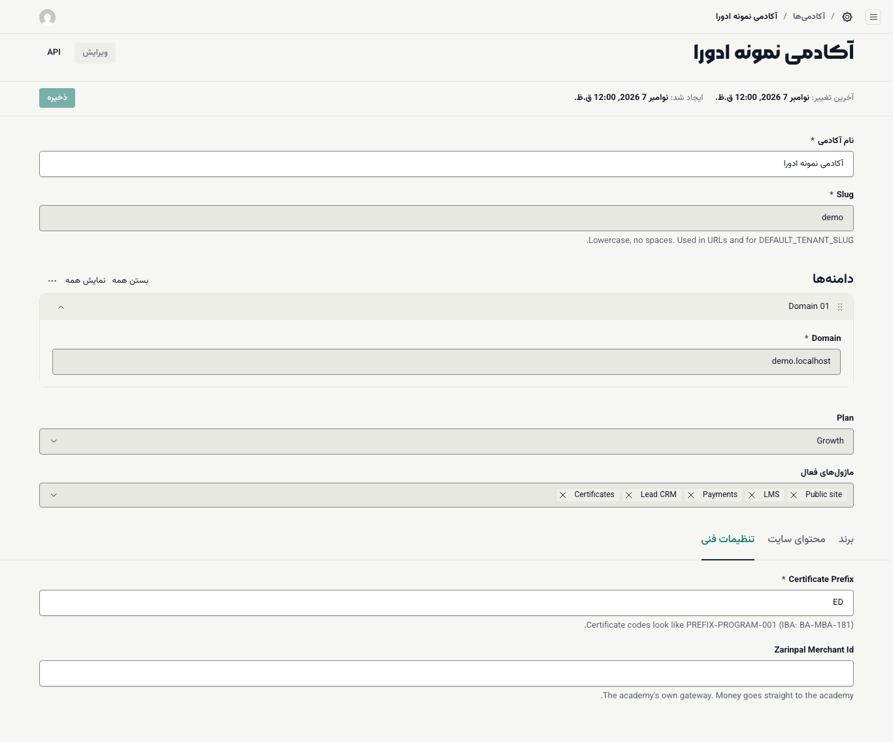

# تنظیمات و برند آکادمی

نام، شعار، رنگ‌ها، لوگو و محتوای صفحهٔ اصلی سایت آکادمی از یک جا تنظیم می‌شود: **ادورا ← آکادمی‌ها**.

**پیش از شروع:** نقش **مدیر آکادمی** داشته باشید. فایل لوگو را آماده کنید.

## بازکردن تنظیمات

۱. در داشبورد، **آکادمی‌ها** را باز کنید.

۲. روی نام آکادمی خود بزنید.

بالای فرم این فیلدها را می‌بینید. بیشتر آن‌ها را تیم ادورا هنگام راه‌اندازی پر کرده است:

- **نام آکادمی:** نامی که بالای سایت و در صفحه‌های ورود می‌آید.
- **Slug** (شناسهٔ لاتین آکادمی) و **دامنه‌ها** (**Domain**): نشانی‌هایی که سایت آکادمی روی آن‌ها باز می‌شود. دامنه‌ها را فقط تیم ادورا می‌تواند تغییر دهد.
- **Plan** (طرح اشتراک) و **ماژول‌های فعال:** کدام بخش‌های ادورا برای آکادمی روشن است؛ مثلاً **LMS** (آموزش)، **Payments** (پرداخت)، **Lead CRM** (سرنخ‌ها) و **Certificates** (گواهی). این دو را هم فقط تیم ادورا تغییر می‌دهد؛ مثلاً برای روشن‌کردن **Live classes** ([کلاس آنلاین زنده](../instructor/04-live-classes.md)) با تیم ادورا هماهنگ کنید.

زیر این فیلدها سه زبانه هست: **برند**، **محتوای سایت** و **تنظیمات فنی**.

## زبانهٔ برند

۱. زبانهٔ **برند** را باز کنید.

۲. **شعار** را بنویسید. شعار زیر نام آکادمی در صفحه‌های ورود و پایین سایت می‌آید.

۳. لوگو را در **Logo** بارگذاری کنید: فایل را روی کادر بکشید یا **ایجاد مورد جدید** را بزنید. **متن جایگزین** (توضیح کوتاه تصویر) را هم بنویسید؛ پر کردنش الزامی است.

۴. در **Primary Color** (رنگ اصلی) و **Accent Color** (رنگ تأکید) کد رنگ را بنویسید.

۵. در **Default Theme** حالت پیش‌فرض سایت را انتخاب کنید: **Light** (روشن) یا **Dark** (تیره). بازدیدکننده می‌تواند با دکمهٔ ماه بالای سایت آن را عوض کند.

۶. **ذخیره** را بزنید.

## زبانهٔ محتوای سایت

این زبانه محتوای صفحهٔ اصلی را تعیین می‌کند:

- **نوار اطلاع‌رسانی:** نواری باریک بالای همهٔ صفحه‌ها. **Enabled** را تیک بزنید و متن را در **Text** بنویسید.
- **مانیفست / درباره ما:** متن معرفی آکادمی، با [ویرایشگر متن](08-tools-editor-and-audit.md).
- **خدمات (مشاوره، سازمانی…):** هر خدمت یک عنوان و یک متن کوتاه دارد. با **افزودن Service** خدمت تازه اضافه کنید.
- **آمار:** عددهای کلیدی آکادمی؛ هر مورد یک **Value** (مقدار) و یک **Label** (عنوان).
- **برندهای همراه:** نام و لوگوی سازمان‌هایی که با آکادمی کار کرده‌اند.
- **Contact:** تلفن و ایمیل تماس.

> **هشدار:** فقط آمار و نام‌هایی را بنویسید که مستند هستند. هر عددی که اینجا بنویسید عیناً در صفحهٔ اصلی سایت نمایش داده می‌شود.

## زبانهٔ تنظیمات فنی

- **Certificate Prefix:** پیشوند کد گواهی‌ها. کدها به شکل `PREFIX-PROGRAM-001` ساخته می‌شوند. پس از صدور اولین گواهی این پیشوند را تغییر ندهید تا کدها یکدست بمانند.
- **Zarinpal Merchant Id:** شناسهٔ پذیرندهٔ درگاه زرین‌پال آکادمی. پول ثبت‌نام‌ها مستقیم به حساب آکادمی واریز می‌شود. این مقدار را از پنل زرین‌پال خود بگیرید.

پس از هر تغییر **ذخیره** را بزنید و صفحهٔ اصلی سایت را در یک زبانهٔ دیگر مرورگر باز کنید تا نتیجه را ببینید.

> **اگر … چه کنم؟**
> - تغییرات در سایت دیده نمی‌شود: مطمئن شوید **ذخیره** را زده‌اید و صفحهٔ سایت را دوباره بارگذاری کنید.
> - کنار فیلدی علامت * قرمز و پیام خطا آمد: آن فیلد الزامی است یا مقدارش درست نیست. پرش کنید و دوباره ذخیره کنید.
> - **آکادمی‌ها** را نمی‌بینید یا نمی‌توانید ذخیره کنید: نقش شما دسترسی ویرایش تنظیمات (`settings.edit`) ندارد. از تیم ادورا بخواهید نقشتان را بررسی کند.
