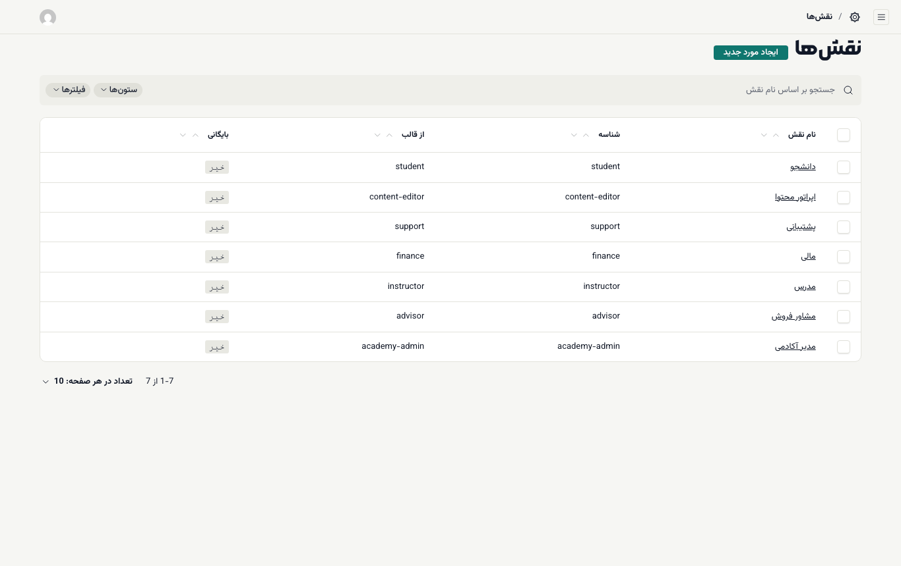
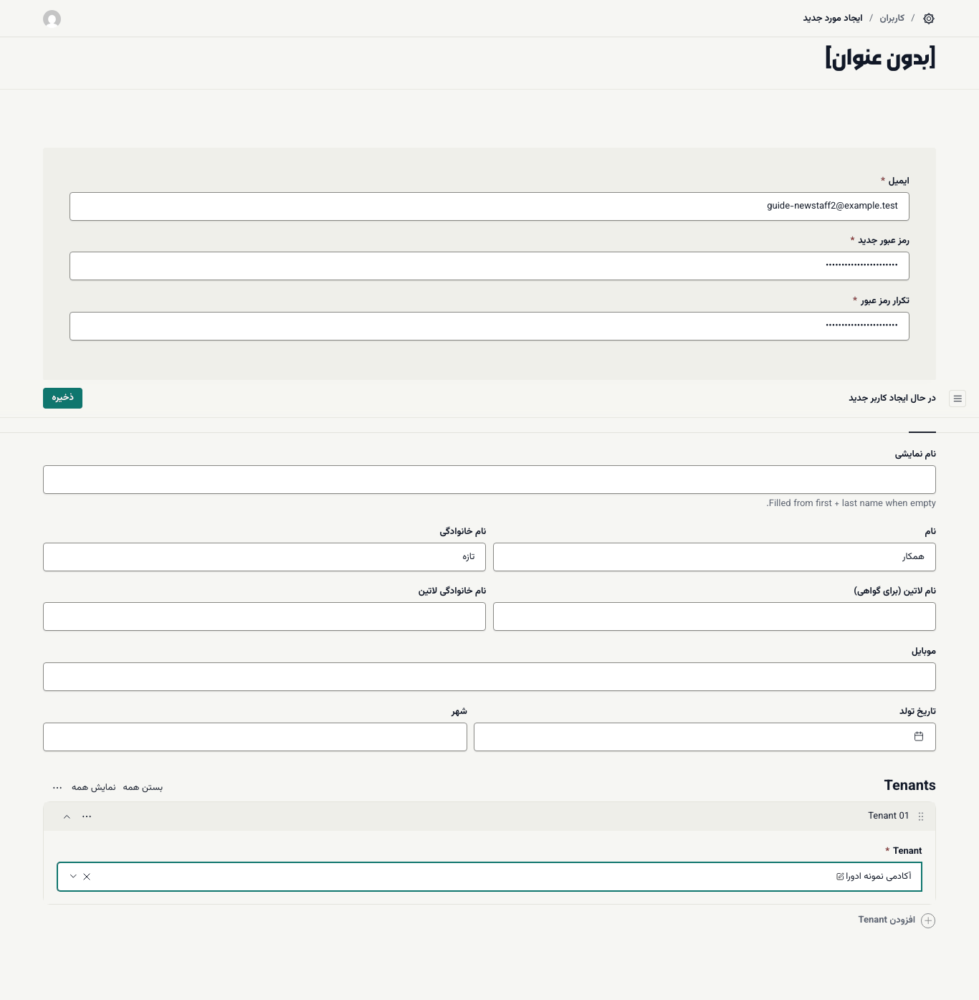
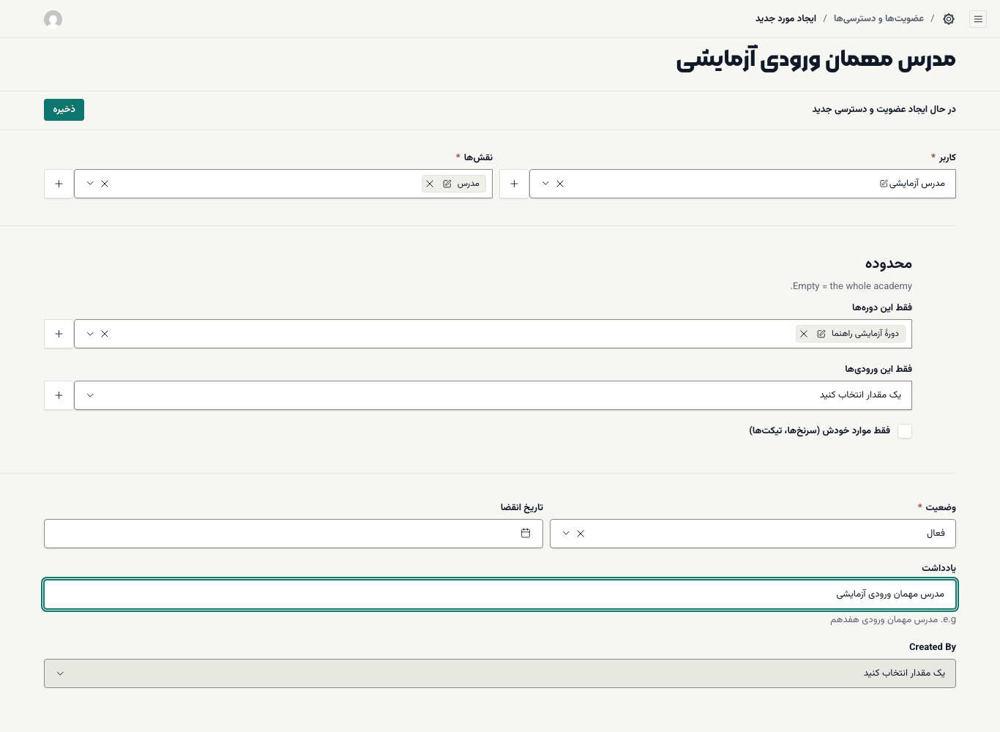
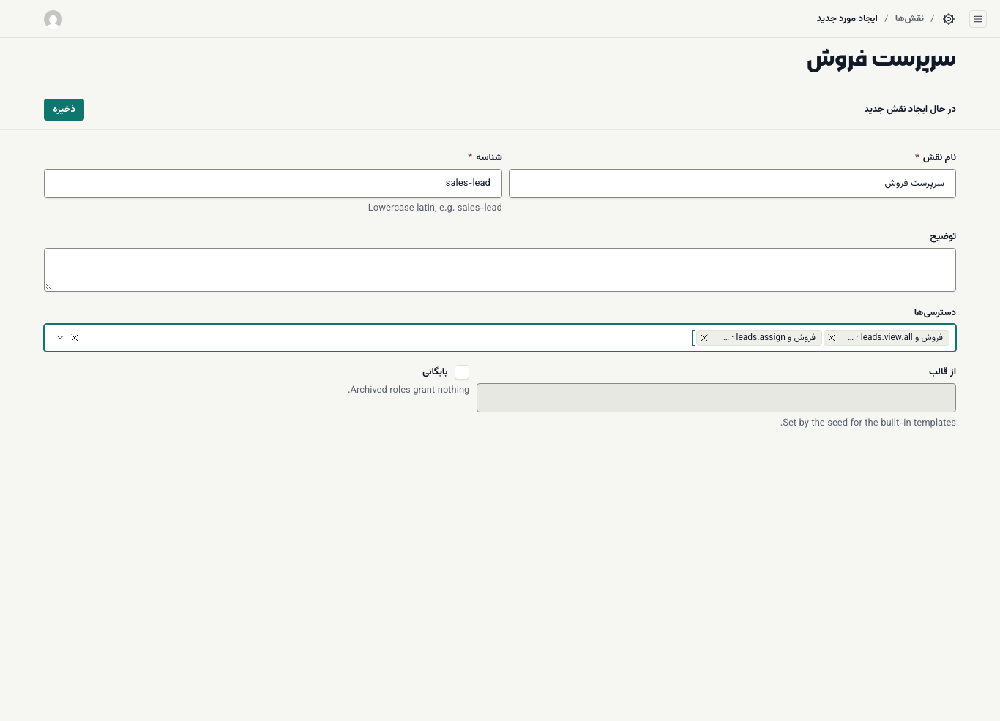
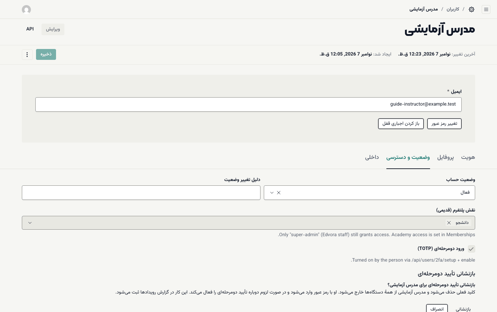

# کارکنان، نقش‌ها و دسترسی‌ها

در ادورا دسترسی هر کارمند از سه چیز ساخته می‌شود:

- **کاربر:** حساب شخص (ایمیل، رمز، نام).
- **نقش:** مجموعه‌ای از دسترسی‌ها؛ مثلاً «مشاور فروش».
- **عضویت و دسترسی:** پیوند یک کاربر با یک یا چند نقش در آکادمی شما، همراه با محدوده و تاریخ انقضا.

کاربری که عضویت ندارد، حتی با ایمیل و رمز درست، فقط پیام «این بخش مخصوص کارکنان آکادمی است» را می‌بیند. دانشجوها عضویت نمی‌خواهند؛ خودشان با موبایل ثبت‌نام می‌کنند.

**پیش از شروع:** نقش **مدیر آکادمی** داشته باشید.

## نقش‌های آماده

در **اعضا و دسترسی ← نقش‌ها** هفت نقش آماده هست. ستون **از قالب** نشان می‌دهد نقش از قالب‌های آمادهٔ ادورا آمده است.

| نقش | شناسه | کار اصلی |
| --- | --- | --- |
| **مدیر آکادمی** | `academy-admin` | همهٔ کارهای داخل آکادمی |
| **مشاور فروش** | `advisor` | فقط سرنخ‌های خودش؛ به **سفارش‌ها** دسترسی ندارد |
| **مدرس** | `instructor` | جلسه‌ها، آزمون‌ها، تکلیف‌ها و نمره‌دهی؛ محدوده را روی عضویت تعیین کنید |
| **مالی** | `finance` | سفارش‌ها، اقساط و کدهای تخفیف |
| **پشتیبانی** | `support` | دیدن کاربران و ثبت‌نام‌ها، بدون کار مالی |
| **اپراتور محتوا** | `content-editor` | محتوای سایت و متن دوره‌ها، بدون انتشار دوره |
| **دانشجو** | `student` | بدون دسترسی به بخش مدیریت |

قالب‌ها دسترسی‌های دیگری هم دارند (مثل ثبت پرداخت دستی برای مشاور یا تأیید بازگشت وجه برای مالی) که صفحه‌هایشان با [میزهای کاری](../coming-soon.md#staff-desks) در نسخهٔ بعدی می‌آیند.

## افزودن یک کارمند

### گام ۱: ساختن کاربر

۱. **اعضا و دسترسی ← کاربران** را باز کنید و **ایجاد مورد جدید** را بزنید.

۲. **ایمیل**، **رمز عبور جدید** و **تکرار رمز عبور** را بنویسید.

۳. در زبانهٔ **هویت**، **نام** و **نام خانوادگی** را بنویسید. **نام نمایشی** اگر خالی بماند از همین دو ساخته می‌شود.

۴. پایین فرم، زیر **Tenants**، **افزودن Tenant** را بزنید و آکادمی خود را انتخاب کنید. بدون این مرحله پیام «Choose the academy for the new user» می‌آید.

۵. **ذخیره** را بزنید. پیام «کاربر با موفقیت ایجاد شد.» را می‌بینید.

### گام ۲: دادن نقش با عضویت

۱. **اعضا و دسترسی ← عضویت‌ها و دسترسی‌ها** را باز کنید و **ایجاد مورد جدید** را بزنید.

۲. در **کاربر** چند حرف از نام شخص را تایپ کنید و او را انتخاب کنید.

۳. در **نقش‌ها** یک یا چند نقش انتخاب کنید.

۴. در صورت نیاز **محدوده** را تنظیم کنید (بخش بعد).

۵. **وضعیت** را روی **فعال** بگذارید.

۶. اگر دسترسی موقت است، **تاریخ انقضا** را تعیین کنید.

۷. در **یادداشت** دلیل این دسترسی را بنویسید؛ مثلاً «مدرس مهمان ورودی هفدهم».

۸. **ذخیره** را بزنید. پیام «عضویت و دسترسی با موفقیت ایجاد شد.» می‌آید.

ایمیل و رمز را خودتان به کارمند بدهید. او از `/staff/login` وارد می‌شود. ([ورود کارکنان](../staff/01-login-and-desks.md))

## محدوده و انقضا

- **فقط این دوره‌ها** و **فقط این ورودی‌ها:** دسترسی را به دوره‌ها یا ورودی‌های مشخص محدود می‌کند. برای مدرس مهمان مناسب است. اگر خالی بماند، دسترسی شامل کل آکادمی است.
- **فقط موارد خودش (سرنخ‌ها، تیکت‌ها):** کارمند فقط سرنخ‌هایی را می‌بیند که به خودش سپرده شده است. نقش **مشاور فروش** حتی بدون این تیک فقط سرنخ‌های خودش را می‌بیند.
- **تاریخ انقضا:** پس از این تاریخ عضویت دیگر هیچ دسترسی‌ای نمی‌دهد. لازم نیست آن را دستی حذف کنید.
- **وضعیت ← معلق:** دسترسی را فوراً قطع می‌کند و عضویت برای بازگرداندن بعدی می‌ماند.

## ساختن نقش سفارشی

اگر هیچ نقش آماده‌ای مناسب نیست (مثلاً سرپرست فروشی که همهٔ سرنخ‌ها را ببیند و تقسیم کند):

۱. **نقش‌ها ← ایجاد مورد جدید** را بزنید.

۲. **نام نقش** را فارسی بنویسید؛ مثلاً «سرپرست فروش».

۳. **شناسه** را با حروف کوچک لاتین و خط تیره بنویسید؛ مثلاً `sales-lead`.

۴. در **دسترسی‌ها** موارد لازم را یکی‌یکی انتخاب کنید. هر گزینه گروه و کد دسترسی را نشان می‌دهد؛ مثلاً «فروش و CRM · leads.view.all». معنای کدهای پرکاربرد در [واژه‌نامه](../glossary.md#permission-codes) آمده است.

۵. **ذخیره** را بزنید.

برای از کار انداختن یک نقش، **بایگانی** را تیک بزنید. نقش بایگانی‌شده هیچ دسترسی‌ای نمی‌دهد.

## معلق‌کردن یا بایگانی یک کاربر

۱. کاربر را در **کاربران** باز کنید و زبانهٔ **وضعیت و دسترسی** را بزنید.

۲. **وضعیت حساب** را انتخاب کنید:
- **معلق (ورود ممنوع، داده حفظ می‌شود):** برای مرخصی یا بررسی.
- **بایگانی (خروج از مجموعه):** برای کسی که از آکادمی رفته است.

۳. در **دلیل تغییر وضعیت** علت را بنویسید و **ذخیره** را بزنید.

کاربر معلق یا بایگانی‌شده فوراً از حسابش خارج می‌شود.

## بازنشانی تأیید دومرحله‌ای

اگر کارمندی گوشی‌اش را گم کرده و نمی‌تواند کد تأیید دومرحله‌ای بدهد:

۱. کاربر را باز کنید و زبانهٔ **وضعیت و دسترسی** را بزنید.

۲. دکمهٔ **بازنشانی تأیید دومرحله‌ای** را بزنید. این دکمه فقط وقتی دیده می‌شود که تأیید دومرحله‌ای آن کاربر روشن باشد.

۳. در پنجرهٔ تأیید، نام کاربر را بررسی کنید و **بازنشانی** را بزنید.

۴. پیام «تأیید دومرحله‌ای … بازنشانی شد.» می‌آید. کارمند حالا فقط با رمز وارد می‌شود و باید دوباره تأیید دومرحله‌ای را روشن کند.

> **هشدار:** پیش از بازنشانی، با تماس تلفنی یا حضوری مطمئن شوید درخواست واقعاً از خود کارمند است. این کار در [گزارش ممیزی](08-tools-editor-and-audit.md#audit-log) ثبت می‌شود.

> **اگر … چه کنم؟**
> - کارمند وارد می‌شود ولی پیام «این بخش مخصوص کارکنان آکادمی است» را می‌بیند: برایش عضویت فعال نساخته‌اید، یا عضویتش معلق یا منقضی شده است.
> - کارمند پیام «به این بخش دسترسی ندارید» را می‌بیند: نقشش آن دسترسی را ندارد. کد دسترسی لازم زیر همان پیام نوشته شده است.
> - در **کاربر** نام شخص پیدا نمی‌شود: چند حرف از نامش را تایپ کنید؛ فهرست فقط ده نفر اول را نشان می‌دهد.
> - حساب کارمندی قفل شده: [رفع اشکال: حساب قفل شده](../troubleshooting.md#locked-account)
