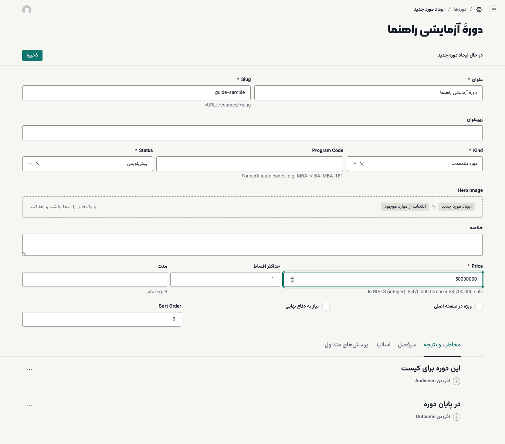
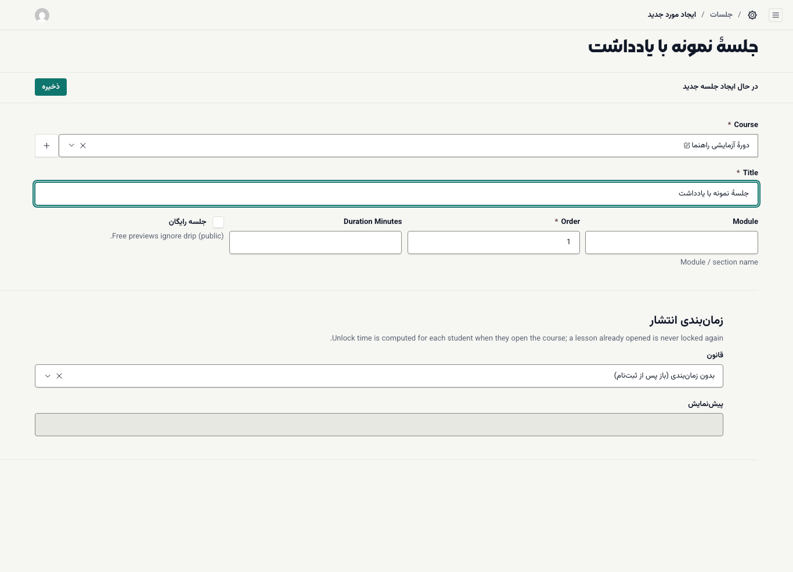
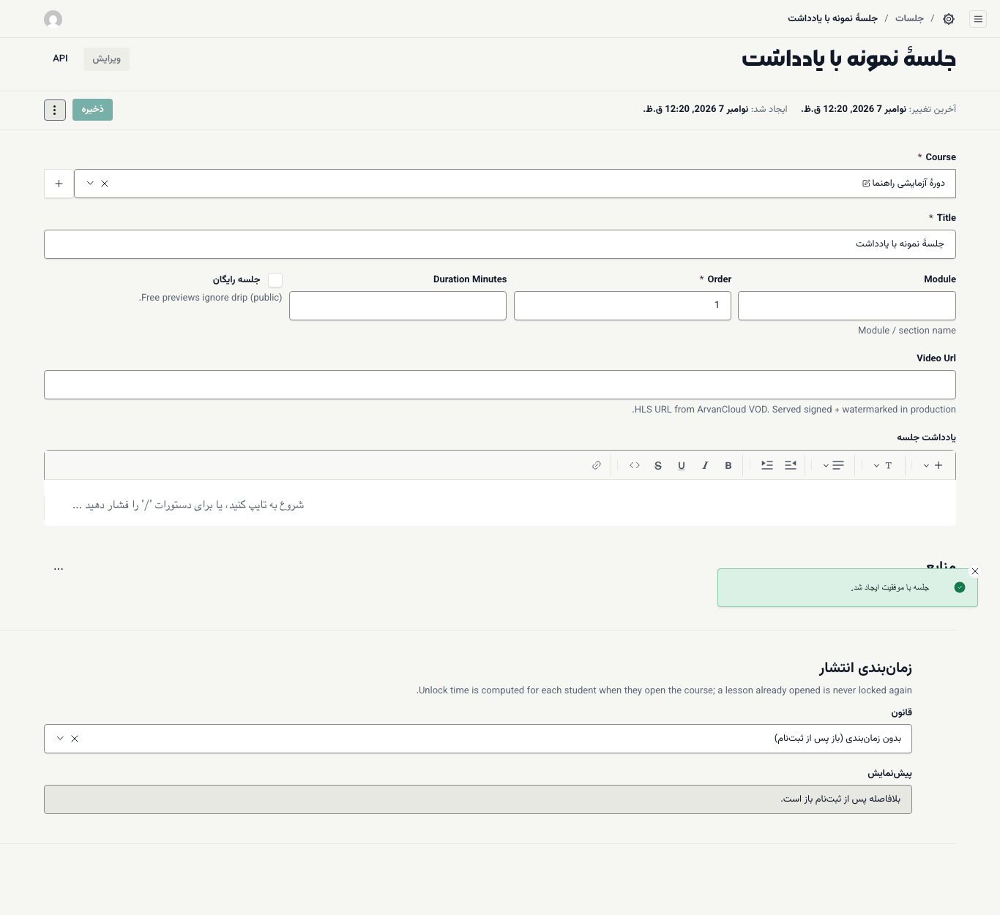
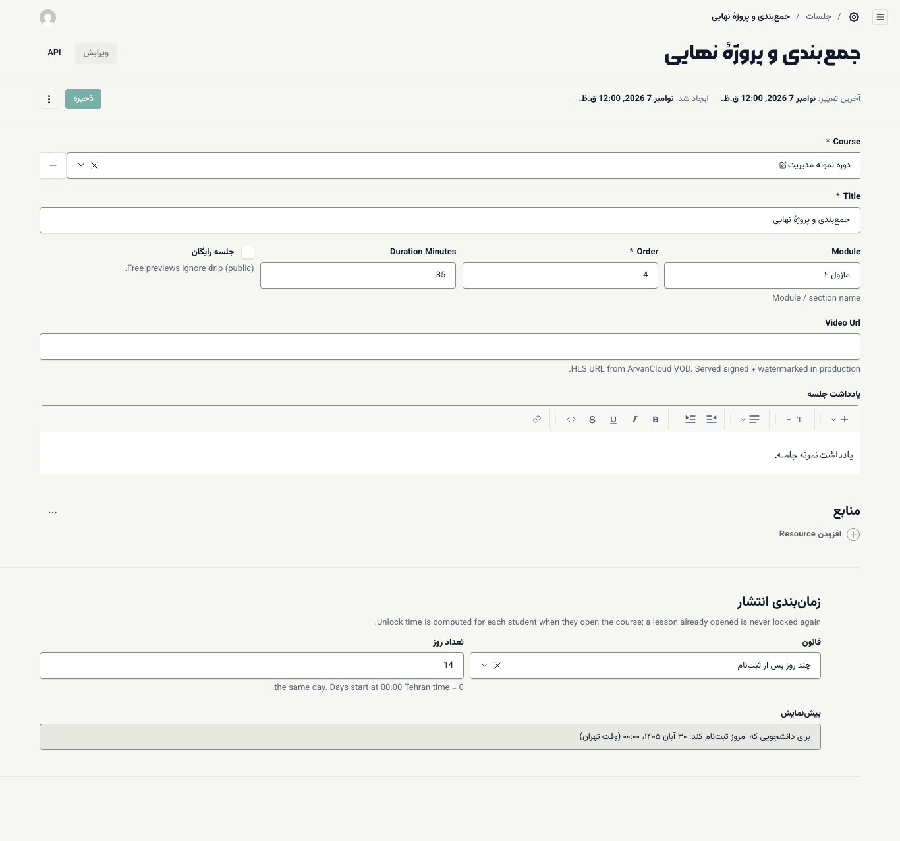

# ساختن دوره و جلسه‌ها

دوره صفحهٔ معرفی و فروش است؛ جلسه‌ها محتوای آموزشی آن‌اند. ترتیب کار: اول دوره، بعد جلسه‌ها، بعد [ورودی و قیمت](05-cohorts-pricing-coupons.md).

**پیش از شروع:** عنوان، توضیح کوتاه، قیمت (به ریال) و فهرست جلسه‌ها را آماده کنید. نشانی ویدیوها از سرویس ویدیوی آکادمی لازم است.

## ساختن دوره

۱. **آموزش ← دوره‌ها** را باز کنید و **ایجاد مورد جدید** را بزنید.

۲. **عنوان** را بنویسید.

۳. **Slug** را بنویسید: بخش لاتین نشانی صفحهٔ دوره، با حروف کوچک و خط تیره؛ مثلاً `brand-strategy` که صفحه‌اش `/courses/brand-strategy` می‌شود.

۴. **زیرعنوان** و **خلاصه** را بنویسید. خلاصه در نتایج جست‌وجو هم دیده می‌شود.

۵. **Kind** (نوع دوره) را انتخاب کنید: **دوره بلندمدت**، **دوره کوتاه / کارگاه**، **دوره ویدیویی** یا **بسته**.

۶. **Program Code** را بنویسید؛ کد کوتاه لاتین دوره که در کد گواهی می‌آید (مثلاً `MBA`).

۷. **Price** را **به ریال** بنویسید. ([ریال و تومان](05-cohorts-pricing-coupons.md#rial-prices))

۸. **حداکثر اقساط** را تعیین کنید (۱ یعنی فقط پرداخت یکجا؛ حداکثر ۱۲).

۹. **مدت** را به زبان ساده بنویسید؛ مثلاً «۴ ماه».

۱۰. **Status** را فعلاً **پیش‌نویس** بگذارید و **ذخیره** را بزنید.

پایین فرم چهار زبانه هست که صفحهٔ دوره را کامل می‌کند:

- **مخاطب و نتیجه:** «این دوره برای کیست» و «در پایان دوره».
- **سرفصل:** فهرست سرفصل‌ها با توضیح و ساعت.
- **اساتید:** نام، سمت و عکس هر استاد.
- **پرسش‌های متداول:** سؤال و پاسخ.

گزینه‌های دیگر:

- **Hero Image:** تصویر بالای صفحهٔ دوره.
- **ویژه در صفحه اصلی:** دوره را در صفحهٔ اصلی سایت برجسته می‌کند.
- **نیاز به دفاع نهایی:** اگر تیک بخورد، دفاع نهایی شرط گواهی می‌شود. نتیجهٔ دفاع هر دانشجو را در **ثبت‌نام‌ها** با تیک **دفاع نهایی قبول** ثبت کنید.
- **Sort Order:** ترتیب نمایش دوره در فهرست؛ عدد کوچک‌تر بالاتر می‌آید.

وقتی همه چیز آماده شد، **Status** را روی **منتشر شده** بگذارید و ذخیره کنید. دورهٔ پیش‌نویس در سایت دیده نمی‌شود.

## ساختن جلسه

۱. **آموزش ← جلسات** را باز کنید و **ایجاد مورد جدید** را بزنید.

۲. در **Course** دوره را انتخاب کنید.

۳. **Title** (عنوان جلسه) را بنویسید.

۴. **Module** را بنویسید؛ نام فصل یا بخش، مثلاً «ماژول ۱». جلسه‌های هم‌فصل در صفحهٔ دانشجو زیر یک عنوان می‌آیند.

۵. **Order** (ترتیب جلسه در دوره) و **Duration Minutes** (مدت به دقیقه) را بنویسید.

۶. اگر می‌خواهید همه، حتی کسانی که ثبت‌نام نکرده‌اند، این جلسه را ببینند، **جلسه رایگان** را تیک بزنید.

۷. **ذخیره** را بزنید.

پس از اولین ذخیره، فیلدهای **Video Url**، **یادداشت جلسه** و **منابع** در فرم ظاهر می‌شوند:

۸. در **Video Url** نشانی پخش ویدیو را بگذارید.

۹. **یادداشت جلسه** را با [ویرایشگر متن](08-tools-editor-and-audit.md) بنویسید.

۱۰. فایل‌های کمکی را با **افزودن Resource** اضافه کنید.

۱۱. دوباره **ذخیره** را بزنید.

## زمان‌بندی انتشار جلسه‌ها (Drip)

در پایین فرم جلسه، **زمان‌بندی انتشار** تعیین می‌کند هر جلسه کی برای هر دانشجو باز شود. در **قانون** یکی را انتخاب کنید:

| قانون | جلسه کی باز می‌شود |
| --- | --- |
| **بدون زمان‌بندی (باز پس از ثبت‌نام)** | بلافاصله پس از ثبت‌نام |
| **تاریخ مشخص** | در **تاریخ و ساعت انتشار** که تعیین می‌کنید |
| **چند روز پس از ثبت‌نام** | **تعداد روز** پس از ثبت‌نام همان دانشجو |
| **چند روز پس از شروع ورودی** | **تعداد روز** پس از تاریخ شروع ورودی |
| **پس از تکمیل جلسهٔ قبل** | وقتی دانشجو جلسهٔ قبلی را «دیده شد» زده و آزمون الزامی آن را قبول شده باشد |

- **تعداد روز** صفر یعنی همان روز. روزها از ساعت ۰۰:۰۰ به وقت تهران شروع می‌شوند.
- **پیش‌نمایش** خلاصهٔ قانون را به زبان ساده نشان می‌دهد.
- جلسه‌ای که یک بار برای دانشجو باز شده، با تغییر بعدی قانون دوباره قفل نمی‌شود.
- **جلسه رایگان** همیشه باز است و قانون زمان‌بندی را نادیده می‌گیرد.

دانشجو زیر هر جلسهٔ قفل دلیلش را می‌بیند؛ مثلاً «باز می‌شود ۳۰ آبان ۱۴۰۵». ([نمای دانشجو](../student/02-panel-and-lessons.md#locked-lessons))

> **اگر … چه کنم؟**
> - فیلد ویدیو یا یادداشت را در فرم جلسه نمی‌بینید: جلسه را یک بار ذخیره کنید.
> - دوره در سایت دیده نمی‌شود: **Status** باید **منتشر شده** باشد.
> - صفحهٔ دوره هست ولی دکمهٔ **ثبت‌نام و پرداخت** نیست و کارت ثبت‌نام «به‌زودی» نشان می‌دهد: دوره [ورودی](05-cohorts-pricing-coupons.md) با وضعیت **ثبت‌نام باز** یا **پیش‌ثبت‌نام** ندارد.
> - دانشجو می‌گوید جلسه باز نمی‌شود: قانون زمان‌بندی همان جلسه و تاریخ ثبت‌نام دانشجو را در **ثبت‌نام‌ها** بررسی کنید.
