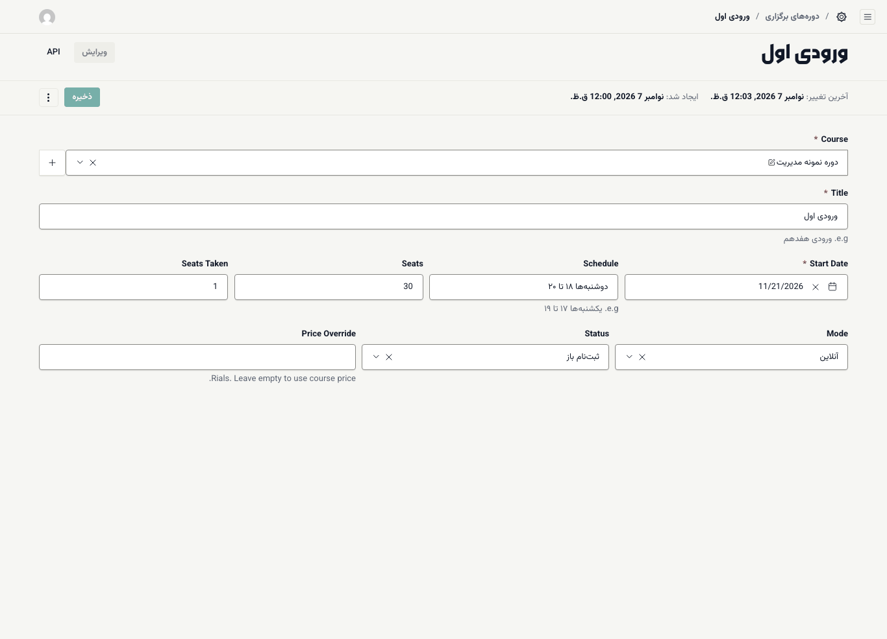
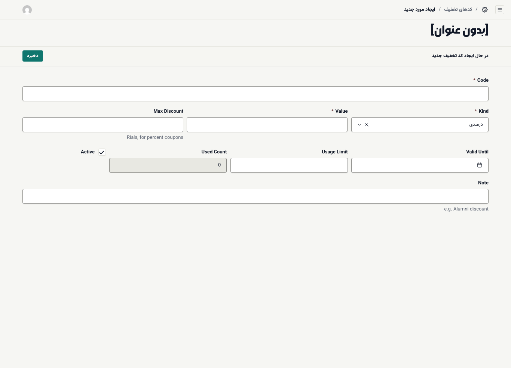

# ورودی، قیمت، اقساط و کد تخفیف

## قیمت به ریال

> **مهم:** همهٔ مبلغ‌ها در بخش مدیریت **به ریال** وارد می‌شوند، اما سایت آن‌ها را **به تومان** نشان می‌دهد. هر تومان ۱۰ ریال است؛ پس یک صفر اضافه کنید.
>
> مثال: دوره‌ای که در سایت باید «۱۲٬۰۰۰٬۰۰۰ تومان» نمایش داده شود، در فیلد **Price** به شکل `120000000` نوشته می‌شود.
>
> عدد را بدون جداکننده و بدون واحد بنویسید. پس از ذخیره، صفحهٔ دوره را در سایت باز کنید و مبلغ را بررسی کنید.

این قاعده برای **Price** دوره، **Price Override** ورودی، و **Max Discount** و **Value** کد تخفیفِ مبلغ ثابت برقرار است. در فهرست‌های بخش مدیریت (مثلاً **سفارش‌ها**) هم مبلغ‌ها به ریال و بدون جداکننده دیده می‌شوند.

## ورودی (دورهٔ برگزاری)

هر دوره می‌تواند چند **ورودی** داشته باشد؛ مثلاً «ورودی هفدهم» که در تاریخ مشخصی شروع می‌شود. دانشجو در یک ورودی ثبت‌نام می‌کند.

۱. **آموزش ← دوره‌های برگزاری** را باز کنید و **ایجاد مورد جدید** را بزنید.

۲. در **Course** دوره را انتخاب کنید.

۳. **Title** را بنویسید؛ مثلاً «ورودی هفدهم».

۴. **Start Date** (تاریخ شروع) را انتخاب کنید.

۵. **Schedule** را به زبان ساده بنویسید؛ مثلاً «یکشنبه‌ها ۱۷ تا ۱۹». همین متن در کارت ثبت‌نام نمایش داده می‌شود.

۶. **Seats** (ظرفیت) را بنویسید. سایت **ظرفیت باقی‌مانده** را از آن حساب می‌کند. **Seats Taken** تعداد ثبت‌نام‌شده‌هاست.

۷. **Mode** را انتخاب کنید: **آنلاین**، **حضوری** یا **ترکیبی**.

۸. **Status** را انتخاب کنید (جدول زیر).

۹. اگر قیمت این ورودی با قیمت دوره فرق دارد، **Price Override** را به ریال بنویسید. اگر خالی بماند، قیمت دوره استفاده می‌شود.

۱۰. **ذخیره** را بزنید.

| وضعیت | در سایت |
| --- | --- |
| **پیش‌ثبت‌نام** | ثبت‌نام و پرداخت ممکن است؛ کارت «پیش‌ثبت‌نام» نشان می‌دهد |
| **ثبت‌نام باز** | ثبت‌نام و پرداخت ممکن است |
| **تکمیل ظرفیت** | ثبت‌نام بسته است؛ اگر ورودی بازِ دیگری نباشد، کارت ثبت‌نام «به‌زودی» نشان می‌دهد |
| **در حال برگزاری** | ثبت‌نام بسته است؛ دانشجوهای فعلی ادامه می‌دهند |
| **پایان یافته** | ثبت‌نام بسته است |

## اقساط

تعداد قسط‌ها را با فیلد **حداکثر اقساط** در فرم دوره تعیین می‌کنید. دانشجو در کارت ثبت‌نام بین **یکجا** و ۲ قسط تا همین حداکثر یکی را انتخاب می‌کند.

در نسخهٔ فعلی، قاعدهٔ تقسیم برای همهٔ دوره‌ها یکسان است:

- **پیش‌پرداخت:** ۴۰٪ مبلغ (پس از تخفیف) هنگام ثبت‌نام پرداخت می‌شود.
- **باقی مبلغ:** به‌طور مساوی در قسط‌های بعدی، هر ۳۰ روز یک قسط.

کارت ثبت‌نام همین محاسبه را پیش از پرداخت به دانشجو نشان می‌دهد (مثلاً «پیش‌پرداخت ۴٬۸۰۰٬۰۰۰ تومان، سپس ۳ قسط ماهانه ۲٬۴۰۰٬۰۰۰ تومان»). وضعیت هر قسط را در **فروش ← سفارش‌ها** می‌بینید. ([سفارش‌ها](06-sales-orders-leads.md#orders))

## کد تخفیف

۱. **فروش ← کدهای تخفیف** را باز کنید و **ایجاد مورد جدید** را بزنید.

۲. **Code** را بنویسید؛ مثلاً `ALUMNI20`. کد خودکار با حروف بزرگ ذخیره می‌شود.

۳. **Kind** را انتخاب کنید: **درصدی** یا **مبلغ ثابت (ریال)**.

۴. **Value** را بنویسید: برای درصدی عدد درصد (مثلاً `20`)، برای مبلغ ثابت مبلغ به ریال.

۵. برای کد درصدی، اگر سقف می‌خواهید، **Max Discount** را به ریال بنویسید.

۶. در صورت نیاز **Valid Until** (تاریخ انقضا) و **Usage Limit** (حداکثر دفعات استفاده) را تعیین کنید. خالی یعنی بدون محدودیت.

۷. **Active** را تیک‌خورده نگه دارید.

۸. در **Note** بنویسید کد برای چه کسانی است؛ مثلاً «تخفیف دانش‌آموختگان».

۹. **ذخیره** را بزنید.

**Used Count** خودکار پر می‌شود و نشان می‌دهد کد چند بار استفاده شده است. برای از کار انداختن کد، تیک **Active** را بردارید.

> **اگر … چه کنم؟**
> - قیمت در سایت ده برابر کمتر یا بیشتر است: مبلغ را به تومان نوشته‌اید یا یک صفر زیاد گذاشته‌اید. قاعده: مبلغ تومان × ۱۰ = عدد فیلد.
> - گزینهٔ قسطی در سایت نیست: **حداکثر اقساط** دوره ۱ است.
> - دانشجو هنگام پرداخت پیام «کد تخفیف معتبر نیست.»، «مهلت این کد تخفیف تمام شده است.» یا «ظرفیت این کد تخفیف تکمیل شده است.» می‌بیند: به‌ترتیب **Active**، **Valid Until** و **Usage Limit** را بررسی کنید.
