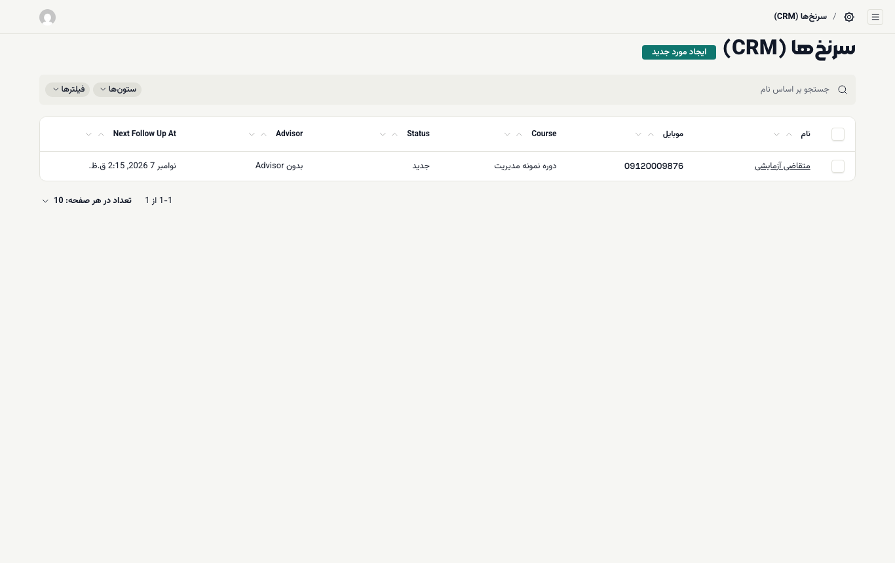
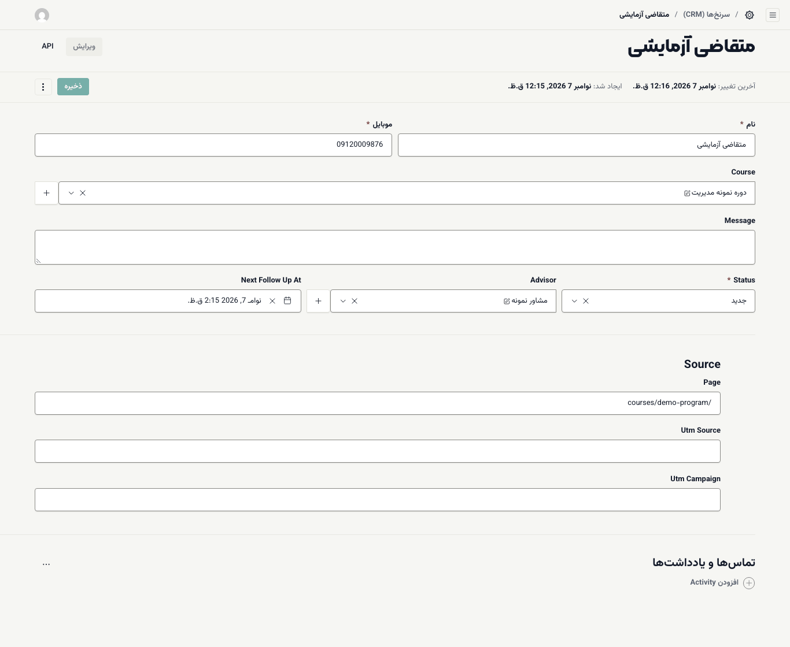
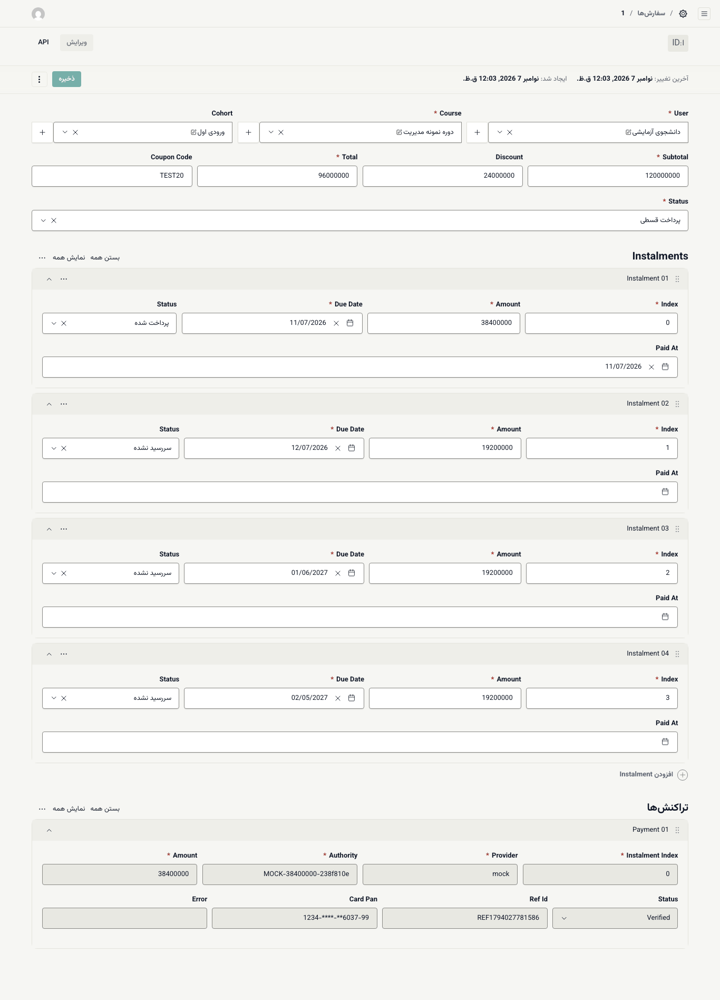

# سرنخ‌ها، سفارش‌ها و ثبت‌نام‌ها

این صفحه سه فهرست گروه **فروش** و **آموزش** را توضیح می‌دهد که مدیر آکادمی هر روز به آن‌ها سر می‌زند.

## سرنخ‌ها: سپردن به مشاور

هر بار بازدیدکننده‌ای در صفحهٔ دوره فرم **سؤال دارید؟** را پر کند و **درخواست تماس مشاور** را بزند، یک **سرنخ** با وضعیت **جدید** ساخته می‌شود.

> **مهم:** سرنخ‌هایی که از سایت می‌آیند به هیچ مشاوری سپرده نشده‌اند (ستون **Advisor** «بدون Advisor» است). مشاور فروش فقط سرنخ‌های خودش را می‌بیند؛ پس تا وقتی شما سرنخ را به او نسپارید، فهرستش خالی است.

۱. **فروش ← سرنخ‌ها (CRM)** را باز کنید. سرنخ‌های تازه با وضعیت **جدید** و **بدون Advisor** دیده می‌شوند.

۲. روی نام سرنخ بزنید.

۳. در **Advisor** مشاور را انتخاب کنید.

۴. **ذخیره** را بزنید.

از اینجا به بعد مشاور سرنخ را در فهرست خود می‌بیند و پیگیری می‌کند. ([راهنمای مشاور](../staff/03-advisor-leads.md))

راه کوتاه‌تر: در میز **مشتریان بالقوه** (`/staff/leads`) زبانهٔ **همهٔ سرنخ‌ها**، سرنخ را باز کنید و در بخش **مشاور** آن را بسپارید. مشاوران با دسترسی `leads.claim` هم خودشان سرنخ‌های بی‌مشاور را برمی‌دارند؛ عضویتی که روی «فقط رکوردهای خودش» باشد سرنخ بی‌مشاور نمی‌بیند.

اگر می‌خواهید کسی (مثلاً سرپرست فروش) بدون شما سرنخ‌ها را ببیند و تقسیم کند، به او نقشی با دسترسی‌های `leads.view.all` و `leads.assign` بدهید. ([نقش سفارشی](03-people-and-roles.md#custom-role))

## سفارش‌ها

**فروش ← سفارش‌ها** همهٔ سفارش‌ها را با ستون‌های **User** (دانشجو)، **Course**، **Total** (مبلغ کل به ریال) و **Status** نشان می‌دهد.

| وضعیت | معنی |
| --- | --- |
| **در انتظار پرداخت** | دانشجو به درگاه رفته ولی پرداخت کامل نشده |
| **پرداخت قسطی** | پیش‌پرداخت یا بخشی از قسط‌ها پرداخت شده |
| **پرداخت شده** | همهٔ مبلغ پرداخت شده |
| **ناموفق** | پرداخت در درگاه ناموفق بوده |
| **مسترد شده** | مبلغ به دانشجو برگردانده شده |
| **لغو شده** | سفارش لغو شده |

با بازکردن یک سفارش این‌ها را می‌بینید:

- **Subtotal** (مبلغ پیش از تخفیف)، **Discount**، **Total** و **Coupon Code**
- **Instalments:** هر قسط با **Amount**، **Due Date** (سررسید) و وضعیت **سررسید نشده** یا **پرداخت شده**
- **تراکنش‌ها:** هر بار رفتن به درگاه، با **Provider** (درگاه)، **Authority** و **Ref Id** (شمارهٔ پیگیری بانک)

## ثبت‌نام‌ها

**آموزش ← ثبت‌نام‌ها** نشان می‌دهد چه کسی در کدام دوره و ورودی است و وضعیتش چیست: **فعال**، **تکمیل شده** یا **لغو شده**.

در هر ثبت‌نام دو کار مهم انجام می‌دهید:

- **دفاع نهایی قبول:** برای دوره‌هایی که دفاع نهایی دارند، پس از دفاع این تیک را بزنید.
- **فرصت اضافهٔ آزمون:** اگر دانشجویی فرصت‌های یک آزمون را تمام کرده، آزمون را انتخاب کنید و **تعداد** فرصت اضافه را بنویسید (۱ تا ۲۰). این کار در گزارش ممیزی ثبت می‌شود.

**تاریخ ثبت‌نام** مبنای قانون‌های «چند روز پس از ثبت‌نام» در [زمان‌بندی انتشار](04-courses-and-lessons.md#drip) است.

> **اگر … چه کنم؟**
> - مشاور می‌گوید فهرستش خالی است: سرنخ‌ها را به او بسپارید (بالا).
> - دانشجو پرداخت کرده ولی سفارش **در انتظار پرداخت** مانده: در **تراکنش‌ها** وضعیت تراکنش و **Ref Id** را ببینید و با شمارهٔ پیگیری بانک مقایسه کنید.
> - نمی‌دانید چه کسی وضعیت سفارشی را تغییر داده: [گزارش ممیزی](08-tools-editor-and-audit.md#audit-log) را ببینید.
