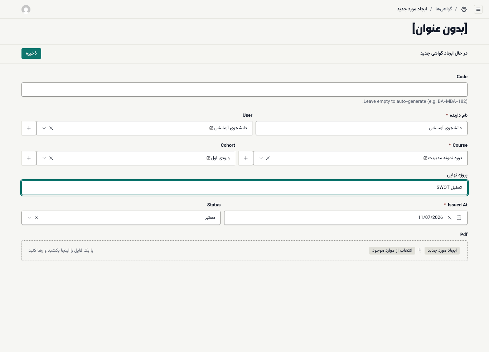

# صدور گواهی

گواهی در ادورا خودکار صادر نمی‌شود. وقتی دانشجو شرایط را کامل کرد، شما گواهی را در بخش مدیریت می‌سازید. گواهی بلافاصله در پنل دانشجو و در صفحهٔ عمومی **استعلام گواهی** (`/verify`) دیده می‌شود.

**پیش از شروع:** **Certificate Prefix** آکادمی ([تنظیمات فنی](02-academy-settings.md#technical-settings)) و **Program Code** دوره ([ساختن دوره](04-courses-and-lessons.md)) تعیین شده باشند. کد گواهی از این دو ساخته می‌شود؛ مثلاً `ED-MGT-001`.

## چه کسی شرایط گواهی دارد؟

در صفحهٔ دورهٔ دانشجو، بخش **پیشرفت و گواهی** شرایط را نشان می‌دهد. بخش مدیریت هنگام ذخیرهٔ گواهی برای دانشجویی که در دوره ثبت‌نام دارد، فقط این را بررسی می‌کند: **همهٔ آزمون‌ها و تکلیف‌های الزامی قبول شده باشند.** تکمیل همهٔ جلسه‌ها و دفاع نهایی را پیش از صدور خودتان بررسی کنید.

برای بررسی سریع:

- **آزمون و تکلیف ← نتایج آزمون‌ها:** ستون **Passed** برای هر تلاش.
- **آزمون و تکلیف ← تحویل تکالیف (نمره‌دهی):** وضعیت و نمرهٔ هر تحویل.
- **آموزش ← ثبت‌نام‌ها:** تیک **دفاع نهایی قبول** و **جلسات بازشده**.

## صدور

۱. **آموزش ← گواهی‌ها** را باز کنید و **ایجاد مورد جدید** را بزنید.

۲. **Code** را خالی بگذارید تا خودکار ساخته شود.

۳. **نام دارنده** را دقیقاً همان‌طور بنویسید که باید روی گواهی بیاید.

۴. در **User** حساب دانشجو را انتخاب کنید (چند حرف از نامش را تایپ کنید).

۵. **Course** و **Cohort** (ورودی) را انتخاب کنید.

۶. اگر دوره پروژهٔ نهایی دارد، عنوانش را در **پروژه نهایی** بنویسید.

۷. **Issued At** (تاریخ صدور) را بررسی کنید.

۸. **Status** را روی **معتبر** بگذارید.

۹. اگر فایل PDF گواهی را دارید، در **Pdf** بارگذاری کنید.

۱۰. **ذخیره** را بزنید. پیام «گواهی با موفقیت ایجاد شد.» می‌آید و کد ساخته‌شده بالای فرم دیده می‌شود.

دانشجو حالا گواهی را در بخش **گواهی‌های من** پنلش می‌بیند. ([نمای دانشجو](../student/06-certificates-and-verify.md))

## باطل‌کردن گواهی

گواهی را نمی‌توان حذف کرد. اگر گواهی‌ای به اشتباه صادر شده، **Status** را روی **باطل شده** بگذارید و ذخیره کنید. از این پس صفحهٔ استعلام برای آن کد «✕ این گواهی باطل شده است» نشان می‌دهد و این تغییر در گزارش ممیزی ثبت می‌شود.

> **اگر … چه کنم؟**
> - هنگام ذخیره پیام «Certificate blocked (quiz): …» یا «Certificate blocked (assignment): …» آمد: دانشجو آزمون یا تکلیف الزامی‌ای را که نامش بعد از دونقطه آمده هنوز قبول نشده است. پس از قبولی دوباره صادر کنید.
> - نام روی گواهی اشتباه است: گواهی را باز کنید، **نام دارنده** را اصلاح و ذخیره کنید. کد عوض نمی‌شود.
