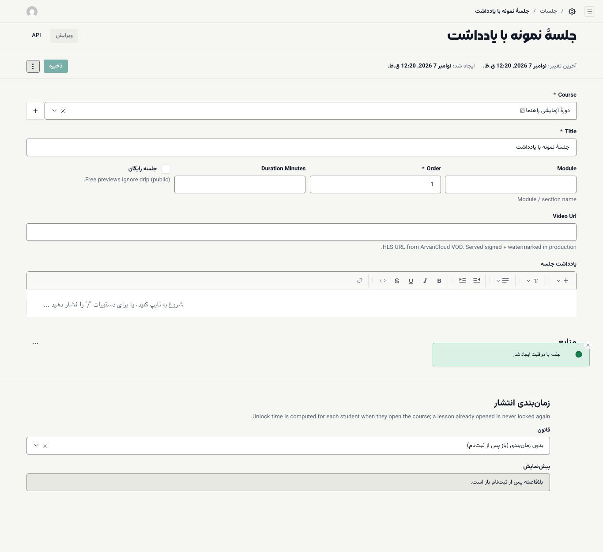
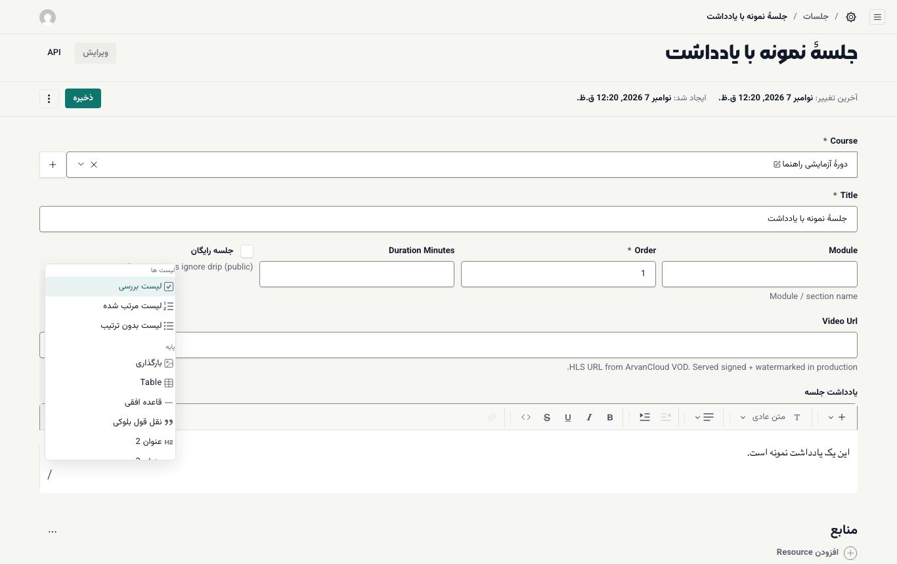
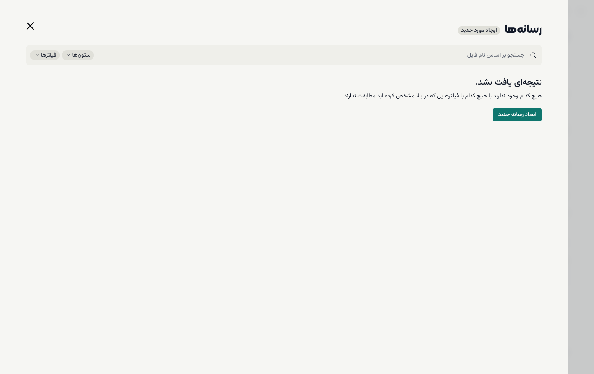
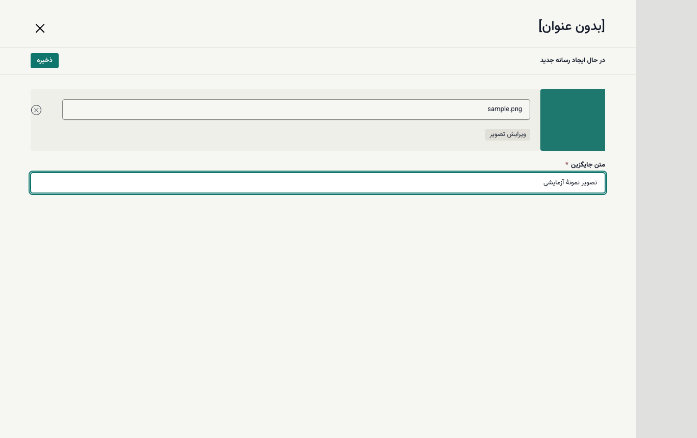
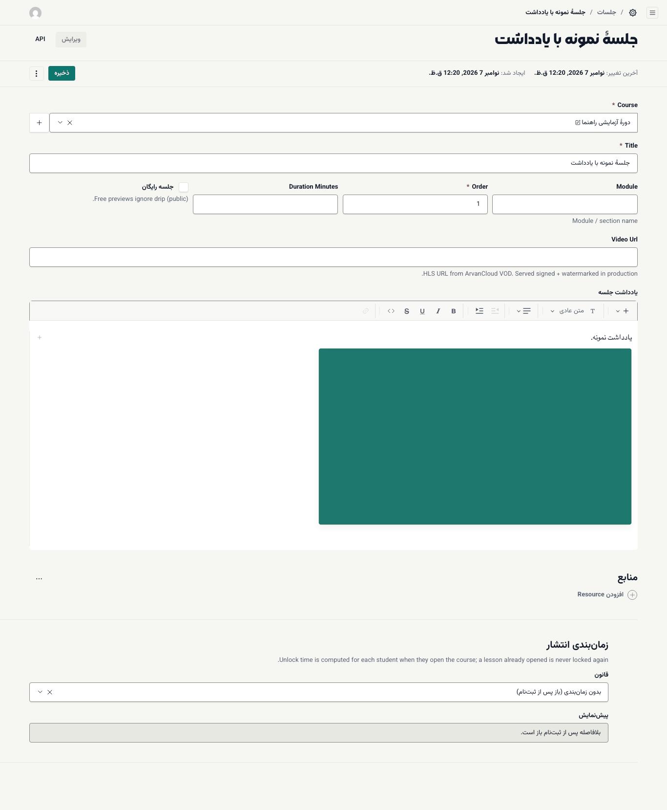
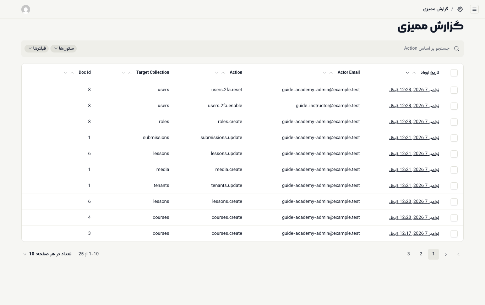
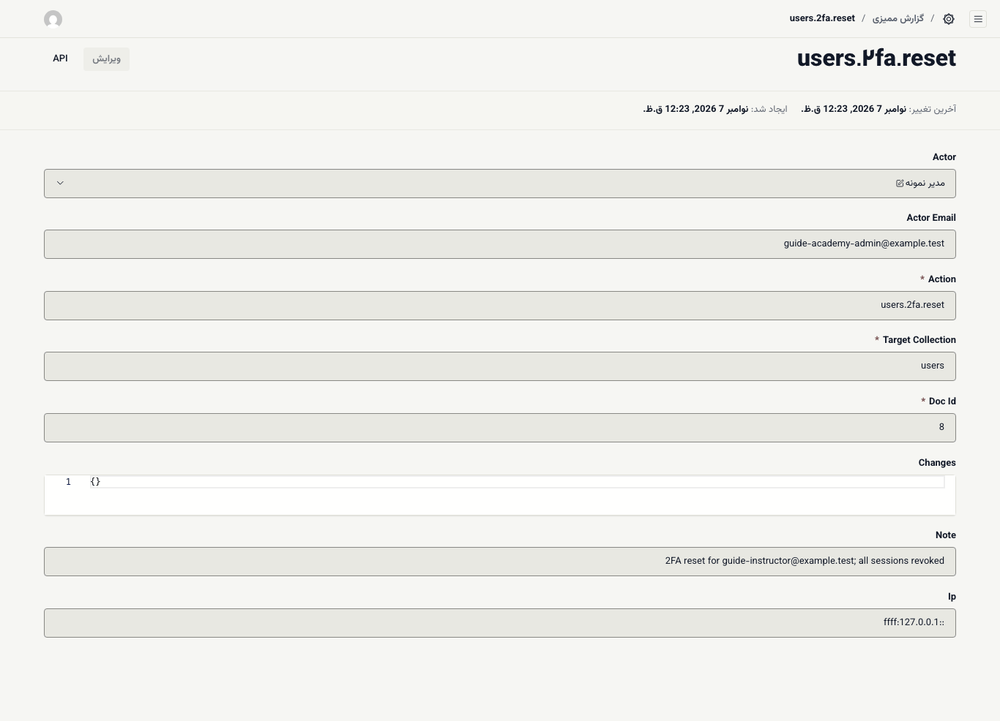

# ابزارها: ویرایشگر متن و گزارش ممیزی

## ویرایشگر متن

متن‌های بلند بخش مدیریت با یک ویرایشگر مشترک نوشته می‌شوند: مانیفست آکادمی، توضیح سرفصل‌ها و پاسخ پرسش‌های متداول دوره، یادداشت جلسه، توضیح آزمون و تکلیف، توضیح پاسخ سؤال، بازخورد نمره، معرفی مدرس و متن مقاله‌های مجله.

### نوشتن و قالب‌بندی

- **نوار ابزار بالای کادر:** فهرست کشویی برای نوع متن (پاراگراف یا عنوان)، دکمه‌های پررنگ، کج، زیرخط، خط‌خورده و کد، پیوند، و ترازبندی.
- **منوی «/»:** در یک خط خالی کلید `/` را بزنید تا فهرست بلوک‌ها باز شود: **لیست بررسی**، **لیست مرتب شده**، **لیست بدون ترتیب**، **بارگذاری** (تصویر)، **Table** (جدول)، **قاعده افقی**، **نقل قول بلوکی**، `عنوان 2`، `عنوان 3`، `عنوان 4` و **پاراگراف**. چند حرف از نام بلوک را تایپ کنید تا فهرست کوتاه شود.
- **انتخاب متن:** با انتخاب چند کلمه، نوار ابزار کوچکی کنار متن ظاهر می‌شود.
- **پیوند:** می‌توانید به یک نشانی بیرونی یا به یکی از دوره‌ها و جلسه‌های همین آکادمی پیوند دهید.

### افزودن تصویر

۱. در یک خط خالی `/` را بزنید و **بارگذاری** را انتخاب کنید.

۲. پنجرهٔ **رسانه‌ها** باز می‌شود. اگر تصویر را قبلاً بارگذاری کرده‌اید، از فهرست انتخابش کنید.

۳. برای تصویر تازه، **ایجاد مورد جدید** (یا **ایجاد رسانه جدید**) را بزنید.

۴. فایل را روی کادر بکشید یا **انتخاب فایل** را بزنید.

۵. **متن جایگزین** را بنویسید؛ یک جملهٔ کوتاه که تصویر را برای کسی که آن را نمی‌بیند توصیف کند. این فیلد الزامی است.

۶. **ذخیره** را در همان پنجره بزنید. تصویر در متن قرار می‌گیرد.

۷. **ذخیره** فرم اصلی را هم بزنید.

همهٔ تصویرهای بارگذاری‌شده در **محتوا ← رسانه‌ها** هم دیده می‌شوند و می‌توانید دوباره از آن‌ها استفاده کنید. ویرایشگر فقط تصویرها و پیوندهای همین آکادمی را می‌پذیرد.

> **اگر … چه کنم؟**
> - تصویر ذخیره نمی‌شود: **متن جایگزین** را ننوشته‌اید.
> - متن را از Word یا یک سایت کپی کرده‌اید و قالبش به هم ریخته: متن را انتخاب کنید و از فهرست نوع متن **پاراگراف** را بزنید، بعد دوباره عنوان‌ها و فهرست‌ها را بسازید.

## گزارش ممیزی

**اعضا و دسترسی ← گزارش ممیزی** فهرست کارهای حساس است: چه کسی، چه زمانی، چه کاری روی چه چیزی انجام داده است. این فهرست فقط خواندنی است؛ هیچ‌کس نمی‌تواند موردی را در آن ویرایش یا حذف کند.

ستون‌ها:

- **تاریخ ایجاد:** زمان رویداد
- **Actor Email:** ایمیل کسی که کار را انجام داده
- **Action:** نوع کار؛ مثلاً `users.2fa.enable` (روشن‌کردن تأیید دومرحله‌ای) یا `users.2fa.reset` (بازنشانی آن)
- **Target Collection** و **Doc Id:** بخش و شمارهٔ موردی که تغییر کرده

با زدن روی هر ردیف، جزئیات آن، از جمله **Changes** (فیلدهای تغییرکرده)، باز می‌شود. برای پیدا کردن یک رویداد خاص از **فیلترها** استفاده کنید؛ مثلاً همهٔ کارهای یک ایمیل.

ساختن و تغییر تقریباً همه‌چیز ثبت می‌شود: تنظیمات آکادمی، دوره‌ها، ورودی‌ها، جلسه‌ها، آزمون‌ها و سؤال‌ها، تکلیف‌ها و نمره‌ها، ثبت‌نام‌ها (از جمله فرصت اضافهٔ آزمون)، سفارش‌ها و کدهای تخفیف، سرنخ‌ها، گواهی‌ها، کاربران، نقش‌ها و عضویت‌ها، رسانه‌ها، و روشن، خاموش یا بازنشانی‌کردن تأیید دومرحله‌ای. دیدن این فهرست دسترسی `audit.view` می‌خواهد.
