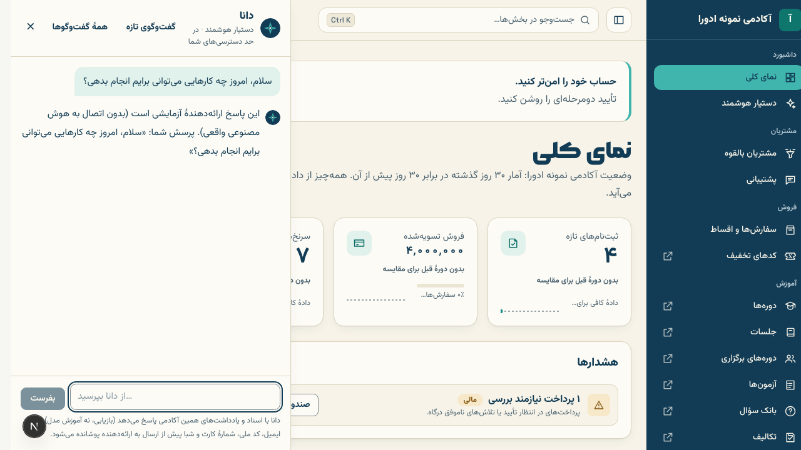
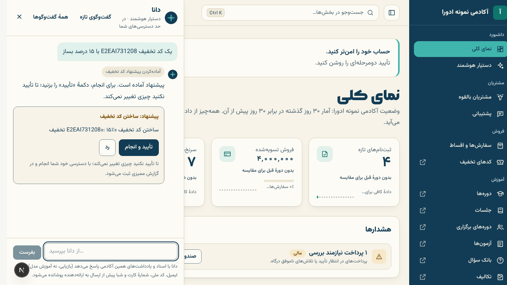
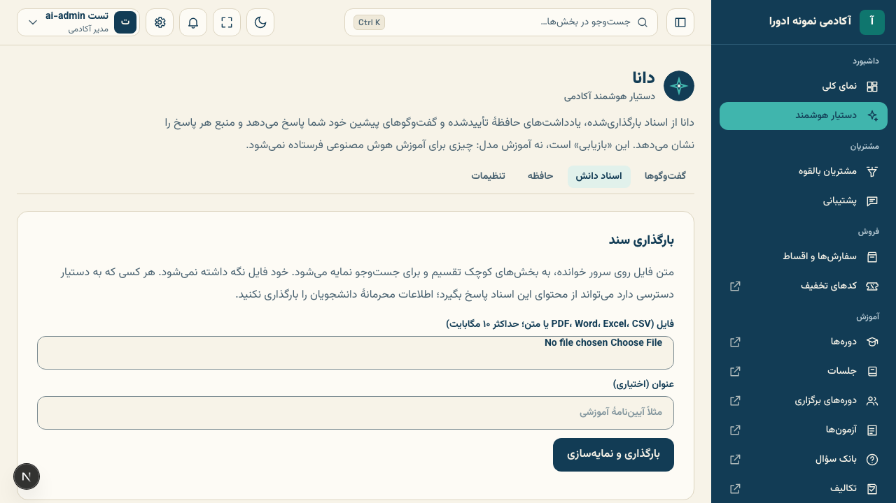
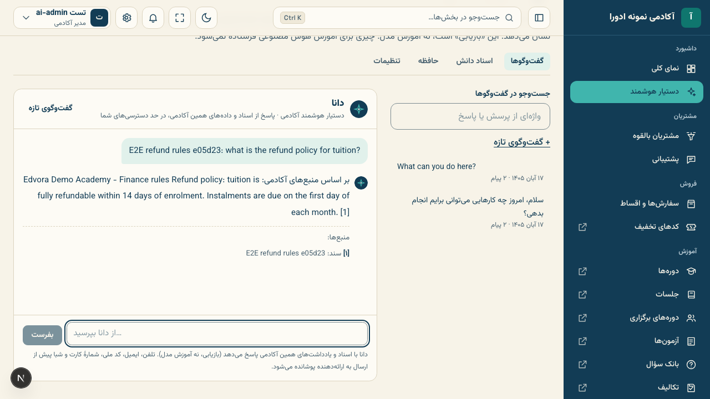
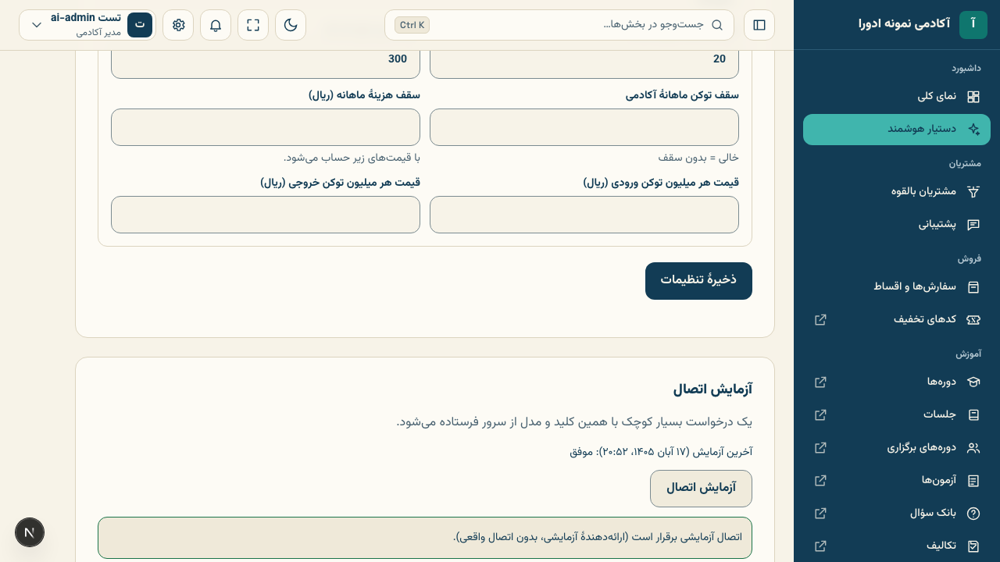

# دستیار هوشمند

دستیار هوشمند به کارکنان آکادمی کمک می‌کند جواب پرسش‌ها را از اسناد خود آکادمی پیدا کنند، در داده‌ها جست‌وجو کنند و کارهای کوچک مثل ساختن کد تخفیف را آماده کنند. دستیار در همهٔ صفحه‌های `/staff` و `/admin` با دکمهٔ **دستیار** (پایین صفحه) یا کلید <kbd>Ctrl</kbd>+<kbd>J</kbd> باز می‌شود و بخش کامل آن در منوی **داشبورد › دستیار هوشمند** است.

**چه کسی می‌بیند:** کسی که نقشش دسترسی «گفت‌وگو با دستیار هوشمند» دارد. تنظیمات، اسناد و حافظه فقط برای دارندگان «تنظیم دستیار هوشمند» است (مدیر آکادمی هر دو را دارد).

## سه قاعدهٔ مهم

1. **دستیار در حد دسترسی خود شما کار می‌کند.** اگر شما سفارش‌ها را نمی‌بینید، دستیار هم نمی‌بیند؛ مشاور فقط سرنخ‌های خودش را می‌بیند.
2. **هیچ تغییری بدون تأیید شما انجام نمی‌شود.** دستیار تغییر را به شکل کارت «پیشنهاد» نشان می‌دهد. تا **تأیید و انجام** را نزنید چیزی عوض نمی‌شود، و پس از تأیید، کار با دسترسی خود شما انجام و در **گزارش ممیزی** ثبت می‌شود. تأیید پرداخت و بازپرداخت هرگز از دستیار انجام نمی‌شود.
3. **«یادگیری» یعنی بازیابی، نه آموزش مدل.** دستیار از اسنادی که بارگذاری می‌کنید، یادداشت‌های حافظهٔ تأییدشده و گفت‌وگوهای پیشین خودتان پاسخ می‌دهد و منبع هر پاسخ را با شماره مثل [۱] نشان می‌دهد. چیزی برای آموزش هوش مصنوعی فرستاده نمی‌شود.

## پیشنهاد و تأیید

از دستیار بخواهید، مثلاً «یک کد تخفیف ALUMNI20 با ۲۰ درصد بساز». کارت پیشنهاد با جزئیات دقیق تغییر نشان داده می‌شود. **تأیید و انجام** یا **رد** را بزنید. هر پیشنهاد ۳۰ دقیقه اعتبار دارد و فقط کسی که آن را خواسته می‌تواند تأییدش کند.

کارهایی که دستیار فعلاً پیشنهاد می‌دهد: ساختن کد تخفیف، ویرایش متن دوره (عنوان، زیرعنوان، خلاصه، مدت؛ نه قیمت)، و ثبت یادداشت یا تاریخ پیگیری برای سرنخ.

## اسناد دانش

در **دستیار هوشمند › اسناد دانش** فایل PDF، Word (‎.docx)، Excel (‎.xlsx)، CSV یا متن (تا ۱۰ مگابایت) بارگذاری کنید. متن روی سرور خوانده و نمایه می‌شود و خود فایل نگه داشته نمی‌شود. هر کسی که به دستیار دسترسی دارد می‌تواند از محتوای این اسناد پاسخ بگیرد، پس اطلاعات محرمانهٔ دانشجویان را بارگذاری نکنید.

## حافظه

دستیار ممکن است از دل گفت‌وگو «یادداشت حافظه» پیشنهاد کند (مثلاً «سیاست بازپرداخت ما ۱۴ روز است»). در **دستیار هوشمند › حافظه** آن را تأیید، ویرایش، رد یا حذف کنید. فقط یادداشت‌های تأییدشده در پاسخ‌ها استفاده می‌شوند. خودتان هم می‌توانید یادداشت بیفزایید.

## تنظیمات

در **دستیار هوشمند › تنظیمات**:

- **ارائه‌دهنده و مدل:** OpenAI، Anthropic Claude، Google Gemini یا «درگاه سازگار با OpenAI» با نشانی و کلید خودش. روی سرور داخل ایران فقط درگاه‌های داخلی (مانند AvalAI یا GapGPT) کار می‌کنند؛ سه سرویس دیگر سرورهای ایران را نمی‌پذیرند.
- **کلید API:** فقط نوشتنی است؛ پس از ذخیره هرگز نمایش داده نمی‌شود (فقط چهار نویسهٔ آخر). با **آزمایش اتصال** مطمئن شوید کلید و مدل درست‌اند.
- **حریم خصوصی:** پیش‌فرض این است که نام‌ها فرستاده می‌شوند و تلفن، ایمیل و کد ملی پیش از ارسال پوشانده می‌شوند. شمارهٔ کارت و شبا همیشه پوشانده می‌شود.
- **سقف‌ها:** پیام در دقیقه و روز برای هر نفر، و سقف توکن یا هزینهٔ ماهانهٔ آکادمی (با قیمت‌هایی که خودتان به ریال وارد می‌کنید).
- **چه نقش‌هایی:** دادن یا برداشتن دسترسی دستیار برای هر نقش.

