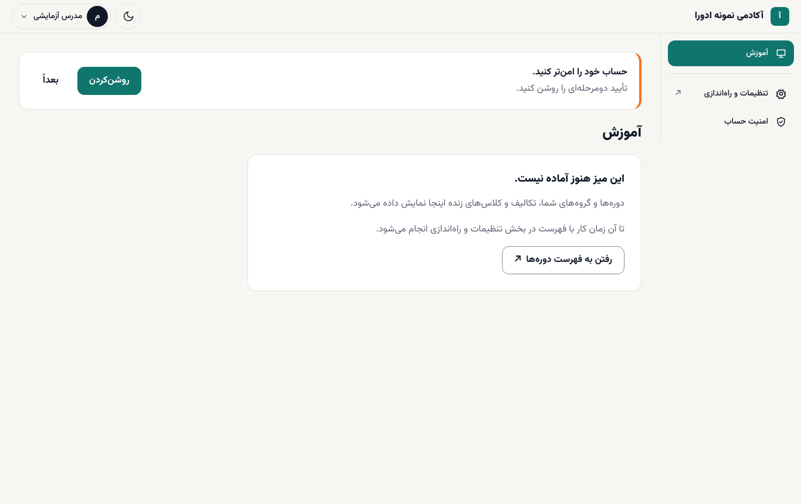

# شروع کار مدرس

مدرس در ادورا آزمون‌ها و تکلیف‌ها را می‌سازد، تکلیف‌ها را نمره می‌دهد و در صورت نیاز جلسه‌ها را ویرایش می‌کند. همهٔ این کارها فعلاً در بخش مدیریت (`/admin`) انجام می‌شود.

**پیش از شروع:** مدیر آکادمی برایتان حساب ساخته و نقش **مدرس** داده است. اگر فقط در یک یا چند دوره تدریس می‌کنید، او دسترسی شما را به همان دوره‌ها محدود کرده است. ([راهنمای مدیر](../academy-admin/03-people-and-roles.md#scope-and-expiry))

## ورود

۱. به `/staff/login` بروید، ایمیل و رمز را بنویسید و **ورود** را بزنید. ([ورود کارکنان](../staff/01-login-and-desks.md))

۲. میز **آموزش** باز می‌شود. این میز هنوز آماده نیست؛ **رفتن به فهرست دوره‌ها** یا **تنظیمات و راه‌اندازی** در منو شما را به بخش مدیریت می‌برد.

۳. تأیید دومرحله‌ای را روشن کنید. ([تأیید دومرحله‌ای](../staff/02-two-factor.md))

## بخش‌هایی که مدرس با آن‌ها کار می‌کند

در بخش مدیریت، گروه **آزمون و تکلیف**:

| بخش | کار |
| --- | --- |
| **بانک سؤال** | ساختن سؤال‌ها برای استفاده در آزمون‌ها |
| **آزمون‌ها** | ساختن آزمون از سؤال‌های بانک و تنظیم قوانین آن |
| **نتایج آزمون‌ها** | دیدن تلاش‌ها و نمره‌های دانشجوها |
| **تکالیف** | تعریف تکلیف، مهلت و نمرهٔ قبولی |
| **تحویل تکالیف (نمره‌دهی)** | صف نمره‌دهی |
| **فایل‌های تکالیف** | فایل‌هایی که دانشجوها فرستاده‌اند |

و در گروه **آموزش**: **جلسات** (یادداشت و ویدیو، زمان‌بندی انتشار) و **ثبت‌نام‌ها** (ثبت نتیجهٔ دفاع نهایی با تیک **دفاع نهایی قبول**؛ دادن فرصت اضافهٔ آزمون فقط کار مدیر آکادمی است). زمان‌بندی انتشار جلسه‌ها در [راهنمای مدیر: ساختن دوره و جلسه‌ها](../academy-admin/04-courses-and-lessons.md#drip) توضیح داده شده است.

## ترتیب پیشنهادی

۱. [سؤال‌ها را در بانک سؤال بسازید و آزمون را تنظیم کنید](02-quizzes.md).

۲. [تکلیف‌ها را تعریف کنید و نمره دهید](03-assignments-and-grading.md).

## کلاس آنلاین زنده

**در نسخهٔ بعدی.** برگزاری کلاس زنده داخل ادورا هنوز در این نسخه نیست. ([به‌زودی](../coming-soon.md#live-classes))

> **اگر … چه کنم؟**
> - دوره‌ای را که تدریس می‌کنید در فهرست‌ها نمی‌بینید: محدودهٔ عضویت شما شامل آن دوره نیست. از مدیر آکادمی بخواهید آن را اضافه کند.
> - واژه‌ای ناآشناست: [واژه‌نامه](../glossary.md)
