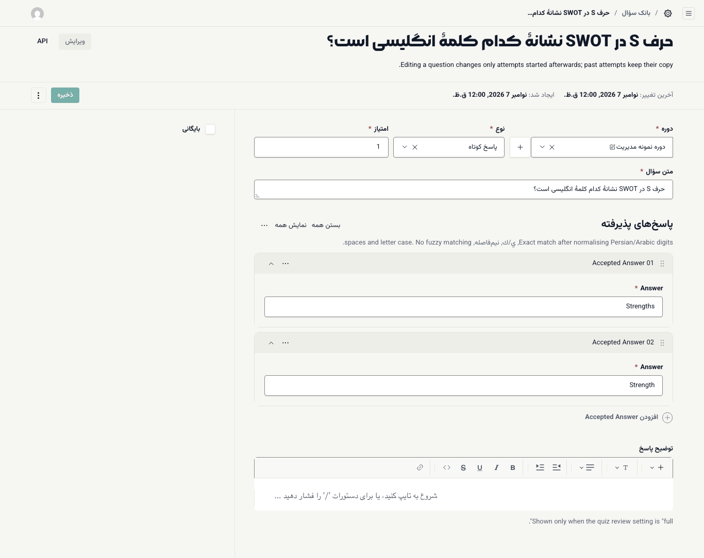
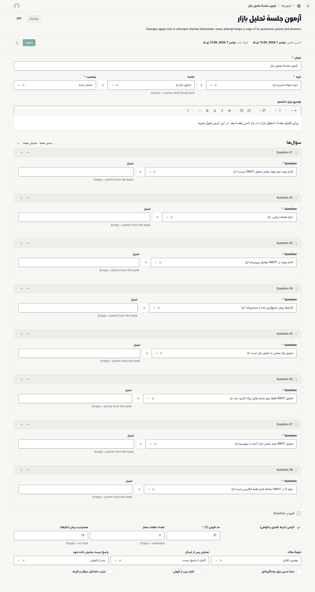
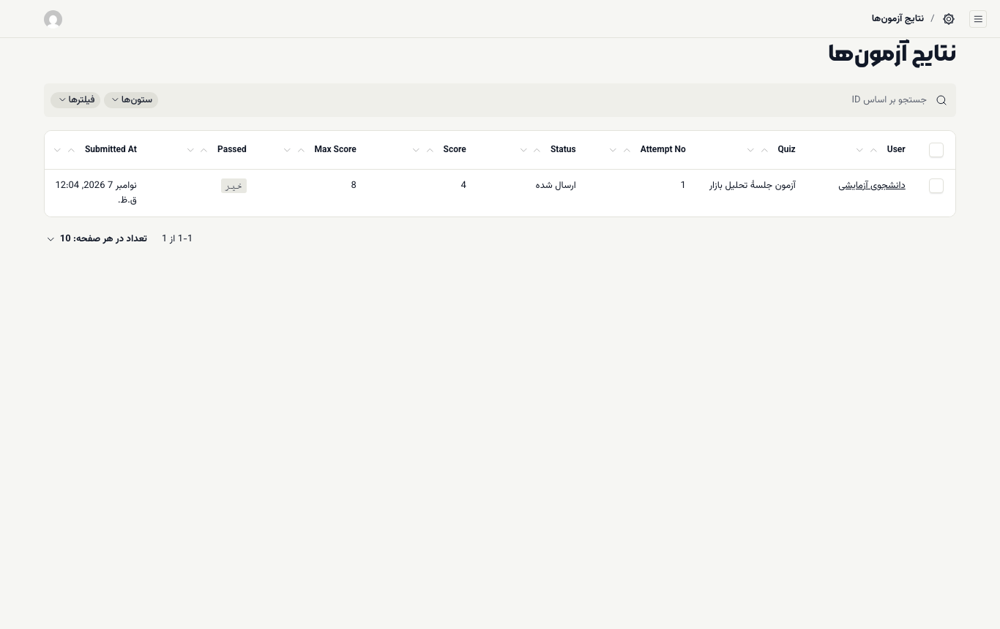

# بانک سؤال و آزمون

در ادورا سؤال‌ها جدا از آزمون نگه‌داری می‌شوند. اول سؤال‌ها را در **بانک سؤال** می‌سازید، بعد آزمون را از میان آن‌ها می‌چینید. یک سؤال می‌تواند در چند آزمون استفاده شود.

**پیش از شروع:** نقش **مدرس** یا **مدیر آکادمی** داشته باشید. دوره و جلسه‌ها ساخته شده باشند.

## ساختن سؤال

۱. **آزمون و تکلیف ← بانک سؤال** را باز کنید و **ایجاد مورد جدید** را بزنید.

۲. **دوره** را انتخاب کنید.

۳. **نوع** را انتخاب کنید (جدول زیر).

۴. **امتیاز** سؤال را بنویسید (پیش‌فرض ۱).

۵. **متن سؤال** را بنویسید.

۶. پاسخ درست را بسته به نوع سؤال تعیین کنید.

۷. اگر می‌خواهید دانشجو پس از آزمون توضیح ببیند، **توضیح پاسخ** را بنویسید.

۸. **ذخیره** را بزنید.

| نوع | پاسخ درست را چطور تعیین کنید |
| --- | --- |
| **تک‌گزینه‌ای** | در **گزینه‌ها** هر گزینه را در **متن گزینه** بنویسید و فقط کنار یکی **درست** را تیک بزنید |
| **چندگزینه‌ای** | مثل بالا، اما کنار همهٔ گزینه‌های درست تیک بزنید |
| **درست / نادرست** | در **پاسخ درست** یکی از **درست** یا **نادرست** را انتخاب کنید |
| **پاسخ کوتاه** | در **پاسخ‌های پذیرفته** هر شکل قابل قبول پاسخ را با **افزودن Accepted Answer** اضافه کنید |

**پاسخ کوتاه** فقط با پاسخ‌های پذیرفته مقایسه می‌شود. پیش از مقایسه، اعداد فارسی و عربی، شکل عربی حرف‌های «ی» و «ک»، نیم‌فاصله، فاصله‌ها و بزرگی و کوچکی حروف انگلیسی یکسان می‌شوند، اما غلط املایی پذیرفته نمی‌شود. پس شکل‌های رایج پاسخ را جدا اضافه کنید (مثلاً `4` و `چهار`).

**توضیح پاسخ** فقط وقتی به دانشجو نشان داده می‌شود که **نمایش پس از ارسال** آزمون روی **کامل با پاسخ درست** باشد.

> **نکته:** ویرایش یک سؤال فقط روی تلاش‌هایی اثر دارد که بعد از ویرایش شروع می‌شوند. تلاش‌های قبلی نسخهٔ خود را نگه می‌دارند. برای کنار گذاشتن سؤال، آن را حذف نکنید؛ **بایگانی** را تیک بزنید.

## ساختن آزمون

۱. **آزمون و تکلیف ← آزمون‌ها** را باز کنید و **ایجاد مورد جدید** را بزنید.

۲. **عنوان** را بنویسید و **دوره** را انتخاب کنید.

۳. در **جلسه**، جلسه‌ای را که آزمون به آن تعلق دارد انتخاب کنید. اگر خالی بماند، آزمون پایانی کل دوره است.

۴. **توضیح برای دانشجو** را بنویسید؛ این متن در صفحهٔ معرفی آزمون نمایش داده می‌شود.

۵. زیر **سؤال‌ها**، با **افزودن Question** هر سؤال را از بانک انتخاب کنید. ترتیب ردیف‌ها ترتیب سؤال‌ها در آزمون است. اگر **امتیاز** ردیف را خالی بگذارید، امتیاز بانک سؤال استفاده می‌شود.

۶. قوانین آزمون را تنظیم کنید (بخش بعد).

۷. **وضعیت** را روی **منتشر شده** بگذارید و **ذخیره** را بزنید. آزمون **پیش‌نویس** به دانشجو نشان داده نمی‌شود.

## قوانین آزمون

| فیلد | معنی |
| --- | --- |
| **الزامی (شرط تکمیل و گواهی)** | قبولی در آزمون شرط تکمیل جلسه، بازشدن جلسهٔ بعد (اگر قانون «پس از تکمیل جلسهٔ قبل» دارد) و صدور گواهی می‌شود |
| **حد قبولی (٪)** | درصد نمره برای قبولی؛ مثلاً ۷۰ |
| **تعداد دفعات مجاز** | چند بار می‌توان شرکت کرد؛ خالی یعنی نامحدود |
| **محدودیت زمان (دقیقه)** | زمان هر تلاش؛ خالی یعنی بدون محدودیت. با تمام شدن زمان، آزمون با پاسخ‌های ذخیره‌شده بسته می‌شود |
| **نتیجهٔ ملاک** | **بهترین تلاش** یا **آخرین تلاش** |
| **نمایش پس از ارسال** | **هیچ (فقط قبول/مردود)**، **فقط نمره**، **نمره و درست/غلط هر سؤال**، یا **کامل با پاسخ درست** |
| **پاسخ درست نمایش داده شود** | اگر نمایش کامل است، کی: **همیشه**، **پس از قبولی** یا **پس از آخرین فرصت** |
| **نمرهٔ نسبی برای چندگزینه‌ای** | در سؤال چندگزینه‌ای، پاسخ تا حدی درست بخشی از امتیاز را می‌گیرد |
| **تکرار پس از قبولی** | دانشجوی قبول‌شده هم بتواند دوباره شرکت کند |
| **ترتیب تصادفی سؤال و گزینه** | ترتیب سؤال‌ها و گزینه‌ها برای هر تلاش به‌هم می‌ریزد |

مثل سؤال‌ها، تغییر قوانین و سؤال‌های آزمون فقط روی تلاش‌های بعدی اثر دارد.

## دیدن نتیجه‌ها و فرصت اضافه

- **آزمون و تکلیف ← نتایج آزمون‌ها:** هر تلاش با **User**، **Quiz**، **Attempt No** (شمارهٔ تلاش)، **Score**، **Max Score**، **Passed** (قبول) و **Submitted At** (زمان ارسال).
- اگر دانشجویی همهٔ فرصت‌هایش را مصرف کرده: نقش **مدرس** نمی‌تواند فرصت اضافه بدهد. از مدیر آکادمی بخواهید در **آموزش ← ثبت‌نام‌ها**، زیر **فرصت اضافهٔ آزمون**، برای آن دانشجو فرصت ثبت کند ([راهنمای مدیر](../academy-admin/06-sales-orders-leads.md#enrollments)). این کار دسترسی `enrollments.manage` می‌خواهد.

> **اگر … چه کنم؟**
> - دانشجو آزمون را نمی‌بیند: **وضعیت** آزمون باید **منتشر شده** باشد. اگر آزمون به جلسه‌ای وصل است که هنوز برای دانشجو باز نشده، صفحهٔ آزمون «این آزمون هنوز در دسترس نیست» نشان می‌دهد.
> - پاسخ کوتاه درست دانشجو غلط حساب شد: شکل پاسخ او را به **پاسخ‌های پذیرفته** اضافه کنید. نمرهٔ تلاش‌های قبلی تغییر نمی‌کند؛ در صورت نیاز از مدیر آکادمی بخواهید یک فرصت اضافه بدهد.
