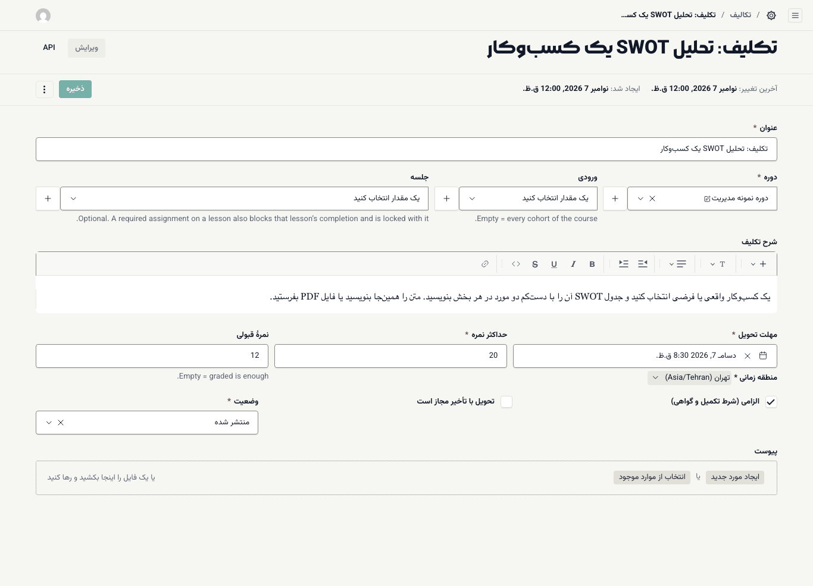
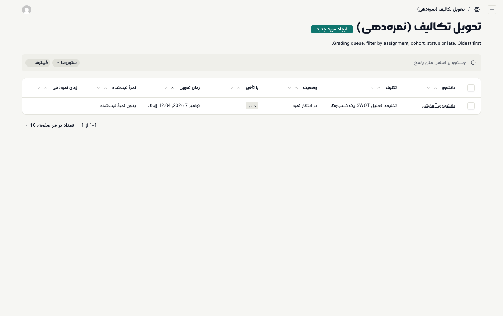
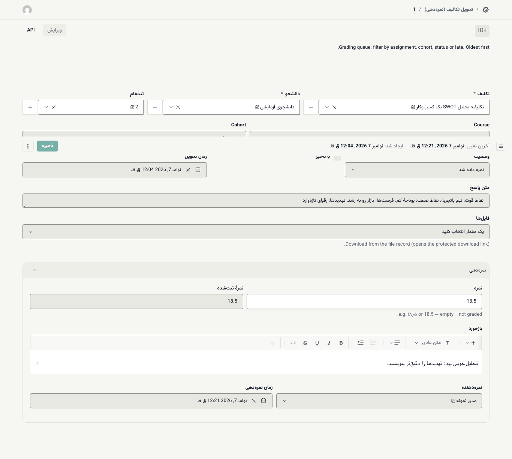
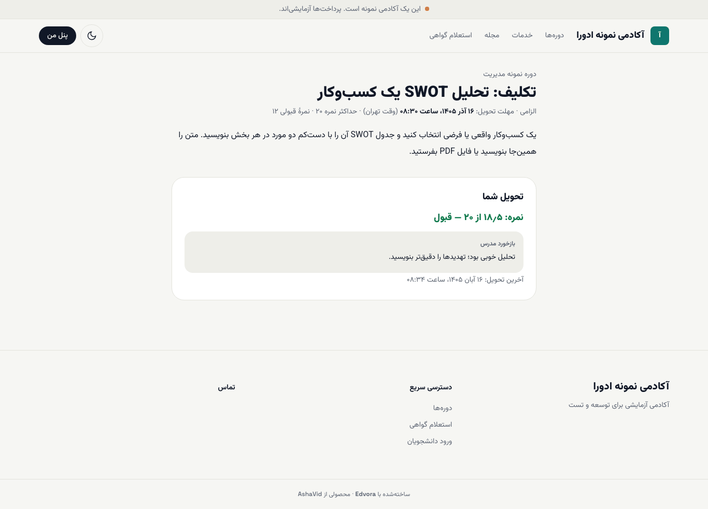

# تکلیف و نمره‌دهی

**پیش از شروع:** نقش **مدرس** یا **مدیر آکادمی** داشته باشید.

## تعریف تکلیف

۱. **آزمون و تکلیف ← تکالیف** را باز کنید و **ایجاد مورد جدید** را بزنید.

۲. **عنوان** را بنویسید و **دوره** را انتخاب کنید.

۳. **ورودی** را فقط وقتی انتخاب کنید که تکلیف مخصوص یک ورودی است. خالی یعنی همهٔ ورودی‌های دوره.

۴. **جلسه** اختیاری است. اگر تکلیف الزامی را به جلسه‌ای وصل کنید، تکمیل آن جلسه هم به تحویل و قبولی تکلیف وابسته می‌شود و تکلیف همراه جلسه قفل و باز می‌شود.

۵. **شرح تکلیف** را با [ویرایشگر متن](../academy-admin/08-tools-editor-and-audit.md) بنویسید. فایل نمونه را در **پیوست** بگذارید.

۶. **مهلت تحویل** را تعیین کنید. **منطقه زمانی** پیش‌فرض **تهران (Asia/Tehran)** است.

۷. **حداکثر نمره** (پیش‌فرض ۲۰) و **نمرهٔ قبولی** را بنویسید. اگر نمرهٔ قبولی خالی بماند، نمره‌گرفتن کافی است.

۸. در صورت نیاز تیک **الزامی (شرط تکمیل و گواهی)** و **تحویل با تأخیر مجاز است** را بزنید.

۹. **وضعیت** را روی **منتشر شده** بگذارید و **ذخیره** را بزنید.

دانشجو می‌تواند متن بنویسد و تا ۵ فایل (PDF، DOCX، JPG، PNG، هر کدام تا ۲۰ مگابایت) بفرستد و تا پایان مهلت تحویلش را تغییر دهد. ([نمای دانشجو](../student/04-assignments.md))

## صف نمره‌دهی

**آزمون و تکلیف ← تحویل تکالیف (نمره‌دهی)** همهٔ تحویل‌ها را، قدیمی‌ترین در بالا، با این ستون‌ها نشان می‌دهد: **دانشجو**، **تکلیف**، **وضعیت** (**در انتظار نمره**، **نمره داده شد** یا **تحویل نشده**)، **با تأخیر**، **زمان تحویل**، **نمرهٔ ثبت‌شده** و **زمان نمره‌دهی**.

با **فیلترها** صف را بر اساس تکلیف، ورودی، وضعیت یا تأخیر محدود کنید؛ مثلاً فقط **در انتظار نمره**.

## نمره‌دادن

۱. روی یک تحویل بزنید.

۲. **متن پاسخ** را بخوانید. فایل‌ها زیر **فایل‌ها** آمده‌اند؛ هر فایل را باز کنید تا از پیوند امن دانلود شود.

۳. زیر **نمره‌دهی**، در **نمره** عدد را بنویسید؛ با رقم فارسی یا انگلیسی و با ممیز، مثل `۱۸٫۵` یا `18.5`.

۴. **بازخورد** را برای دانشجو بنویسید.

۵. **ذخیره** را بزنید. **نمرهٔ ثبت‌شده**، **نمره‌دهنده** و **زمان نمره‌دهی** خودکار پر می‌شوند.

دانشجو بلافاصله در صفحهٔ تکلیف نمره را (مثلاً ۱۸٫۵ از ۲۰ و وضعیت قبول) همراه با **بازخورد مدرس** می‌بیند. پس از نمره‌دادن، دانشجو دیگر نمی‌تواند تحویلش را تغییر دهد.

> **اگر … چه کنم؟**
> - در ستون **دانشجو** به‌جای نام، «بدون عنوان - ID: …» می‌بینید: نقش مدرس فعلاً اجازهٔ دیدن اطلاعات کاربران را ندارد و فقط شمارهٔ دانشجو را می‌بیند. اگر نام لازم است، از مدیر آکادمی بپرسید.
> - تحویلی در صف نیست: **وضعیت** تکلیف **منتشر شده** باشد و فیلترهای فهرست را پاک کنید.
> - نمره را اشتباه ثبت کرده‌اید: تحویل را باز کنید، نمره را اصلاح کنید و ذخیره کنید. تغییر در گزارش ممیزی ثبت می‌شود.
> - دانشجو بعد از مهلت تحویل داده: ستون **با تأخیر** «بله» است. سیاست نمره‌دهی تأخیر را آکادمی تعیین می‌کند؛ سیستم خودکار نمره کم نمی‌کند.
