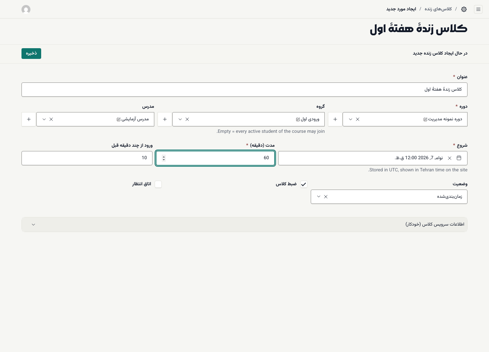
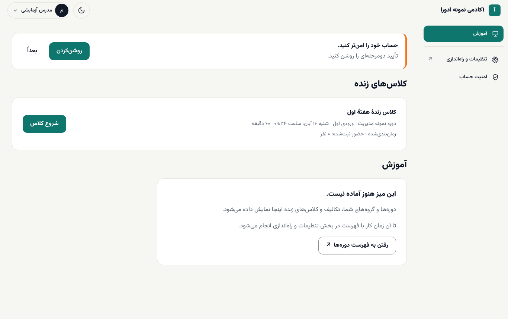
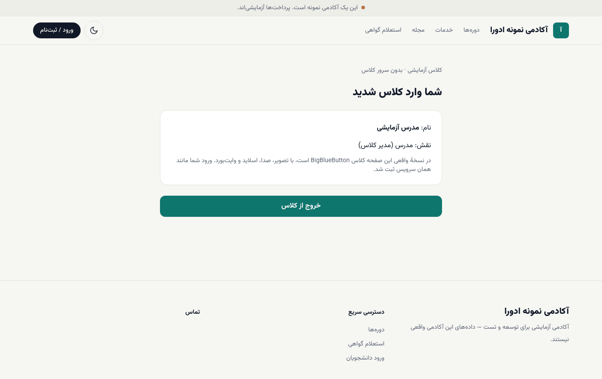
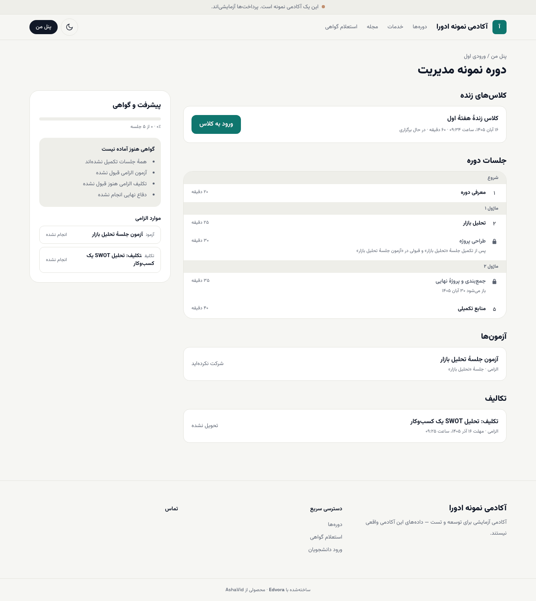
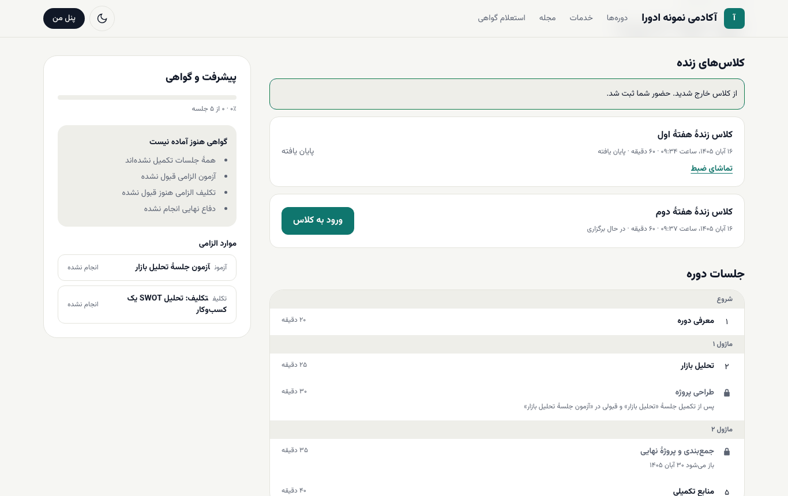
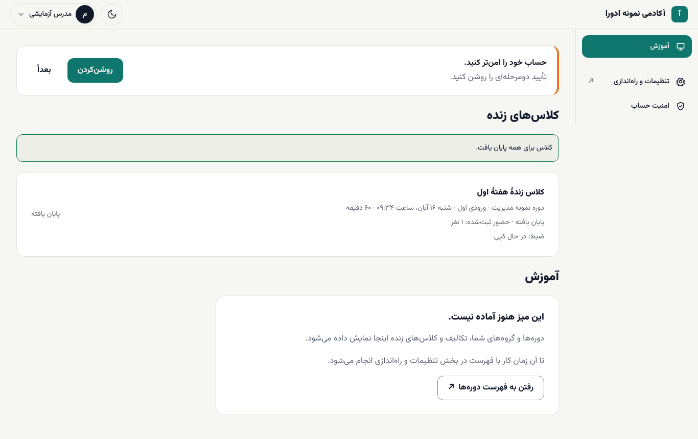
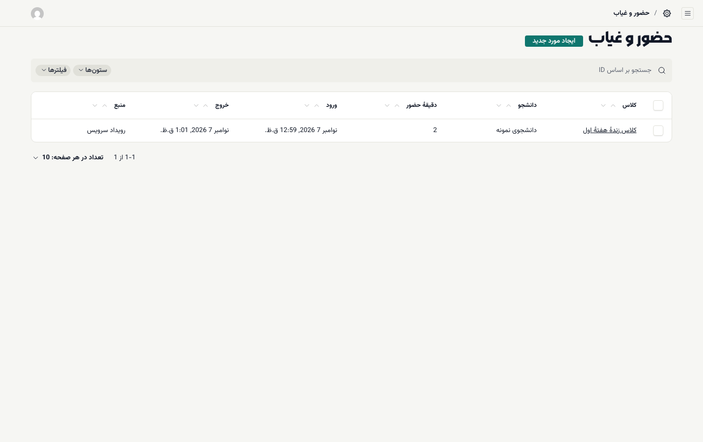

# کلاس آنلاین زنده

ادورا کلاس زنده را زمان‌بندی می‌کند، ورود مدرس و دانشجو را کنترل می‌کند و حضور هر دانشجو را ثبت می‌کند. خود کلاس (تصویر، صدا، اسلاید و وایت‌بورد) روی سرور BigBlueButton برگزار می‌شود.

> **پیش‌نیاز مهم:** برای برگزاری کلاس واقعی، تیم ادورا باید ماژول **Live classes** را برای آکادمی روشن کند و یک سرور BigBlueButton برای آکادمی راه‌اندازی و به ادورا وصل کند. ضبط کلاس هم به فضای ذخیره‌سازی نیاز دارد. تا وقتی سرور وصل نشده، ادورا یک کلاس آزمایشی بدون تصویر و صدا نشان می‌دهد. تصویرهای «کلاس آزمایشی» در این راهنما از همان حالت گرفته شده‌اند.

**چه کسی چه کاری می‌کند:**

| کار | چه کسی |
| --- | --- |
| زمان‌بندی کلاس در بخش مدیریت | مدیر آکادمی (یا نقشی با دسترسی `cohorts.manage`) |
| شروع و پایان کلاس | مدرس همان کلاس (دسترسی `live.host`) |
| ورود به کلاس | دانشجوهای ثبت‌نام‌شده در دوره و ورودی |
| دیدن حضور و غیاب | مدیر آکادمی و مدرس |

## زمان‌بندی کلاس (مدیر آکادمی)

۱. در بخش مدیریت **آموزش ← کلاس‌های زنده** را باز کنید و **ایجاد مورد جدید** را بزنید.

۲. **عنوان** را بنویسید؛ مثلاً «کلاس زندهٔ هفتهٔ اول».

۳. **دوره** را انتخاب کنید.

۴. **گروه** (ورودی) را انتخاب کنید. اگر خالی بماند، همهٔ دانشجوهای فعال دوره می‌توانند وارد شوند.

۵. **مدرس** را انتخاب کنید. فقط همین مدرس (یا مدیر آکادمی) می‌تواند کلاس را شروع کند.

۶. زمان **شروع** را تعیین کنید. این زمان در سایت به وقت تهران نشان داده می‌شود.

۷. **مدت (دقیقه)** را بنویسید (پیش‌فرض ۹۰).

۸. در **ورود از چند دقیقه قبل** تعیین کنید دانشجوها از چند دقیقه پیش از شروع بتوانند وارد شوند (پیش‌فرض ۱۰).

۹. **ضبط کلاس** و **اتاق انتظار** را در صورت نیاز تیک بزنید.

۱۰. **ذخیره** را بزنید. **وضعیت** کلاس **زمان‌بندی‌شده** است.

بخش **اطلاعات سرویس کلاس (خودکار)** را خالی بگذارید؛ ادورا آن را پر می‌کند.

## شروع کلاس (مدرس)

۱. از `/staff/login` وارد شوید. میز **آموزش** باز می‌شود.

۲. زیر **کلاس‌های زنده**، کلاس‌هایی را می‌بینید که مدرسشان شما هستید: دوره، ورودی، زمان، مدت، وضعیت و تعداد حضور ثبت‌شده.

۳. **شروع کلاس** را بزنید. این دکمه از نیم ساعت پیش از زمان شروع فعال می‌شود.

۴. کلاس در همان پنجره باز می‌شود و شما مدیر کلاس هستید.

۵. اگر از کلاس بیرون آمدید، در میز **آموزش** دکمهٔ **بازگشت به کلاس** را بزنید.

## ورود دانشجو

دانشجو کلاس‌های زنده را در صفحهٔ دورهٔ خود (`/learn/<دوره>`)، بالای فهرست جلسه‌ها، زیر **کلاس‌های زنده** می‌بیند:

- پیش از آن‌که مدرس کلاس را شروع کند، دکمه **منتظر شروع مدرس** است.
- وقتی کلاس **در حال برگزاری** است، **ورود به کلاس** را می‌زند و وارد می‌شود. نیازی به نصب برنامه نیست.
- با **خروج از کلاس** به صفحهٔ دوره برمی‌گردد و پیام «از کلاس خارج شدید. حضور شما ثبت شد.» را می‌بیند.

راهنمای دانشجو: [پنل من و جلسه‌ها](../student/02-panel-and-lessons.md#live)

## پایان کلاس

۱. در میز **آموزش**، کنار کلاس در حال برگزاری، **پایان کلاس برای همه** را بزنید.

۲. پیام «کلاس برای همه پایان یافت.» می‌آید و وضعیت کلاس **پایان یافته** می‌شود.

اگر **ضبط کلاس** روشن بوده و سرور کلاس و فضای ذخیره‌سازی آکادمی راه‌اندازی شده باشند، پس از آماده شدن ضبط، دانشجو در صفحهٔ دوره پیوند **تماشای ضبط** را می‌بیند. مدت آماده شدن ضبط به سرور کلاس بستگی دارد.

## حضور و غیاب

حضور دانشجوها خودکار ثبت می‌شود: زمان ورود، زمان خروج و دقیقه‌های حضور.

۱. در بخش مدیریت **آموزش ← حضور و غیاب** را باز کنید.

۲. هر ردیف یک دانشجو در یک کلاس است: **کلاس**، **دانشجو**، **دقیقهٔ حضور**، **ورود**، **خروج** و **منبع**.

۳. **منبع** نشان می‌دهد حضور از کجا ثبت شده: **رویداد سرویس** (خودکار از سرور کلاس)، **گزارش پایان کلاس**، **اصلاح دستی** یا **ورود از فایل**.

تعداد حضور ثبت‌شدهٔ هر کلاس در میز **آموزش** هم کنار همان کلاس دیده می‌شود.

> **اگر … چه کنم؟**
> - دکمهٔ **شروع کلاس** را نمی‌بینید: یا هنوز بیش از نیم ساعت به شروع مانده، یا مدرس این کلاس کس دیگری است، یا ماژول کلاس زنده برای آکادمی روشن نیست.
> - **پیام «اتصال به سرویس کلاس برقرار نشد…»** آمد: سرور کلاس در دسترس نیست. چند لحظه بعد دوباره امتحان کنید و اگر ادامه داشت به مدیر آکادمی خبر دهید.
> - دانشجو می‌گوید «هنوز زمان ورود به این کلاس نرسیده است»: دکمهٔ ورود دانشجو از چند دقیقه پیش از شروع (فیلد **ورود از چند دقیقه قبل**) فعال می‌شود.
> - دانشجو می‌گوید «مدرس هنوز کلاس را شروع نکرده است»: **شروع کلاس** را بزنید.
