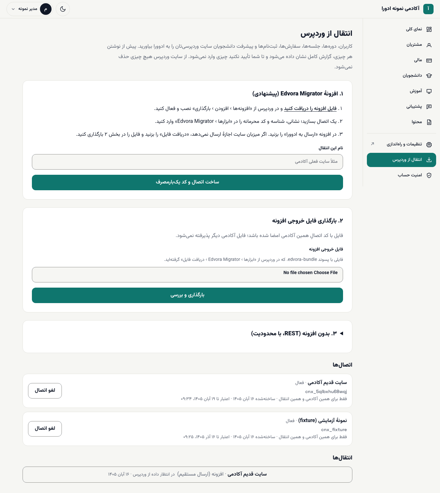
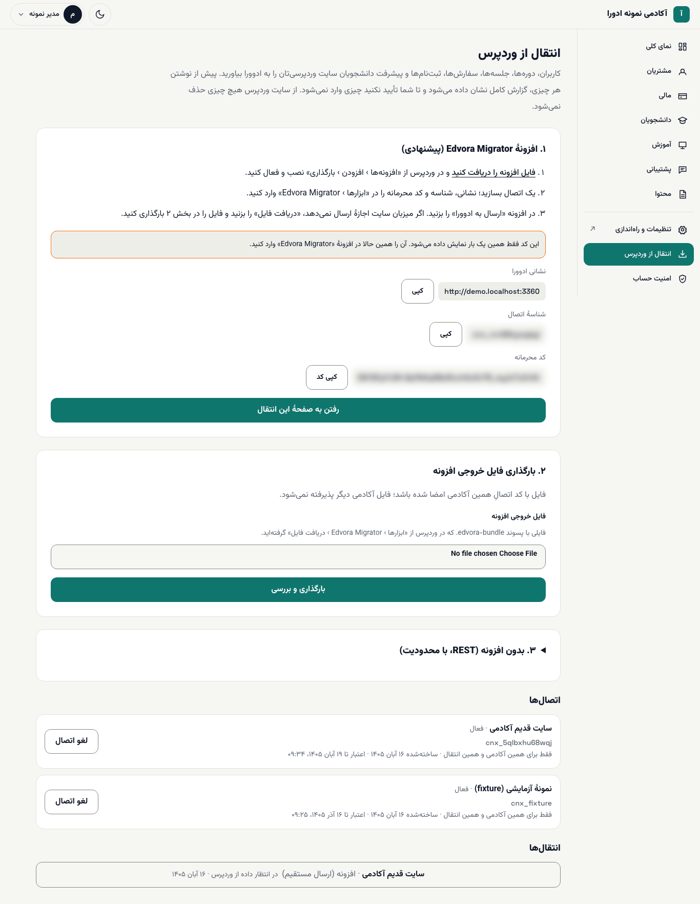
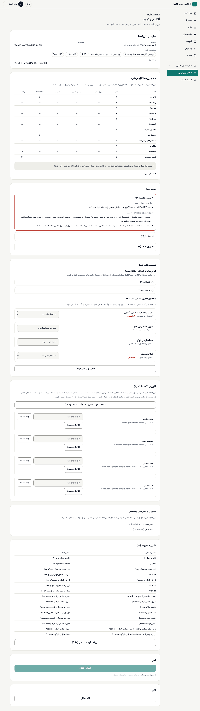
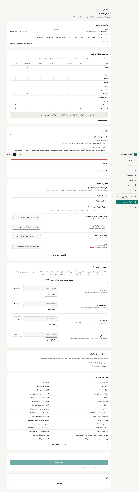
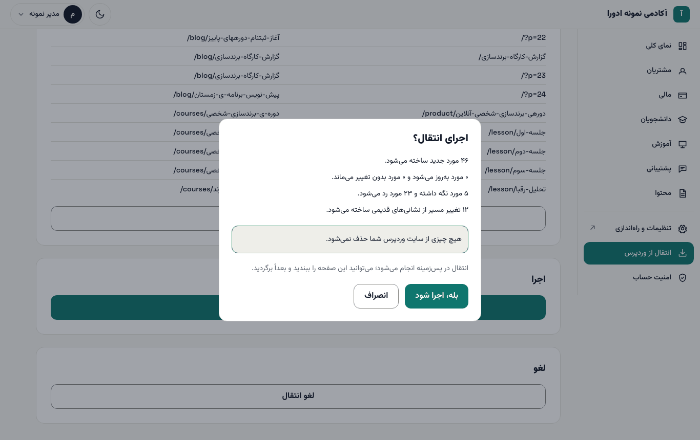
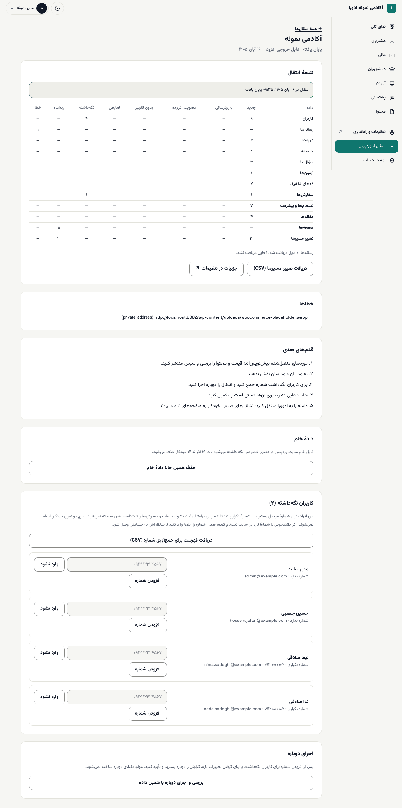
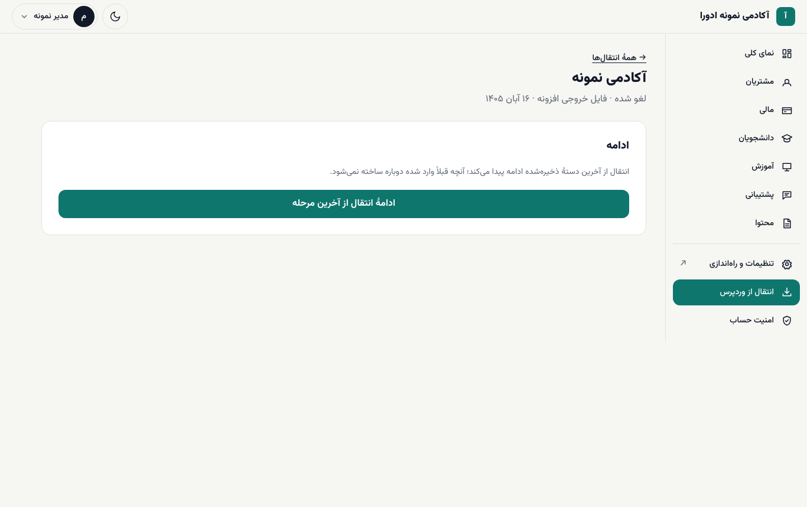
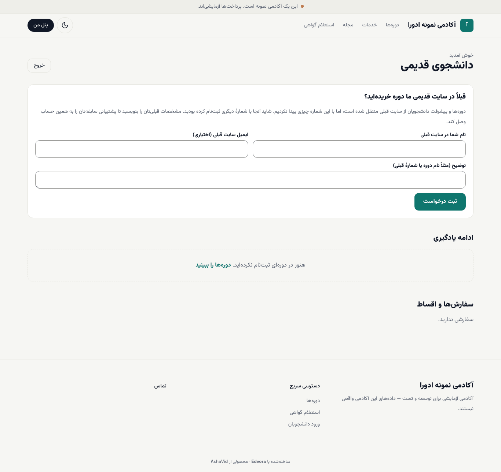

# انتقال آکادمی از وردپرس به ادورا

اگر سایت فعلی آکادمی روی وردپرس است، کاربران، دوره‌ها، جلسه‌ها، آزمون‌ها، سفارش‌ها، کدهای تخفیف، ثبت‌نام‌ها، پیشرفت دانشجوها و مقاله‌ها را با افزونهٔ **Edvora Migrator** به ادورا منتقل می‌کنید. پیش از نوشتن هر چیزی، ادورا گزارش کامل نشان می‌دهد و تا شما تأیید نکنید چیزی وارد نمی‌شود. از سایت وردپرس هیچ چیزی حذف یا تغییر داده نمی‌شود.

**پیش از شروع:**

- در ادورا دسترسی **اجرای انتقال از وردپرس** (`import.run`) داشته باشید. نقش **مدیر آکادمی** این دسترسی را دارد.
- در وردپرس مدیر سایت باشید (اجازهٔ نصب افزونه).
- وردپرس ۵٫۶ یا بالاتر و PHP ۷٫۴ یا بالاتر.
- پشتیبانی‌شده: ووکامرس، LifterLMS و Tutor LMS. صفحه‌های معمولی وردپرس فعلاً منتقل نمی‌شوند.
- چند دقیقه وقت برای خواندن گزارش بگذارید. انتقال خودش در پس‌زمینه انجام می‌شود.

## گام ۱: دریافت و نصب افزونه

۱. از `/staff/login` وارد شوید و در منوی میز کار **انتقال از وردپرس** را باز کنید (`/staff/import`).

۲. در بخش **۱. افزونهٔ Edvora Migrator (پیشنهادی)** روی **فایل افزونه را دریافت کنید** بزنید.

۳. در پیشخوان وردپرس به **افزونه‌ها ← افزودن ← بارگذاری** بروید، فایل را بارگذاری و افزونه را فعال کنید.

افزونه فقط داده‌ها را می‌خواند و هیچ چیزی را در سایت وردپرس تغییر نمی‌دهد. رمزهای عبور، نشست‌ها و رمزهای برنامه هرگز منتقل نمی‌شوند.

## گام ۲: ساختن اتصال

۱. در صفحهٔ **انتقال از وردپرس** ادورا، در **نام این انتقال** یک نام بنویسید؛ مثلاً «سایت قدیم آکادمی».

۲. **ساخت اتصال و کد یک‌بارمصرف** را بزنید.

۳. سه مقدار نمایش داده می‌شود: **نشانی ادوورا**، **شناسهٔ اتصال** و **کد محرمانه**. هر کدام دکمهٔ **کپی** دارد.

۴. در پیشخوان وردپرس، از منوی **ابزارها** صفحهٔ افزونه را باز کنید (در وردپرس فارسی با نام **انتقال به ادوورا**). این سه مقدار را در **نشانی ادوورا**، **شناسه‌ی اتصال** و **کلید محرمانه** بگذارید و **ذخیره‌ی تنظیمات** را بزنید.

۵. **آزمایش اتصال** را بزنید. باید پیام **اتصال برقرار است.** بیاید.

> **هشدار:** کد محرمانه **فقط همین یک بار** نمایش داده می‌شود. آن را همان لحظه در افزونه وارد کنید و جای دیگری ذخیره یا برای کسی ارسال نکنید. هر اتصال فقط برای همین آکادمی و همین انتقال معتبر است و پس از چند روز (تاریخ اعتبار زیر **اتصال‌ها** نوشته شده) یا پس از پایان انتقال باطل می‌شود. اگر کد را گم کردید، **لغو اتصال** را بزنید و اتصال تازه بسازید.

## گام ۳: فرستادن داده از وردپرس

در صفحهٔ افزونه در وردپرس، بخش **خلاصه‌ی پیش از انتقال** افزونه‌های شناسایی‌شده و تعداد رکوردها را نشان می‌دهد. یکی از دو راه را انتخاب کنید:

- **ارسال به ادوورا** (راه پیشنهادی): داده مستقیم به ادورا فرستاده می‌شود. در پایان پیام «انجام شد. برای بازبینی درون‌ریزی به ادوورا برگردید.» می‌آید.
- **دریافت فایل بسته**: اگر میزبان سایت اجازهٔ ارسال نمی‌دهد، فایلی با پسوند `.edvora-bundle` دریافت کنید. بعد در ادورا، بخش **۲. بارگذاری فایل خروجی افزونه**، فایل را انتخاب کنید و **بارگذاری و بررسی** را بزنید. فایل باید با کد اتصال همین آکادمی امضا شده باشد.

اگر ارسال با خطا متوقف شد، دوباره **ارسال به ادوورا** را بزنید؛ بخش‌هایی که قبلاً رسیده‌اند دوباره فرستاده نمی‌شوند.

> **بدون افزونه:** بخش **۳. بدون افزونه (REST، با محدودیت)** برای وقتی است که نصب افزونه ممکن نیست. این روش شمارهٔ موبایلی را که افزونه‌هایی مثل Digits ذخیره کرده‌اند نمی‌بیند و آن دانشجوها نگه داشته می‌شوند. هر وقت ممکن است از افزونه استفاده کنید.

## گام ۴: خواندن گزارش بررسی (اجرای آزمایشی)

پس از رسیدن داده، صفحهٔ همان انتقال با وضعیت **گزارش آماده؛ منتظر تأیید** باز می‌شود. این فقط پیش‌نمایش است و تا «اجرای انتقال» را تأیید نکنید، چیزی در ادورا نوشته نمی‌شود.

بخش‌های گزارش:

- **سایت و افزونه‌ها:** نسخهٔ وردپرس و PHP، افزونه‌های شناسایی‌شده (مثلاً ووکامرس، LifterLMS، Tutor LMS) و **واحد پول** هر کدام. همهٔ مبلغ‌ها به ریال تبدیل می‌شوند.
- **چه چیزی منتقل می‌شود:** جدولی با ستون‌های **جدید**، **به‌روزرسانی**، **بدون تغییر**، **تعارض**، **نگه‌داشته** و **ردشده** برای هر نوع داده.
- **هشدارها:** در سه سطح **مسدودکننده**، **هشدار** و **برای اطلاع**. تا موارد مسدودکننده برطرف نشوند، اجرا ممکن نیست.
- **تصمیم‌های شما:** پرسش‌هایی که فقط شما می‌توانید جواب دهید (پایین‌تر).
- **کاربران نگه‌داشته:** کسانی که شمارهٔ موبایل معتبر ندارند یا شماره‌شان تکراری است.
- **مدیران و مدرسان وردپرس:** این افراد کاربر عادی وارد می‌شوند. نقش‌ها را پس از انتقال دستی بدهید ([کارکنان و نقش‌ها](../academy-admin/03-people-and-roles.md)).
- **تغییر مسیرها:** نشانی‌های قدیمی سایت و صفحهٔ تازه‌ای که به آن منتقل می‌شوند. **دریافت فهرست کامل (CSV)** فهرست کامل را می‌دهد.

### تصمیم‌های شما

۱. **کدام سامانهٔ آموزشی منتقل شود؟** اگر روی سایت هم LifterLMS و هم Tutor فعال است، یکی را انتخاب کنید.

۲. **محصول‌های ووکامرس و دوره‌ها:** هر محصولی که سفارش دارد باید به یک دوره وصل شود. برای هر محصول یکی را انتخاب کنید: یکی از دوره‌ها (گزینهٔ پیشنهادی با «(پیشنهاد)» مشخص است)، **خود محصول یک دورهٔ جدا شود**، یا **دوره نیست؛ سفارش‌هایش منتقل نشود**.

۳. **ذخیره و بررسی دوباره** را بزنید. گزارش با تصمیم‌های شما دوباره ساخته می‌شود.

### کاربران نگه‌داشته

حساب، سفارش‌ها و ثبت‌نام‌های این افراد تا وقتی شماره‌ای برایشان ثبت نشود ساخته نمی‌شود. هیچ دو نفری خودکار ادغام نمی‌شوند. برای هر نفر:

- **افزودن شماره**: شمارهٔ موبایل درست را بنویسید. اگر دانشجو قبلاً با شمارهٔ تازه در سایت ادورا ثبت‌نام کرده، همان شماره را وارد کنید تا سابقه‌اش به حسابش وصل شود.
- **وارد نشود**: این فرد منتقل نمی‌شود.
- **دریافت فهرست برای جمع‌آوری شماره (CSV)**: فهرست را برای تماس با این افراد بگیرید.

## گام ۵: اجرای انتقال

۱. پایین گزارش، **اجرای انتقال** را بزنید.

۲. پنجرهٔ تأیید خلاصه را نشان می‌دهد: چند مورد ساخته، به‌روز، نگه داشته یا رد می‌شود و چند تغییر مسیر ساخته می‌شود.

۳. **بله، اجرا شود** را بزنید.

انتقال در پس‌زمینه انجام می‌شود و می‌توانید صفحه را ببندید و بعداً برگردید. پس از پایان، وضعیت **پایان یافته** و بخش **نتیجهٔ انتقال** نمایش داده می‌شود.

## لغو و ادامه

- **لغو:** تا پیش از پایان، **لغو انتقال** و سپس **بله، لغو شود** را بزنید. وضعیت **لغو شده** می‌شود.
- **ادامه:** در انتقالی که **لغو شده** یا با خطا متوقف شده، **ادامهٔ انتقال از آخرین مرحله** را بزنید. انتقال از آخرین دستهٔ ذخیره‌شده ادامه پیدا می‌کند و آنچه قبلاً وارد شده دوباره ساخته نمی‌شود.
- **اجرای دوباره:** پس از افزودن شماره برای کاربران نگه‌داشته، یا برای گرفتن تغییرات تازهٔ سایت قدیم، در صفحهٔ انتقال پایان‌یافته **بررسی و اجرای دوباره با همین داده** را بزنید. موارد تکراری دوباره ساخته نمی‌شوند و چیزهایی که در ادورا ویرایش کرده‌اید بازنویسی نمی‌شوند؛ آن‌ها در ستون **تعارض** می‌آیند.

## گام ۶: بعد از انتقال چه چیزهایی را بررسی کنم؟

بخش **قدم‌های بعدی** در نتیجهٔ انتقال همین فهرست را دارد:

۱. **دوره‌ها پیش‌نویس‌اند.** در **آموزش ← دوره‌ها** قیمت (به ریال) و محتوای هر دوره را بررسی و سپس منتشر کنید ([ساختن دوره](../academy-admin/04-courses-and-lessons.md)).

۲. **به مدیران و مدرسان نقش بدهید.** همه به‌عنوان کاربر عادی وارد شده‌اند و کارکنان باید رمز تازه بگیرند و تأیید دومرحله‌ای را روشن کنند.

۳. **برای کاربران نگه‌داشته شماره جمع کنید** و انتقال را دوباره اجرا کنید.

۴. **جلسه‌هایی که ویدیویشان دستی است را تکمیل کنید.**

۵. **خطاها را ببینید.** بخش **خطاها** مواردی را که منتقل نشده‌اند (مثلاً تصویری که دریافت نشد) نشان می‌دهد.

۶. **دامنه را به ادورا منتقل کنید.** نشانی‌های قدیمی خودکار به صفحه‌های تازه می‌روند. فهرست را با **دریافت تغییر مسیرها (CSV)** بگیرید و چند نشانی قدیمی را در مرورگر امتحان کنید. تغییر مسیرها در بخش مدیریت، **محتوا ← تغییر مسیرها**، هم دیده می‌شوند.

۷. **دادهٔ خام** سایت وردپرس در فضای خصوصی نگه داشته می‌شود و در تاریخی که در صفحه نوشته شده خودکار حذف می‌شود. با **حذف همین حالا دادهٔ خام** می‌توانید زودتر حذفش کنید.

دانشجویی که در سایت قدیم خرید کرده اما با شمارهٔ دیگری وارد ادورا شده، در **پنل من** کادر «قبلاً در سایت قدیمی ما دوره خریده‌اید؟» را می‌بیند. با نوشتن نام و ایمیل سایت قبلی و زدن **ثبت درخواست**، درخواستش در صفحهٔ همان انتقال برای شما نمایش داده می‌شود.

> **اگر … چه کنم؟**
> - **اجرای انتقال** غیرفعال است و پیام «تا موارد مسدودکننده برطرف نشوند، اجرا ممکن نیست.» آمد: بخش **هشدارها ← مسدودکننده** را بخوانید و در **تصمیم‌های شما** جواب دهید.
> - فایل بارگذاری‌شده پذیرفته نشد: فایل با کد اتصال آکادمی دیگری امضا شده یا خراب است. در وردپرس با اتصال همین آکادمی فایل تازه بگیرید.
> - افزونه پیام «نشانی ادوورا باید با https باشد…» داد: نشانی ادورا را دقیقاً همان‌طور که در صفحهٔ اتصال آمده کپی کنید.
> - کد محرمانه را گم کرده‌اید: **لغو اتصال** را بزنید و اتصال تازه بسازید.
