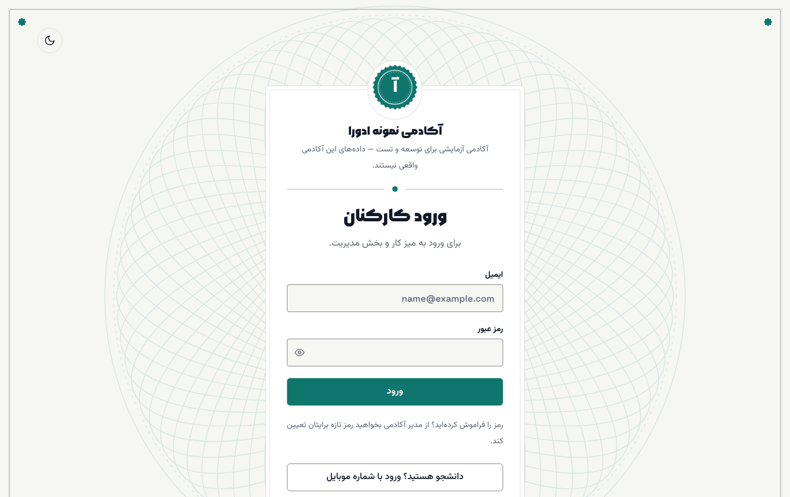
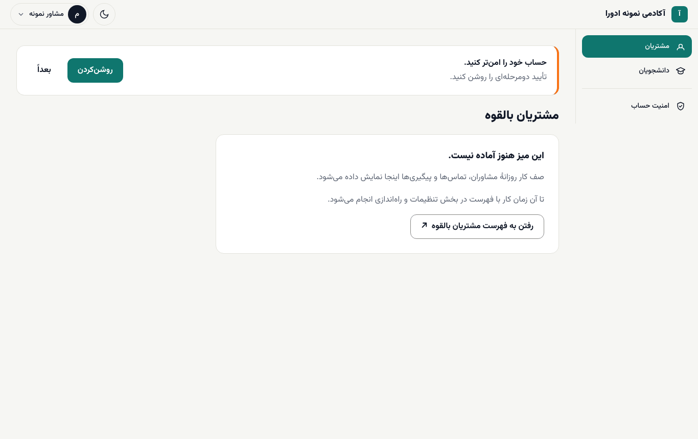
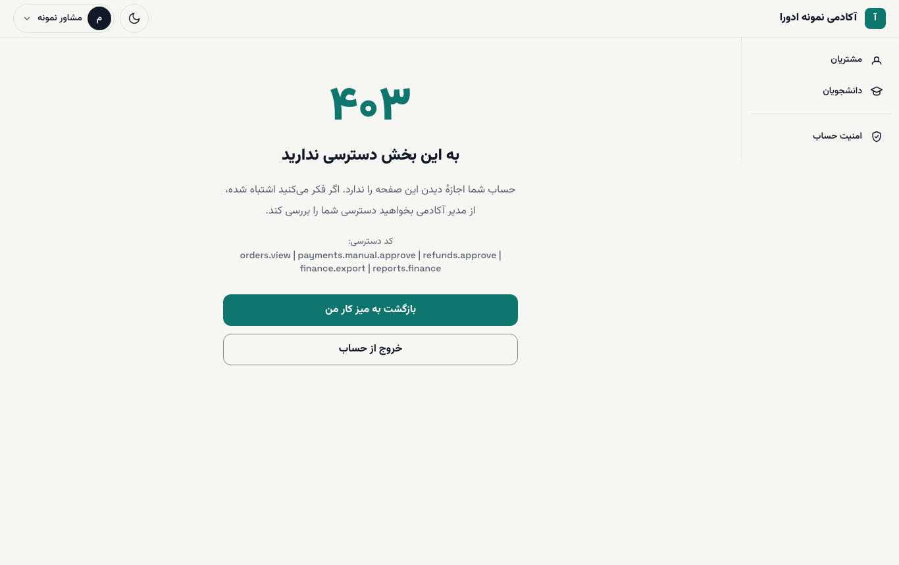

# ورود کارکنان و میزهای کار

این راهنما برای مشاوران فروش، کارشناسان مالی، پشتیبانی و مدرسان است. ورود کارکنان با ایمیل و رمز عبور است، نه با کد پیامکی دانشجوها.

**پیش از شروع:** مدیر آکادمی برایتان حساب ساخته و نقش داده است ([راهنمای مدیر](../academy-admin/03-people-and-roles.md)). ایمیل و رمز را از او بگیرید. نشانی ورود: `/staff/login` روی دامنهٔ آکادمی.

## ورود

۱. به `/staff/login` بروید.

۲. **ایمیل** و **رمز عبور** را بنویسید.

۳. **ورود** را بزنید. اگر تأیید دومرحله‌ای را روشن کرده‌اید، کد شش‌رقمی هم پرسیده می‌شود ([تأیید دومرحله‌ای](02-two-factor.md)).

۴. به میز کار نقش خود می‌روید.

## میز کار و منو

سمت راست صفحه منوی میزهاست. هر کس فقط میزهای نقش خودش را می‌بیند:

| نقش | میزها در منو |
| --- | --- |
| **مشاور فروش** | **مشتریان**، **دانشجویان**، **امنیت حساب** |
| **مالی** | **مالی**، **دانشجویان**، **امنیت حساب** |
| **پشتیبانی** | **دانشجویان**، **پشتیبانی**، **امنیت حساب** |
| **مدرس** | **آموزش**، **تنظیمات و راه‌اندازی**، **امنیت حساب** |
| **مدیر آکادمی** | همهٔ میزها، به‌اضافهٔ **نمای کلی** و **تنظیمات و راه‌اندازی** |

بالای صفحه، روی نام خود بزنید تا منوی کاربر با **مشاهدهٔ سایت** و **خروج** باز شود.

## میزها امروز چه نشان می‌دهند؟

میزهای کار هنوز در حال ساخت‌اند. هر میز فعلاً پیام **«این میز هنوز آماده نیست.»** و توضیح کوتاهی از آیندهٔ خود را نشان می‌دهد. تا آن زمان کار روزانه در بخش مدیریت (`/admin`) انجام می‌شود و بیشتر میزها پیوند مستقیم به فهرست مربوط را دارند:

| میز | پیوند میز | کار امروز |
| --- | --- | --- |
| **مشتریان** | **رفتن به فهرست مشتریان بالقوه** | [کار با سرنخ‌ها](03-advisor-leads.md) |
| **مالی** | **رفتن به فهرست سفارش‌ها** | [مالی](04-finance.md) |
| **آموزش** | **رفتن به فهرست دوره‌ها** | کلاس‌های زندهٔ مدرس روی همین میز است ([کلاس زنده](../instructor/04-live-classes.md))؛ باقی کارها در [راهنمای مدرس](../instructor/01-getting-started.md) |
| **انتقال از وردپرس** | میز کامل (برای مدیر آکادمی) | [انتقال از وردپرس](../migration/wordpress.md) |
| **پشتیبانی** | بدون پیوند | [پشتیبانی](05-support.md) |
| **دانشجویان** | بدون پیوند | فهرست **ثبت‌نام‌ها** و **کاربران** در `/admin` |
| **نمای کلی** | **رفتن به تنظیمات و راه‌اندازی** | [راهنمای مدیر آکادمی](../academy-admin/01-getting-started.md) |

با زدن پیوند به بخش مدیریت می‌روید؛ چون قبلاً وارد شده‌اید، رمز دوباره پرسیده نمی‌شود. برای برگشتن به میز، به `/staff` بروید. میزهای کامل در نسخه‌های بعدی می‌آیند. ([به‌زودی](../coming-soon.md#staff-desks))

بالای میز ممکن است کارت **«حساب خود را امن‌تر کنید.»** را ببینید. با **روشن‌کردن** تأیید دومرحله‌ای را راه بیندازید یا با **بعداً** کارت را ببندید.

> **اگر … چه کنم؟**
> - **پیام «خطا. ایمیل یا رمز عبور درست نیست.»** آمد: ایمیل را بدون فاصله و با حروف کوچک بنویسید. اگر رمز را فراموش کرده‌اید، از مدیر آکادمی بخواهید رمز تازه برایتان تعیین کند.
> - **صفحهٔ «این بخش مخصوص کارکنان آکادمی است»** آمد: حساب شما هنوز نقشی در این آکادمی ندارد، یا با حساب دانشجویی وارد شده‌اید. از مدیر آکادمی بخواهید برایتان «عضویت» بسازد.
> - **صفحهٔ «به این بخش دسترسی ندارید»** (خطای ۴۰۳) آمد: نقش شما این میز را ندارد. **بازگشت به میز کار من** را بزنید. اگر فکر می‌کنید باید دسترسی داشته باشید، **کد دسترسی** نوشته‌شده در صفحه را برای مدیر آکادمی بفرستید.
> - **پیام «ورود موقتاً بسته شده است. چند دقیقه بعد دوباره امتحان کنید.»** آمد: چند بار رمز اشتباه وارد شده. چند دقیقه صبر کنید. [رفع اشکال](../troubleshooting.md#locked-account)

