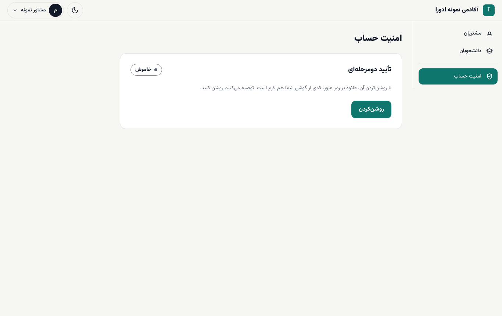
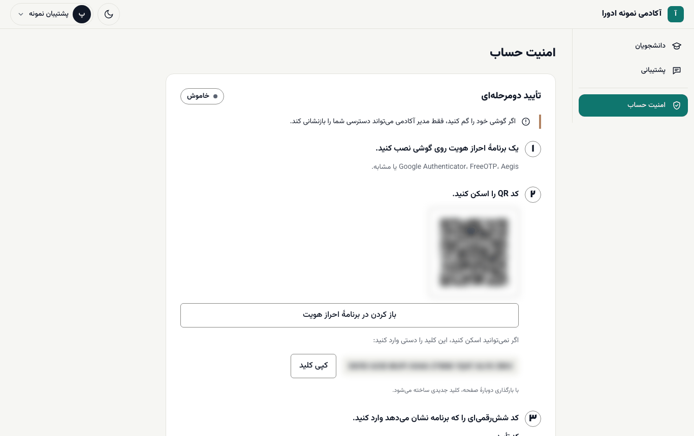
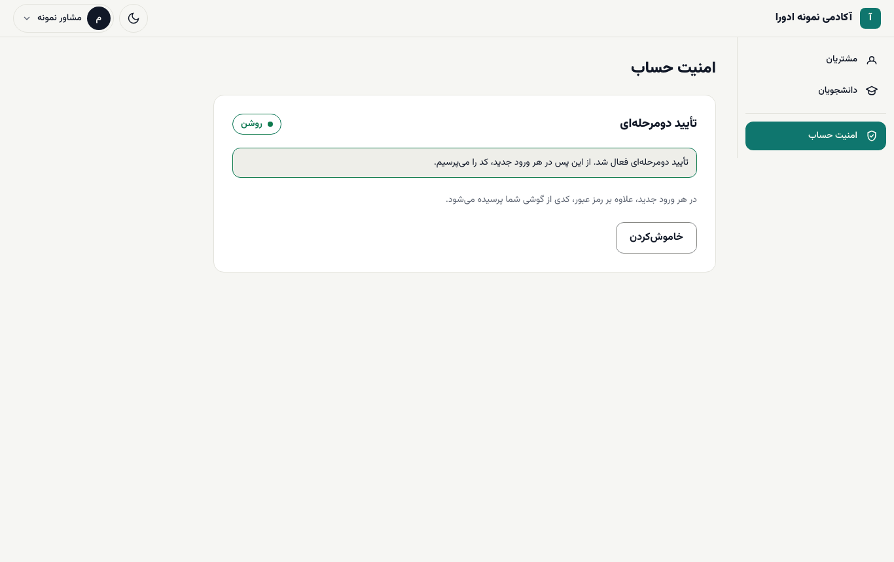
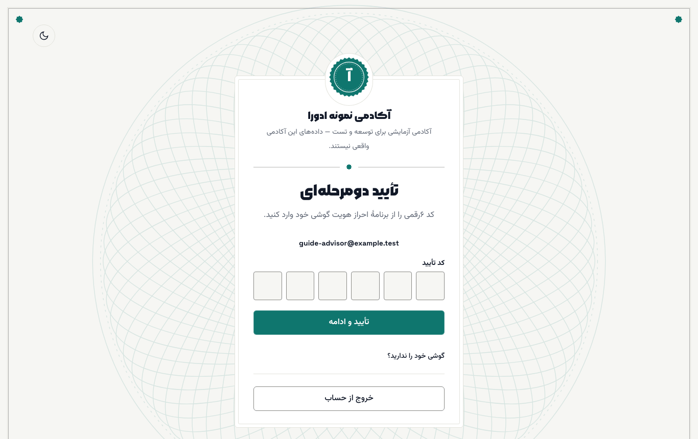
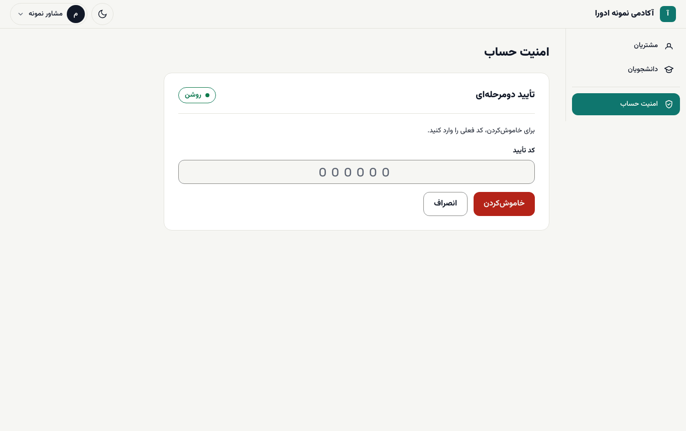
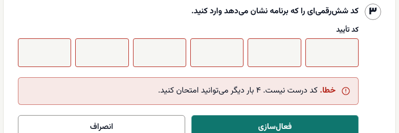

# تأیید دومرحله‌ای

با تأیید دومرحله‌ای، برای ورود علاوه بر رمز عبور یک کد شش‌رقمی هم لازم است که برنامه‌ای روی گوشی شما می‌سازد. اگر کسی رمز شما را بداند، بدون گوشی‌تان نمی‌تواند وارد شود. روشن‌کردن آن را توصیه می‌کنیم، به‌ویژه برای مدیر آکادمی و واحد مالی.

**پیش از شروع:** یک برنامهٔ احراز هویت روی گوشی نصب کنید؛ مثل Google Authenticator، FreeOTP یا Aegis. این برنامه‌ها بدون اینترنت هم کد می‌سازند.

## روشن‌کردن

۱. در منوی میز کار **امنیت حساب** را باز کنید (`/staff/security`).

۲. کنار **تأیید دومرحله‌ای** وضعیت **خاموش** را می‌بینید. **روشن‌کردن** را بزنید و بعد **شروع**.

۳. برنامهٔ احراز هویت گوشی را باز کنید و **کد QR** صفحه را اسکن کنید. اگر روی همین گوشی هستید، **باز کردن در برنامهٔ احراز هویت** را بزنید. اگر اسکن ممکن نیست، **کپی کلید** را بزنید و کلید را دستی در برنامه وارد کنید.

۴. کد شش‌رقمی‌ای را که برنامه نشان می‌دهد در **کد تأیید** بنویسید و **فعال‌سازی** را بزنید.

۵. پیام **«تأیید دومرحله‌ای فعال شد.»** می‌آید. **ادامه** را بزنید.

> **هشدار:** کلید و کد QR را به کسی نشان ندهید و از آن عکس نگیرید. با بارگذاری دوبارهٔ صفحه کلید تازه‌ای ساخته می‌شود؛ پس اسکن و فعال‌سازی را در یک نوبت تمام کنید.

## ورود با کد

از این پس در هر ورود تازه، پس از ایمیل و رمز، صفحهٔ **تأیید دومرحله‌ای** باز می‌شود:

۱. برنامهٔ احراز هویت را باز کنید.

۲. کد شش‌رقمی فعلی را در **کد تأیید** بنویسید. کد هر ۳۰ ثانیه عوض می‌شود.

۳. **تأیید و ادامه** را بزنید.

مدیرانی که تأیید دومرحله‌ای دارند هم برای ورود به بخش مدیریت از همین مسیر وارد شوند: در صفحهٔ ورود `/admin` پیوند **ورود کارکنان و تأیید دومرحله‌ای** را بزنید.

## خاموش‌کردن

۱. **امنیت حساب** را باز کنید و **خاموش‌کردن** را بزنید.

۲. کد فعلی برنامه را در **کد تأیید** بنویسید و دوباره **خاموش‌کردن** را بزنید.

۳. پیام **«تأیید دومرحله‌ای خاموش شد.»** می‌آید.

> **اگر … چه کنم؟**
> - **پیام «خطا. کد درست نیست. … بار دیگر می‌توانید امتحان کنید.»** آمد: ساعت گوشی را بررسی کنید (باید روی تنظیم خودکار باشد) و کد تازه را وارد کنید.
> - **پیام «چند بار کد اشتباه وارد شد. تا ۱۵ دقیقهٔ دیگر امکان ورود ندارید.»** آمد: ۱۵ دقیقه صبر کنید و دوباره امتحان کنید.
> - گوشی را گم کرده‌اید یا برنامه را پاک کرده‌اید: در صفحهٔ کد، **گوشی خود را ندارید؟** را باز کنید. فقط مدیر آکادمی می‌تواند تأیید دومرحله‌ای شما را بازنشانی کند ([راهنمای مدیر](../academy-admin/03-people-and-roles.md#reset-2fa)). پس از بازنشانی با رمز وارد شوید و دوباره آن را روشن کنید.

