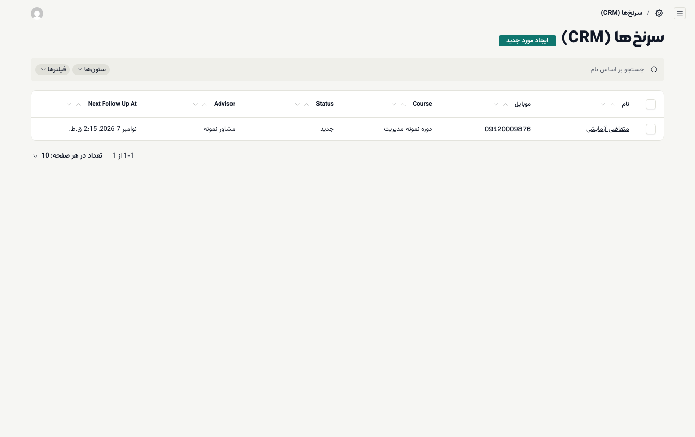
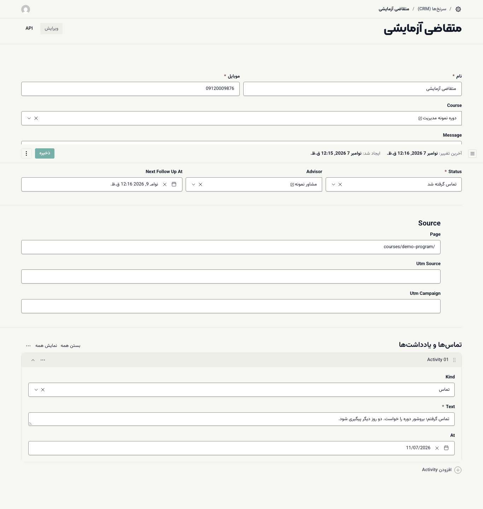

# مشاور فروش: کار با سرنخ‌ها

**سرنخ** کسی است که به دوره علاقه نشان داده و منتظر تماس است؛ معمولاً کسی که فرم **سؤال دارید؟** صفحهٔ دوره را پر کرده. کار مشاور: تماس، ثبت نتیجه، پیگیری تا ثبت‌نام.

**پیش از شروع:** نقش **مشاور فروش** داشته باشید و [وارد شده باشید](01-login-and-desks.md). میز **مشتریان** هنوز آماده نیست؛ کار با سرنخ‌ها در بخش مدیریت انجام می‌شود.

## بازکردن فهرست سرنخ‌ها

۱. در میز **مشتریان**، **رفتن به فهرست مشتریان بالقوه** را بزنید. (یا مستقیم: `/admin/collections/leads`)

۲. فهرست سرنخ‌هایی که به شما سپرده شده با ستون‌های **نام**، **موبایل**، **Course** (دوره)، **Status** (وضعیت)، **Advisor** (مشاور) و **Next Follow Up At** (زمان پیگیری بعدی) باز می‌شود.

شما فقط سرنخ‌هایی را می‌بینید که به خودتان سپرده شده است. سرنخ‌هایی که از سایت می‌آیند اول به کسی سپرده نشده‌اند و مدیر آکادمی آن‌ها را بین مشاوران تقسیم می‌کند. اگر فهرست شما خالی است و پیام «نتیجه‌ای یافت نشد.» را می‌بینید، هنوز سرنخی به شما سپرده نشده است.

## ثبت یک تماس

۱. روی نام سرنخ بزنید.

۲. با شمارهٔ **موبایل** تماس بگیرید. در **Message** پیامی را که متقاضی در فرم نوشته می‌بینید و در **Source** صفحه‌ای را که فرم از آن ارسال شده.

۳. پایین فرم، زیر **تماس‌ها و یادداشت‌ها**، **افزودن Activity** را بزنید.

۴. در **Kind** نوع کار را انتخاب کنید: **تماس**، **یادداشت** یا **SMS**.

۵. در **Text** نتیجه را کوتاه بنویسید؛ مثلاً «بروشور خواست. پنجشنبه دوباره تماس بگیرم.»

۶. **Status** را به‌روز کنید (جدول زیر).

۷. **ذخیره** را بزنید.

## وضعیت‌ها و زمان پیگیری

وضعیت هر سرنخ فقط در مسیر مشخصی جلو می‌رود. با هر تغییر وضعیت، **Next Follow Up At** خودکار تنظیم می‌شود:

| وضعیت | بعد از آن می‌تواند برود به | پیگیری بعدی خودکار |
| --- | --- | --- |
| **جدید** | **تماس گرفته شد**، **از دست رفت** | ۲ ساعت بعد |
| **تماس گرفته شد** | **پیگیری**، **ثبت‌نام کرد**، **از دست رفت** | ۴۸ ساعت بعد |
| **پیگیری** | **تماس گرفته شد**، **ثبت‌نام کرد**، **از دست رفت** | ۷۲ ساعت بعد |
| **ثبت‌نام کرد** | (پایان) | ندارد |
| **از دست رفت** | **پیگیری** | ۳۰ روز بعد |

زمان پیگیری را می‌توانید دستی هم تغییر دهید. برای دیدن کارهای امروز، روی سرتیتر ستون **Next Follow Up At** بزنید تا فهرست به ترتیب زمان پیگیری مرتب شود.

## افزودن سرنخ دستی

اگر کسی تلفنی یا حضوری تماس گرفته:

۱. در فهرست سرنخ‌ها **ایجاد مورد جدید** را بزنید.

۲. **نام** و **موبایل** را بنویسید و در صورت امکان **Course** را انتخاب کنید.

۳. **ذخیره** را بزنید. سرنخی که خودتان بسازید خودکار به شما سپرده می‌شود.

> **اگر … چه کنم؟**
> - هنگام ذخیره پیامی مثل `Lead cannot move from … to …` آمد: این تغییر وضعیت مجاز نیست (جدول بالا). وضعیت مجاز بعدی را انتخاب کنید.
> - پیامی دربارهٔ **leads.assign** آمد: نمی‌توانید سرنخ را به مشاور دیگری بسپارید. از مدیر آکادمی بخواهید.
> - می‌خواهید سفارش متقاضی را ببینید: نقش مشاور به **سفارش‌ها** دسترسی ندارد؛ از واحد مالی بپرسید.
> - متقاضی ثبت‌نام کرد: وضعیت را **ثبت‌نام کرد** بگذارید. ثبت‌نام و پرداخت را خود دانشجو از صفحهٔ دوره انجام می‌دهد ([راهنمای دانشجو](../student/01-start.md)).
