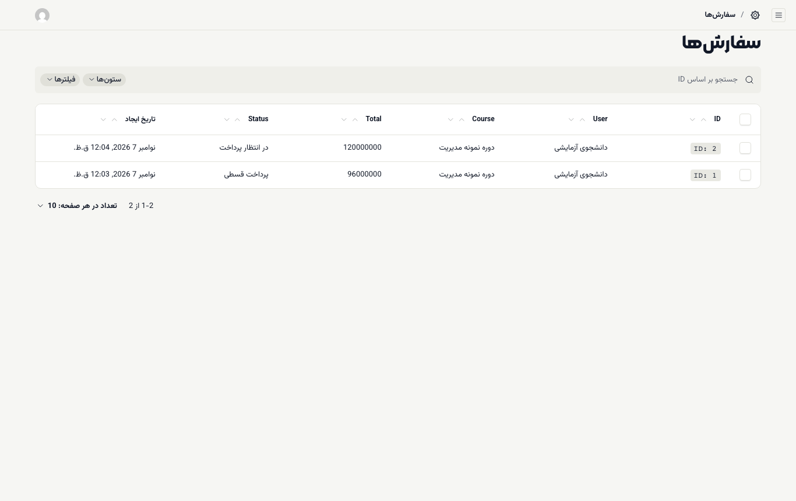
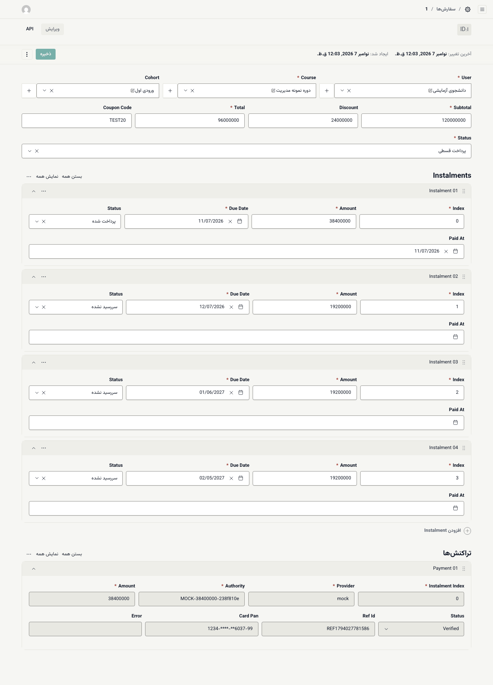

# مالی: سفارش‌ها و اقساط

**پیش از شروع:** نقش **مالی** داشته باشید و [وارد شده باشید](01-login-and-desks.md). میز **مالی** هنوز آماده نیست؛ کار در بخش مدیریت انجام می‌شود.

## دیدن سفارش‌ها

۱. در میز **مالی**، **رفتن به فهرست سفارش‌ها** را بزنید (یا مستقیم: `/admin/collections/orders`).

۲. هر ردیف یک سفارش است: **ID** (شمارهٔ سفارش)، **User** (دانشجو)، **Course**، **Total** و **Status**.

> **مبلغ‌ها در بخش مدیریت به ریال‌اند.** عدد `96000000` در ستون **Total** یعنی ۹٬۶۰۰٬۰۰۰ تومان. دانشجو همین مبلغ را در پنلش به تومان می‌بیند.

## خواندن یک سفارش

روی شمارهٔ سفارش بزنید:

- **Subtotal**، **Discount**، **Total** و **Coupon Code:** مبلغ پیش از تخفیف، تخفیف، مبلغ نهایی و کد تخفیف استفاده‌شده.
- **Status:** وضعیت کل سفارش؛ مثلاً **پرداخت قسطی**. معنای همهٔ وضعیت‌ها در [راهنمای مدیر](../academy-admin/06-sales-orders-leads.md#orders) آمده است.
- **Instalments:** هر قسط با **Amount** (مبلغ)، **Due Date** (سررسید)، **Status** (**سررسید نشده** یا **پرداخت شده**) و **Paid At** (زمان پرداخت).
- **تراکنش‌ها:** هر بار مراجعهٔ دانشجو به درگاه، با **Provider** (درگاه)، **Authority** (شناسهٔ تراکنش درگاه)، **Amount**، **Status** (**Started**، **Verified** یا **Failed**)، **Ref Id** (شمارهٔ پیگیری بانک) و **Card Pan** (شمارهٔ کارت، به شکلی که درگاه برمی‌گرداند).

## پاسخ به دانشجویی که می‌گوید پرداخت کرده‌ام

۱. سفارش دانشجو را پیدا کنید: در کادر جست‌وجو یا با **فیلترها** روی **User**.

۲. در **تراکنش‌ها** دنبال تراکنشی با همان مبلغ و زمان بگردید.

۳. اگر وضعیتش **Verified** است، قسط باید **پرداخت شده** باشد. **Ref Id** را با شمارهٔ پیگیری‌ای که دانشجو دارد مقایسه کنید.

۴. اگر **Failed** یا **Started** است، پرداخت در درگاه کامل نشده. طبق قوانین بانکی، مبلغ کسرشده حداکثر تا ۷۲ ساعت به حساب دانشجو برمی‌گردد.

## کارهایی که هنوز ممکن نیست

ثبت رسید دستی (کارت‌به‌کارت)، تأیید بازگشت وجه و خروجی گرفتن از سفارش‌ها در میز **مالی** می‌آیند. ([به‌زودی](../coming-soon.md#staff-desks)) تا آن زمان، هر تغییر دستی در سفارش را با مدیر آکادمی هماهنگ کنید؛ همهٔ تغییرها در گزارش ممیزی ثبت می‌شوند.

> **اگر … چه کنم؟**
> - فهرست سفارش‌ها را نمی‌بینید یا صفحهٔ «به این بخش دسترسی ندارید» می‌آید: نقش شما دسترسی `orders.view` ندارد. از مدیر آکادمی بخواهید نقشتان را بررسی کند.
> - مبلغ‌ها عجیب به نظر می‌رسند: یادتان باشد بخش مدیریت ریال نشان می‌دهد، نه تومان.
