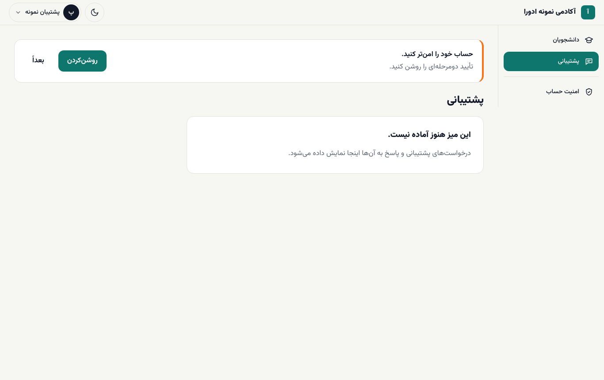

# پشتیبانی

**پیش از شروع:** نقش **پشتیبانی** داشته باشید و [وارد شده باشید](01-login-and-desks.md).

میز **پشتیبانی** (ثبت و پاسخ به درخواست‌های دانشجوها) **به‌زودی** می‌آید و فعلاً پیام «این میز هنوز آماده نیست.» را نشان می‌دهد. ([به‌زودی](../coming-soon.md#staff-desks))

## امروز چه کار می‌توانید بکنید؟

درخواست‌ها را از همان مسیری که آکادمی تا امروز داشته (تلفن، پیام‌رسان) بگیرید. برای پاسخ، این صفحه‌های راهنما بیشترین کمک را می‌کنند:

| دانشجو می‌گوید | جواب در |
| --- | --- |
| «کد ورود نمی‌آید» یا «کد را قبول نمی‌کند» | [ورود دانشجو](../student/01-start.md#sms-login) و [رفع اشکال](../troubleshooting.md#sms-not-received) |
| «پول کم شد ولی ثبت‌نام نشدم» | [سفارش‌ها و اقساط](../student/05-orders-and-instalments.md) و [مالی](04-finance.md#payment-dispute) |
| «جلسهٔ بعد باز نمی‌شود» | [جلسه‌های قفل](../student/02-panel-and-lessons.md#locked-lessons) |
| «فرصت آزمونم تمام شد» | [فرصت اضافهٔ آزمون](../academy-admin/06-sales-orders-leads.md#enrollments) (کار مدیر آکادمی) |
| «گواهی‌ام کو؟» | [پیشرفت و گواهی](../student/07-progress.md) |

در بخش مدیریت می‌توانید **کاربران** و **ثبت‌نام‌ها** را ببینید تا وضعیت دانشجو را بررسی کنید. تغییر اطلاعات و کارهای مالی با نقش شما ممکن نیست؛ آن‌ها را به مدیر آکادمی یا واحد مالی بسپارید.
