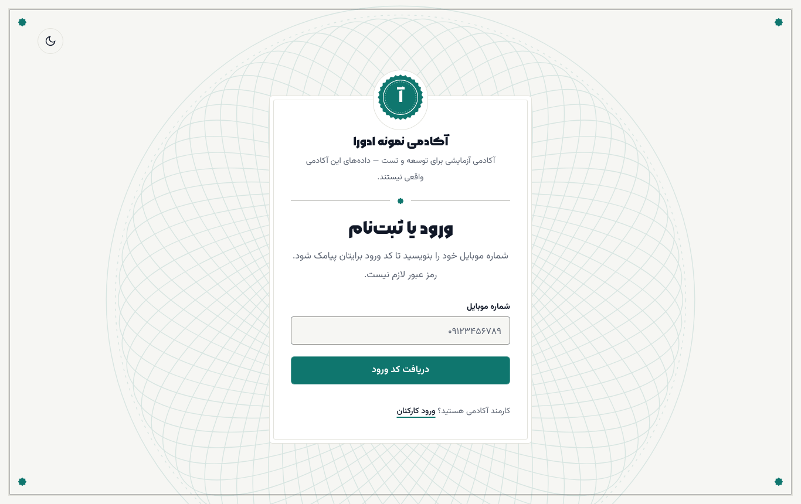
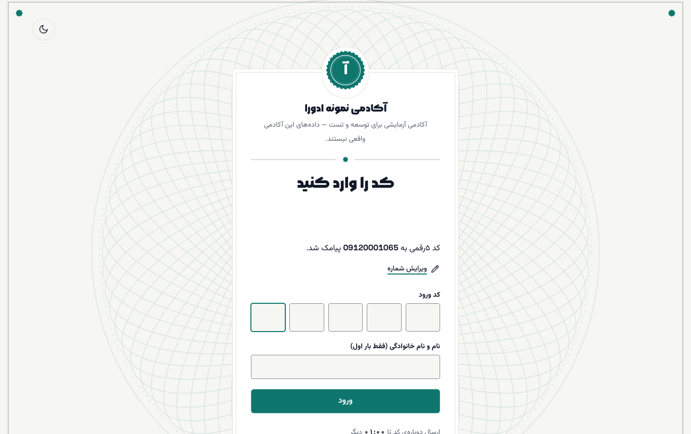
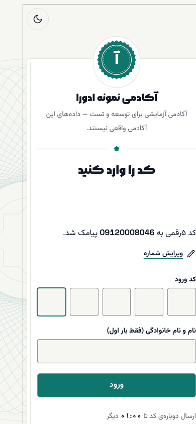
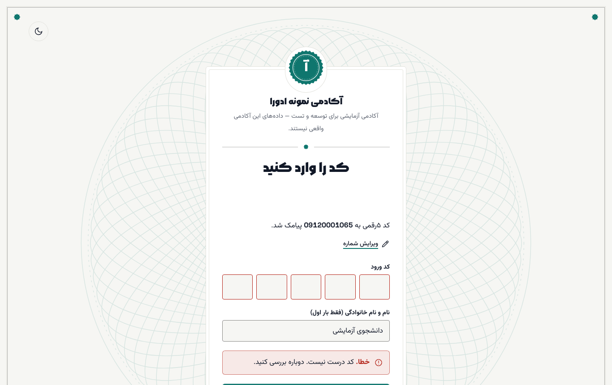
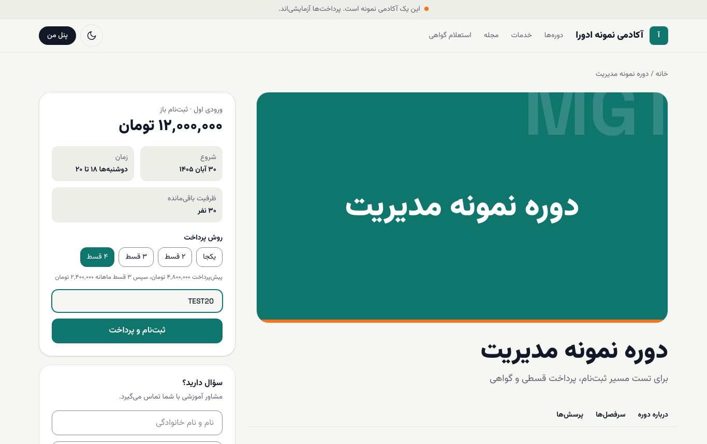
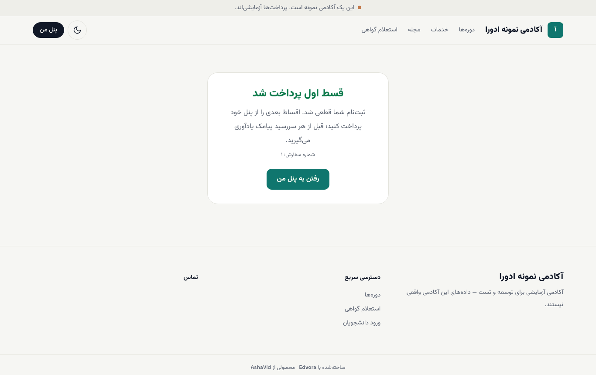
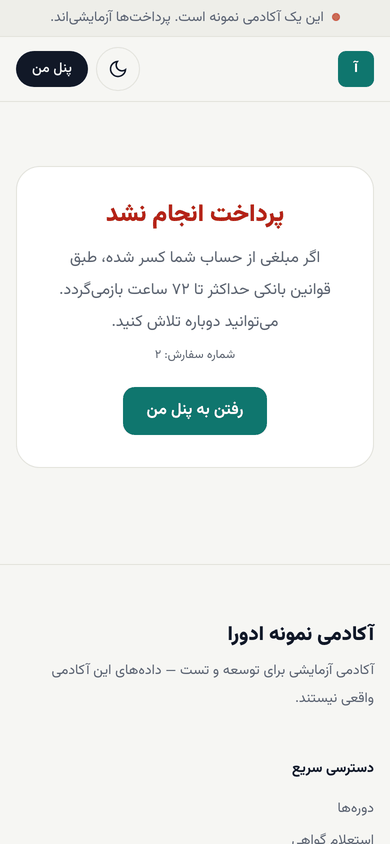

# شروع: ورود و ثبت‌نام در دوره

در این صفحه با شمارهٔ موبایل وارد سایت آکادمی می‌شوید، دوره را انتخاب می‌کنید و هزینه را یکجا یا قسطی می‌پردازید. رمز عبور لازم نیست؛ هر بار یک کد پیامکی می‌گیرید.

**پیش از شروع:** گوشی‌ای که شماره‌اش را وارد می‌کنید باید کنارتان باشد. نشانی ورود: `/login` روی دامنهٔ آکادمی (مثلاً `https://academy.example/login`).

## ورود با کد پیامکی

۱. در سایت آکادمی روی **پنل من** بزنید یا مستقیم به `/login` بروید.

۲. در کادر **شماره موبایل** شماره‌تان را بنویسید (با ۰۹ شروع می‌شود و ۱۱ رقم دارد) و **دریافت کد ورود** را بزنید.

۳. کد ۵رقمی پیامک‌شده را در **کد ورود** بنویسید. هر کد ۲ دقیقه اعتبار دارد.

۴. اگر بار اول است که وارد می‌شوید، **نام و نام خانوادگی** را هم بنویسید. این نام روی پنل و گواهی شما می‌آید؛ بار بعد دیگر پرسیده نمی‌شود.

۵. **ورود** را بزنید. به **پنل من** می‌روید.

اگر شماره را اشتباه زده‌اید، **ویرایش شماره** را بزنید. پس از حدود یک دقیقه، پیوند **کد نرسید؟ ارسال دوباره** فعال می‌شود.

> **اگر … چه کنم؟**
> - **پیام «کد درست نیست. دوباره بررسی کنید.»** آمد: رقم‌ها را دوباره نگاه کنید. کد فارسی یا انگلیسی فرقی نمی‌کند.
> - **پیام «کد منقضی شده است. کد تازه بگیرید.»** یا **«چند بار کد اشتباه وارد شد. کد تازه بگیرید.»** آمد: **ارسال دوباره** را بزنید و کد جدید را وارد کنید.
> - **پیام «ورود با این شماره ممکن نیست…»** آمد: حساب شما غیرفعال شده است. با پشتیبانی آکادمی تماس بگیرید.
> - پیامک نرسید: یک دقیقه صبر کنید و **ارسال دوباره** را بزنید. جزئیات بیشتر در [رفع اشکال](../troubleshooting.md#sms-not-received).

## انتخاب دوره و پرداخت

۱. از منوی بالا **دوره‌ها** را باز کنید و دوره را انتخاب کنید.

۲. در کارت کنار صفحه، ورودی، تاریخ شروع، زمان کلاس‌ها و **ظرفیت باقی‌مانده** را می‌بینید.

۳. در **روش پرداخت** یکی از گزینه‌ها را انتخاب کنید: **یکجا** یا چند قسط. زیر گزینه‌ها مبلغ پیش‌پرداخت و مبلغ هر قسط ماهانه نوشته می‌شود.

۴. اگر کد تخفیف دارید، در کادر **کد تخفیف (اختیاری)** بنویسید.

۵. **ثبت‌نام و پرداخت** را بزنید. به درگاه بانکی آکادمی می‌روید.

۶. پرداخت را در درگاه کامل کنید. پس از بازگشت به سایت، صفحهٔ نتیجه را می‌بینید. در پرداخت قسطی، عنوان صفحه **قسط اول پرداخت شد** است و ثبت‌نام شما قطعی می‌شود.

۷. **رفتن به پنل من** را بزنید.

مبلغ‌ها در سایت به **تومان** نمایش داده می‌شوند. اگر اول وارد نشده باشید، سایت پیش از پرداخت شما را به صفحهٔ ورود می‌برد.

> **اگر … چه کنم؟**
> - **صفحهٔ «پرداخت انجام نشد»** آمد: اگر مبلغی از حسابتان کم شده، طبق قوانین بانکی حداکثر تا ۷۲ ساعت برمی‌گردد. می‌توانید دوباره از صفحهٔ دوره ثبت‌نام کنید.
> - **پیام «کد تخفیف معتبر نیست.»** یا «مهلت این کد تخفیف تمام شده است.» آمد: کد را بدون فاصله دوباره بنویسید یا کادر را خالی بگذارید و بدون تخفیف ادامه دهید.
> - سؤالی پیش از ثبت‌نام دارید: در کارت **سؤال دارید؟** پایین همان صفحه نام و موبایل خود را بنویسید و **درخواست تماس مشاور** را بزنید. مشاور آکادمی با شما تماس می‌گیرد.

## بعد از این

- [پنل و جلسه‌ها](02-panel-and-lessons.md): از کجا درس را ادامه دهید.
- [سفارش‌ها و اقساط](05-orders-and-instalments.md): پرداخت قسط‌های بعدی.
- واژه‌ای ناآشنا بود؟ [واژه‌نامه](../glossary.md)
