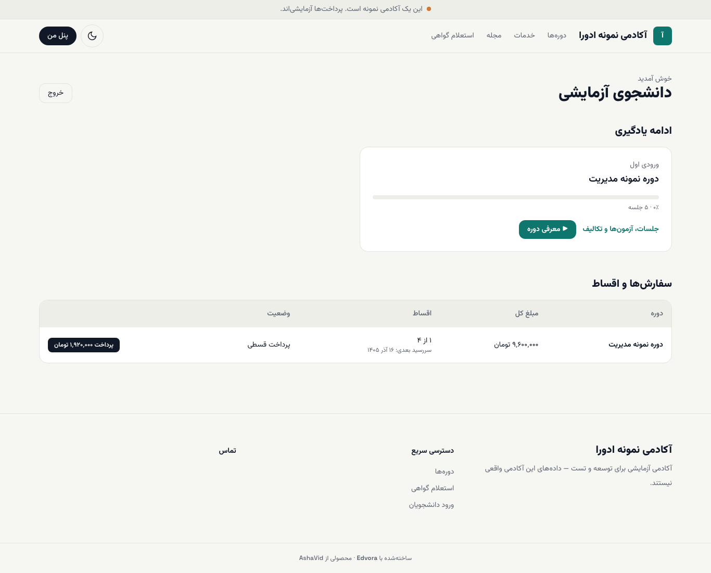
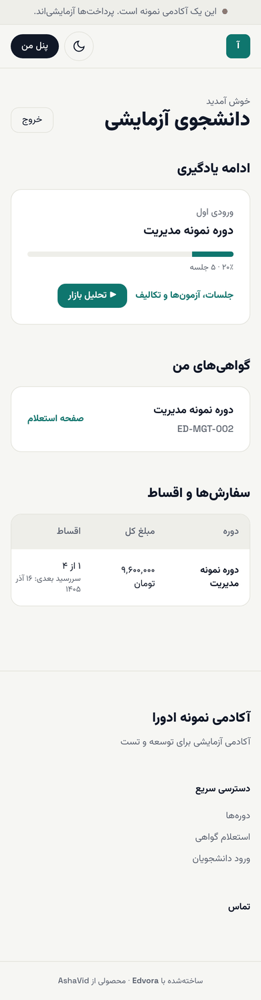
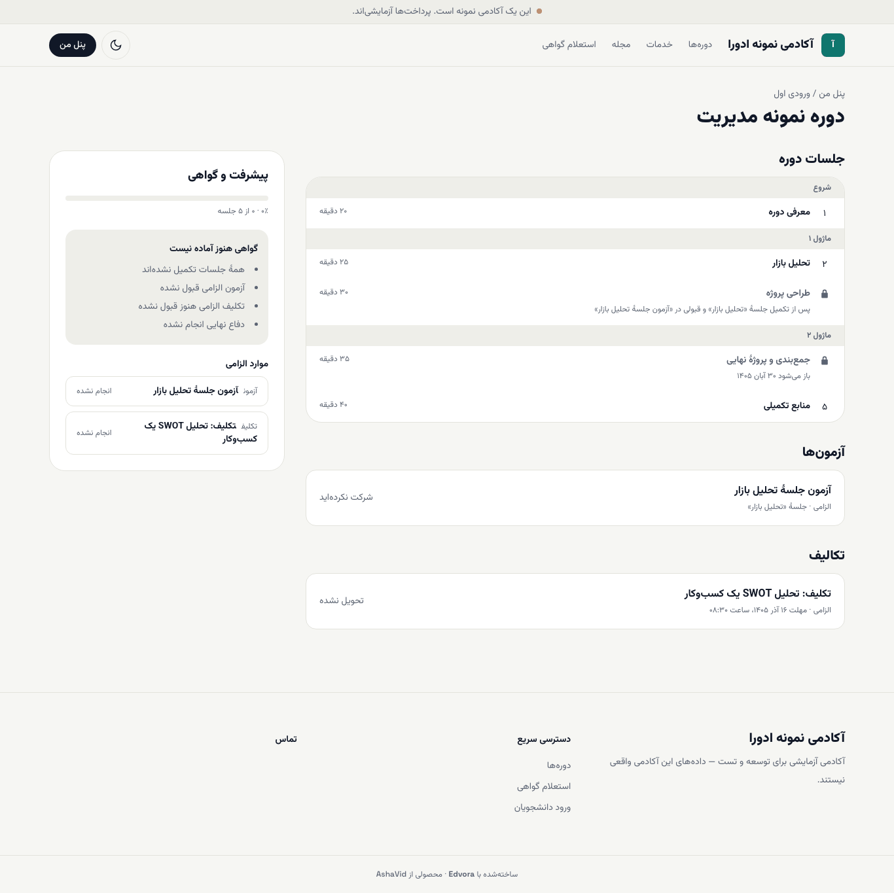
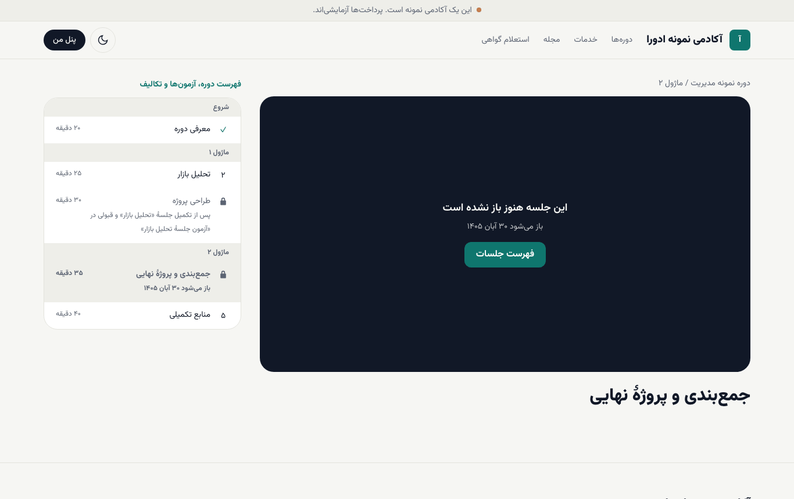
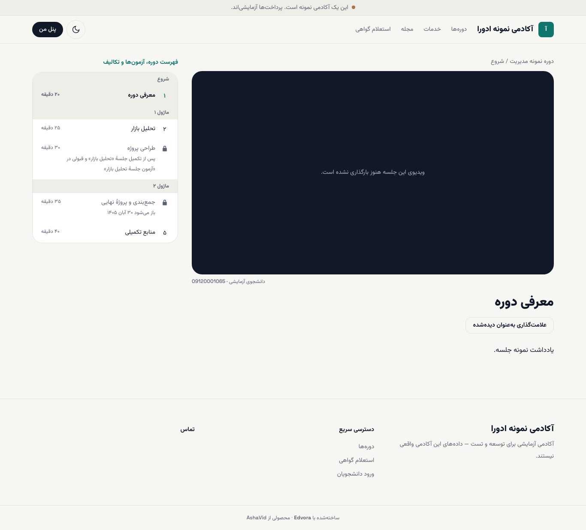
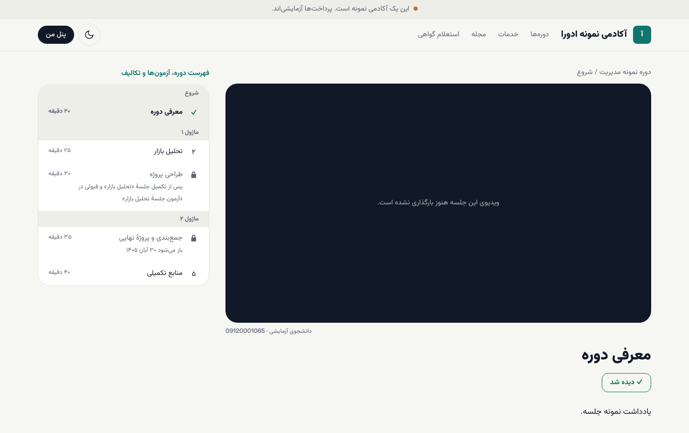
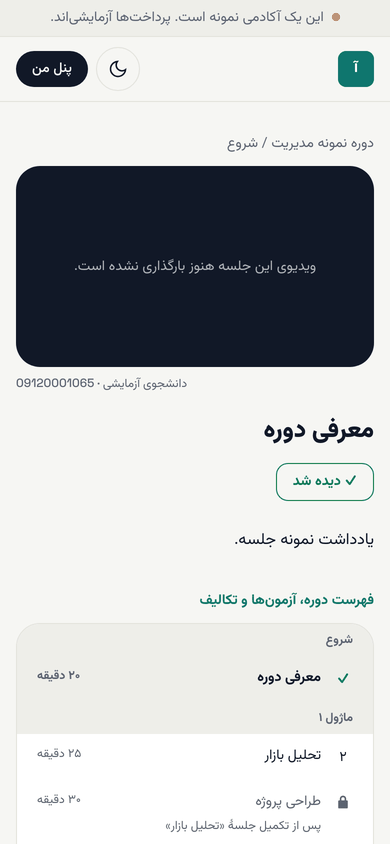

# پنل من و جلسه‌های دوره

**پنل من** (`/dashboard`) نقطهٔ شروع هر بار آمدن به سایت است. از اینجا جلسه‌ها، آزمون‌ها، تکلیف‌ها، اقساط و گواهی‌ها را پیدا می‌کنید.

**پیش از شروع:** وارد شده باشید ([ورود](01-start.md)) و در دست‌کم یک دوره ثبت‌نام کرده باشید.

## پنل من چه دارد؟

- **ادامه یادگیری:** هر دوره‌ای که در آن ثبت‌نام کرده‌اید، با نام ورودی، درصد پیشرفت و تعداد جلسه‌ها. دکمهٔ **جلسات، آزمون‌ها و تکالیف** صفحهٔ دوره را باز می‌کند و دکمهٔ کنارش (با علامت ▶ و نام جلسه) شما را مستقیم به جلسهٔ بعدی می‌برد.
- **گواهی‌های من:** فقط وقتی دیده می‌شود که آکادمی برایتان گواهی صادر کرده باشد. ([گواهی و استعلام](06-certificates-and-verify.md))
- **سفارش‌ها و اقساط:** مبلغ کل، تعداد قسط‌های پرداخت‌شده، سررسید بعدی و دکمهٔ پرداخت قسط. ([سفارش‌ها و اقساط](05-orders-and-instalments.md))
- **خروج:** کنار نام شما، بالای پنل.

اگر هنوز در دوره‌ای ثبت‌نام نکرده‌اید، پنل می‌نویسد «هنوز در دوره‌ای ثبت‌نام نکرده‌اید» و پیوند **دوره‌ها را ببینید** را نشان می‌دهد.

## صفحهٔ دوره: فهرست جلسه‌ها

۱. در پنل، **جلسات، آزمون‌ها و تکالیف** را بزنید.

۲. جلسه‌ها به ترتیب و بر اساس فصل (ماژول) فهرست شده‌اند. جلوی هر جلسه مدت آن آمده است.

۳. پایین‌تر، بخش‌های **آزمون‌ها**، **تکالیف** و **پیشرفت و گواهی** را می‌بینید.

### جلسه‌های قفل

بعضی جلسه‌ها هنوز باز نیستند. زیر نام هر جلسهٔ قفل، دلیلش نوشته شده است:

- **باز می‌شود** و یک تاریخ: جلسه در آن روز باز می‌شود.
- **پس از تکمیل جلسهٔ «…»**: اول جلسهٔ قبلی را کامل کنید. اگر آن جلسه آزمون الزامی دارد، قبولی در آزمون هم لازم است.

جلسه‌ای که یک بار برایتان باز شده، دیگر قفل نمی‌شود؛ حتی اگر آکادمی تاریخ‌ها را تغییر دهد.

## دیدن جلسه و ثبت «دیده شد»

۱. روی نام جلسه بزنید.

۲. ویدیو را ببینید و یادداشت‌ها و منابع زیر آن را بخوانید.

۳. در پایان، **علامت‌گذاری به‌عنوان دیده‌شده** را بزنید. دکمه به **✓ دیده شد** تغییر می‌کند و درصد پیشرفت دوره بالا می‌رود.

۴. از فهرست کنار صفحه (**فهرست دوره، آزمون‌ها و تکالیف**) به جلسهٔ بعد بروید.

> **اگر … چه کنم؟**
> - **پیام «ویدیوی این جلسه هنوز بارگذاری نشده است.»** را دیدید: آکادمی هنوز ویدیو را اضافه نکرده است. یادداشت‌ها و منابع را بخوانید یا از پشتیبانی بپرسید.
> - جلسهٔ بعدی باز نشد: ببینید زیر نامش چه شرطی نوشته شده. معمولاً یا **دیده شد** را نزده‌اید یا آزمون همان جلسه را هنوز قبول نشده‌اید.
> - روی موبایل فهرست جلسه‌ها را نمی‌بینید: صفحه را پایین بکشید؛ فهرست زیر ویدیو و یادداشت‌ها می‌آید.

## بعد از این

- [آزمون‌ها](03-quizzes.md)
- [تکلیف‌ها](04-assignments.md)
