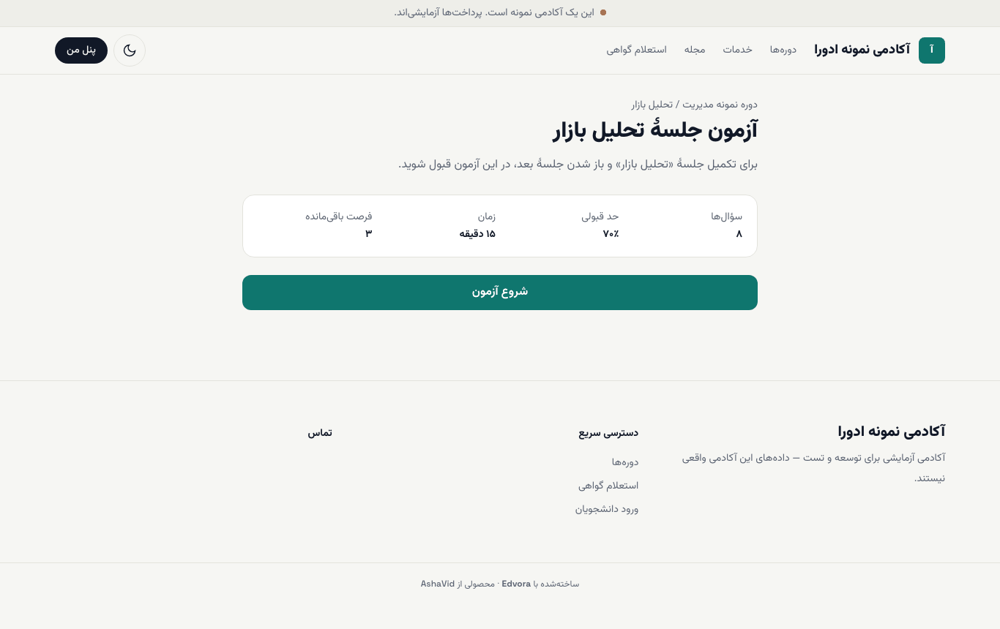
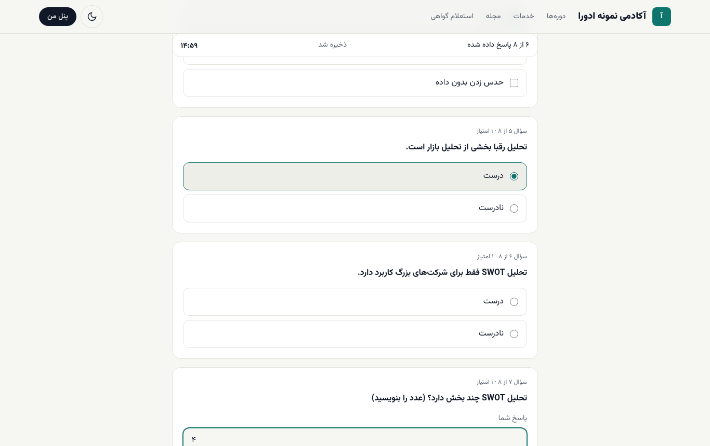
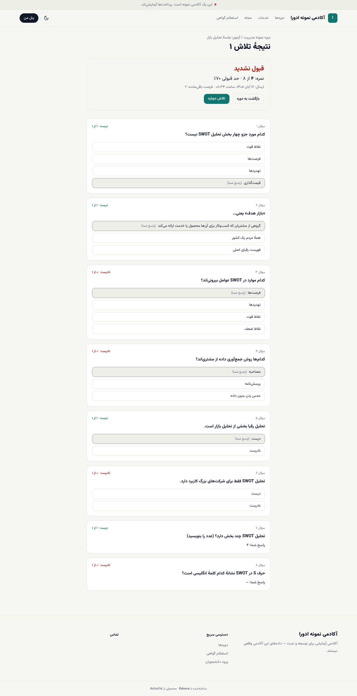
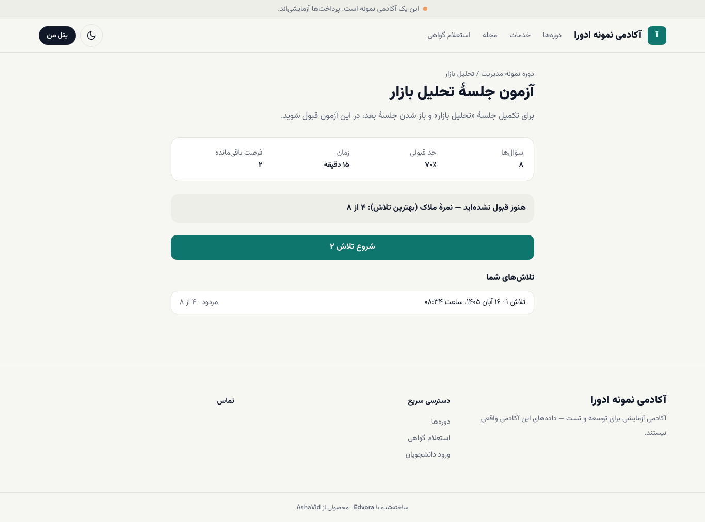
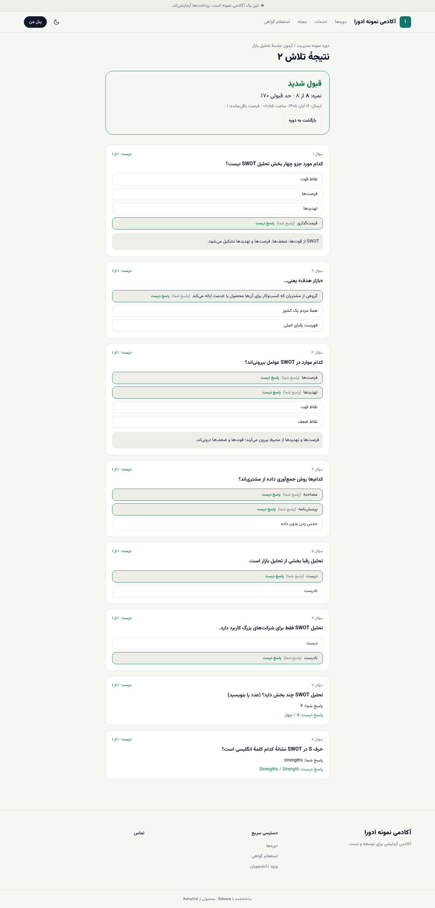

# شرکت در آزمون

آزمون‌ها در صفحهٔ دوره، بخش **آزمون‌ها**، فهرست شده‌اند. کنار هر آزمون می‌بینید که **الزامی** است یا نه و به کدام جلسه مربوط است. آزمون الزامی شرط گرفتن گواهی است. اگر جلسهٔ بعد با شرط «پس از تکمیل جلسهٔ قبل» باز شود، قبولی در آزمون آن جلسه هم لازم است؛ این شرط زیر نام جلسهٔ قفل نوشته شده.

**پیش از شروع:** اگر آزمون زمان‌دار است، وقتی شروع کنید که بتوانید تا آخر بمانید. زمان از لحظهٔ **شروع آزمون** حساب می‌شود.

## پیش از شروع: صفحهٔ معرفی آزمون

۱. در صفحهٔ دوره، روی نام آزمون بزنید.

۲. صفحهٔ معرفی چهار چیز را نشان می‌دهد: تعداد **سؤال‌ها**، **حد قبولی** (درصد)، **زمان** و **فرصت باقی‌مانده** (چند بار دیگر می‌توانید شرکت کنید).

## پاسخ‌دادن

۱. **شروع آزمون** را بزنید.

۲. به سؤال‌ها پاسخ دهید. بالای صفحه تعداد پاسخ‌داده‌ها (مثلاً «۶ از ۸ پاسخ داده شده») و زمان باقی‌مانده دیده می‌شود.

۳. پاسخ‌ها خودکار ذخیره می‌شوند و عبارت **ذخیره شد** را می‌بینید. اگر صفحه بسته شد، با بازکردن دوبارهٔ آزمون ادامه می‌دهید؛ اما زمان آزمون در این فاصله هم می‌گذرد.

۴. در سؤال‌هایی که نوشته شده «چند گزینه ممکن است درست باشد»، همهٔ گزینه‌های درست را انتخاب کنید.

۵. در سؤال پاسخ کوتاه، پاسخ را در کادر **پاسخ شما** بنویسید. اعداد فارسی و انگلیسی، فاصله‌های اضافه و بزرگی یا کوچکی حروف انگلیسی تفاوتی ایجاد نمی‌کند، اما املا باید درست باشد.

۶. در پایان **ارسال پاسخ‌ها** را بزنید.

## نتیجه

پس از ارسال، صفحهٔ **نتیجهٔ تلاش** باز می‌شود: **قبول شدید** یا **قبول نشدید**، نمره، حد قبولی و فرصت باقی‌مانده.

اینکه پاسخ درست هر سؤال را ببینید یا فقط نمره را، به تنظیم آکادمی بستگی دارد. در بعضی آزمون‌ها پاسخ درست فقط پس از قبولی یا پس از آخرین فرصت نشان داده می‌شود.

اگر قبول نشدید و فرصت دارید، **تلاش دوباره** را بزنید. در صفحهٔ معرفی آزمون، زیر **تلاش‌های شما**، همهٔ تلاش‌ها و نمرهٔ ملاک دیده می‌شود. نمرهٔ ملاک بسته به تنظیم آزمون، بهترین تلاش یا آخرین تلاش شماست.

> **اگر … چه کنم؟**
> - **پیام «ارسال انجام نشد. پاسخ‌ها روی همین دستگاه نگه داشته شده‌اند…»** آمد: اتصال اینترنت را بررسی کنید و دوباره **ارسال پاسخ‌ها** را بزنید. پاسخ‌هایتان پاک نشده است.
> - **پیام «فرصت دیگری برای این آزمون ندارید.»** آمد: با پشتیبانی آکادمی تماس بگیرید. آکادمی می‌تواند برای شما فرصت اضافه بدهد.
> - **پیام «این آزمون هنوز در دسترس نیست»** آمد: آزمون به جلسه‌ای وصل است که هنوز برایتان باز نشده. با بازشدن آن جلسه می‌توانید شرکت کنید.
> - زمان تمام شد: آزمون خودکار بسته می‌شود و پاسخ‌هایی که تا آن لحظه ذخیره شده بودند تصحیح می‌شوند. [رفع اشکال](../troubleshooting.md#quiz)

## بعد از این

- [تکلیف‌ها](04-assignments.md)
- [پیشرفت و گواهی](07-progress.md)
