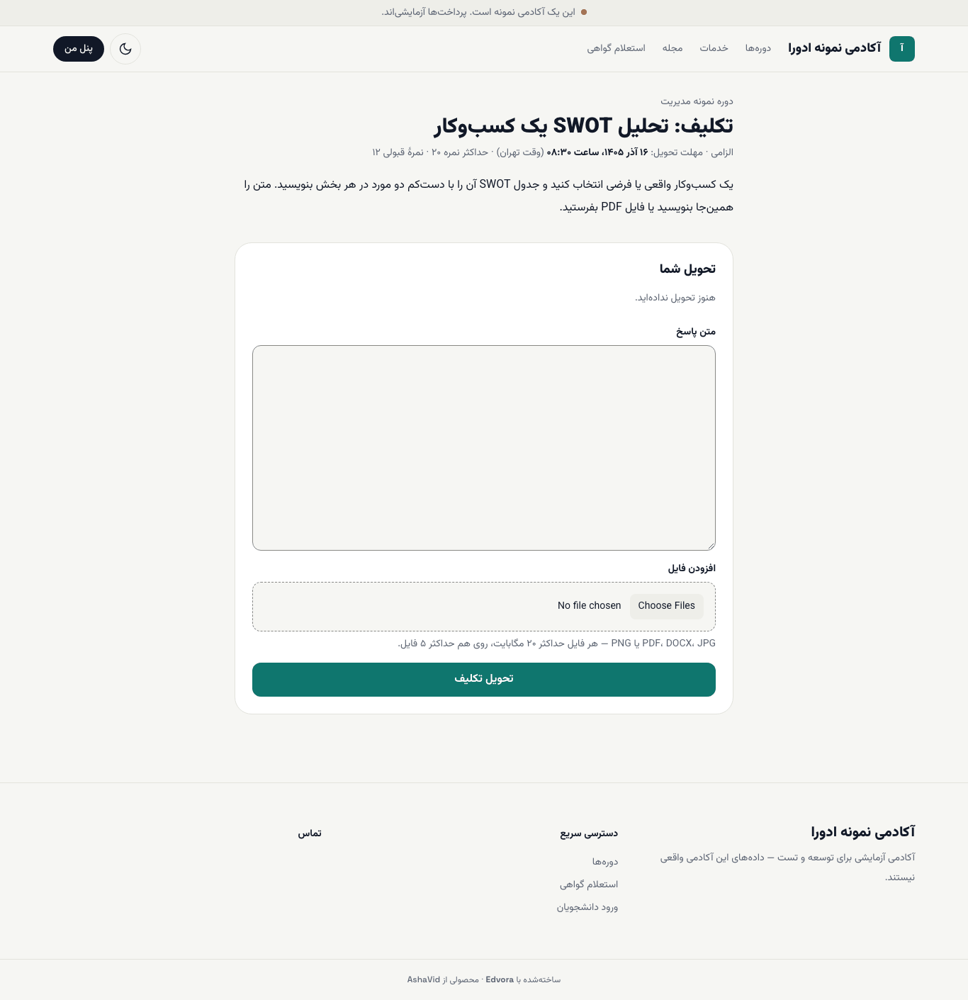
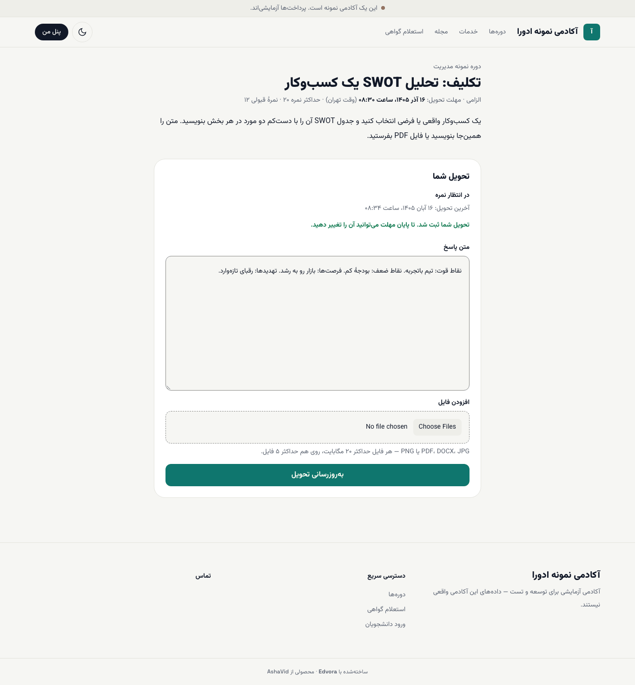
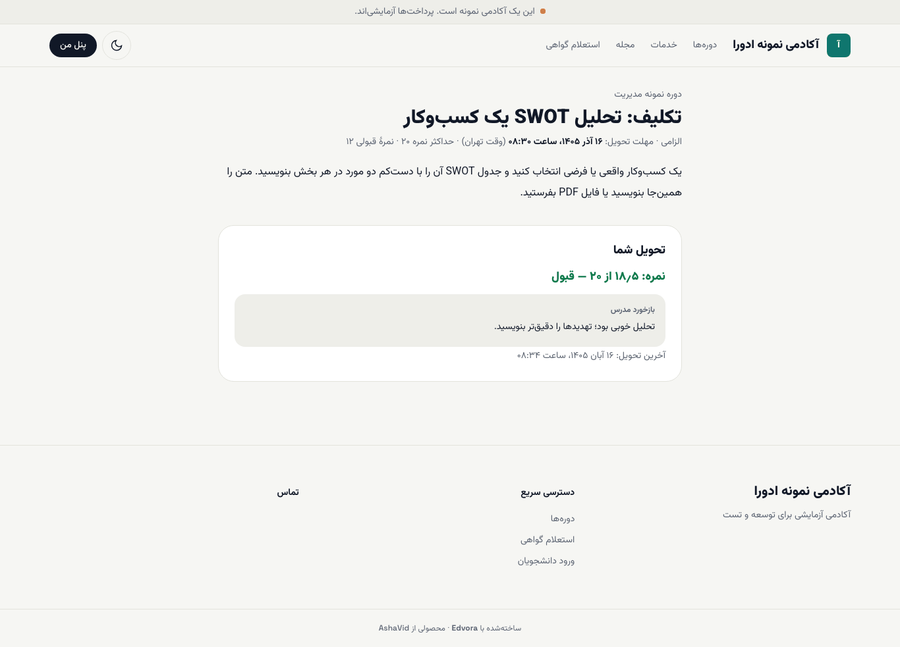

# تحویل تکلیف

تکلیف‌ها در صفحهٔ دوره، بخش **تکالیف**، فهرست شده‌اند. کنار هر تکلیف مهلت تحویل و وضعیت آن (مثلاً **تحویل نشده**) آمده است.

**پیش از شروع:** فایل‌ها را آماده کنید. فرمت‌های پذیرفته: PDF، DOCX، JPG و PNG. هر فایل حداکثر ۲۰ مگابایت و روی هم حداکثر ۵ فایل.

## تحویل

۱. در صفحهٔ دوره روی نام تکلیف بزنید.

۲. بالای صفحه را بخوانید: الزامی بودن، **مهلت تحویل** (به وقت تهران)، **حداکثر نمره** و **نمرهٔ قبولی**.

۳. پاسخ را در **متن پاسخ** بنویسید یا با **افزودن فایل** فایل‌هایتان را اضافه کنید. می‌توانید هر دو را با هم بفرستید.

۴. **تحویل تکلیف** را بزنید.

پس از تحویل، وضعیت به **در انتظار نمره** تغییر می‌کند و زمان **آخرین تحویل** نوشته می‌شود.

## تغییر تحویل

تا پایان مهلت می‌توانید متن یا فایل‌ها را عوض کنید و **به‌روزرسانی تحویل** را بزنید. آخرین تحویل ملاک است. پس از نمره‌دادن، دکمهٔ تحویل دیگر نمایش داده نمی‌شود.

## دیدن نمره و بازخورد

وقتی مدرس نمره داد، در همان صفحه زیر **تحویل شما** نمره (مثلاً ۱۸٫۵ از ۲۰ و وضعیت قبول) و **بازخورد مدرس** را می‌بینید.

> **اگر … چه کنم؟**
> - **پیام «ارسال انجام نشد. اتصال را بررسی کنید و دوباره تلاش کنید؛ تحویل قبلی شما دست نخورده است.»** آمد: اینترنت را بررسی کنید و دوباره بفرستید.
> - فایل بارگذاری نمی‌شود: فرمت (PDF، DOCX، JPG، PNG) و حجم (۲۰ مگابایت) را بررسی کنید.
> - مهلت گذشته است: اگر آکادمی تحویل با تأخیر را مجاز کرده باشد، هنوز می‌توانید بفرستید و تحویل شما «با تأخیر» ثبت می‌شود. در غیر این صورت با مدرس یا پشتیبانی تماس بگیرید.

## بعد از این

- [پیشرفت و گواهی](07-progress.md)
