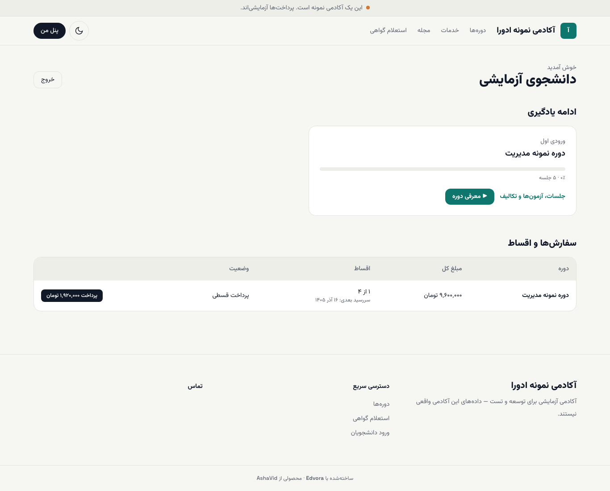

# سفارش‌ها و پرداخت قسط‌ها

اگر هنگام ثبت‌نام پرداخت قسطی را انتخاب کرده‌اید، قسط‌های بعدی را از **پنل من** می‌پردازید.

**پیش از شروع:** وارد شده باشید. کارت بانکی‌ای که با درگاه پرداخت کار می‌کند همراهتان باشد.

## دیدن وضعیت اقساط

در **پنل من**، بخش **سفارش‌ها و اقساط** برای هر سفارش این ستون‌ها را دارد:

- **دوره**
- **مبلغ کل:** مبلغ پس از کسر تخفیف، به تومان
- **اقساط:** چند قسط از چند قسط پرداخت شده (مثلاً «۱ از ۴») و **سررسید بعدی** به تاریخ شمسی
- **وضعیت:** مثلاً **پرداخت قسطی** (بخشی پرداخت شده) یا **پرداخت شده**

## پرداخت قسط بعدی

۱. در ردیف همان سفارش، دکمهٔ **پرداخت** را بزنید. مبلغ قسط روی دکمه نوشته شده است (مثلاً «پرداخت ۱٬۹۲۰٬۰۰۰ تومان»).

۲. در درگاه بانکی پرداخت کنید.

۳. پس از بازگشت به سایت، صفحهٔ نتیجه را می‌بینید و ستون **اقساط** یک قسط جلو می‌رود.

> **اگر … چه کنم؟**
> - **صفحهٔ «پرداخت انجام نشد»** آمد: اگر مبلغی کم شده، طبق قوانین بانکی حداکثر تا ۷۲ ساعت برمی‌گردد. دوباره از پنل تلاش کنید.
> - **پیام «اتصال به درگاه پرداخت انجام نشد. دوباره تلاش کنید.»** آمد: چند دقیقه بعد دوباره امتحان کنید. اگر تکرار شد، به پشتیبانی آکادمی خبر دهید.
> - پرداخت کرده‌ام ولی ستون اقساط عوض نشده: صفحه را دوباره باز کنید. اگر باز هم عوض نشد، **شماره سفارش** را که در صفحهٔ نتیجه آمده بود به پشتیبانی بدهید.

## بعد از این

- [پنل و جلسه‌ها](02-panel-and-lessons.md)
