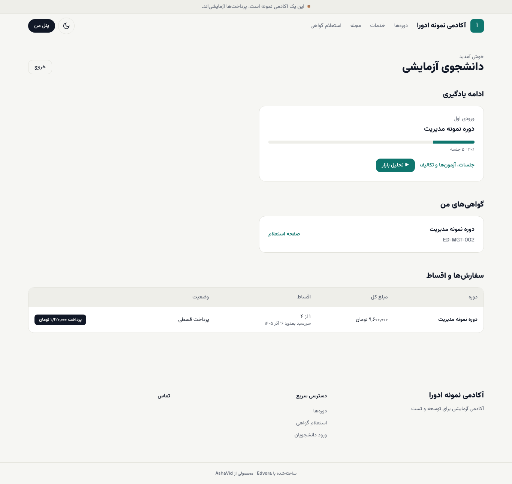
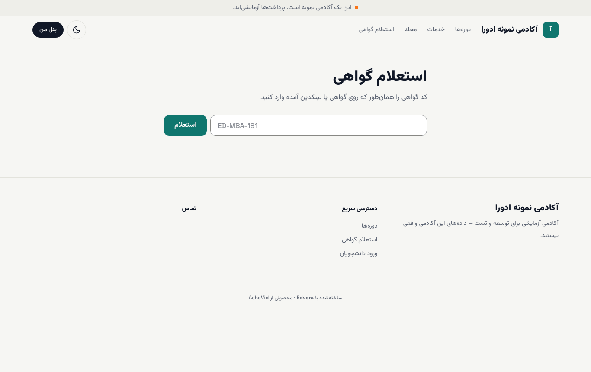
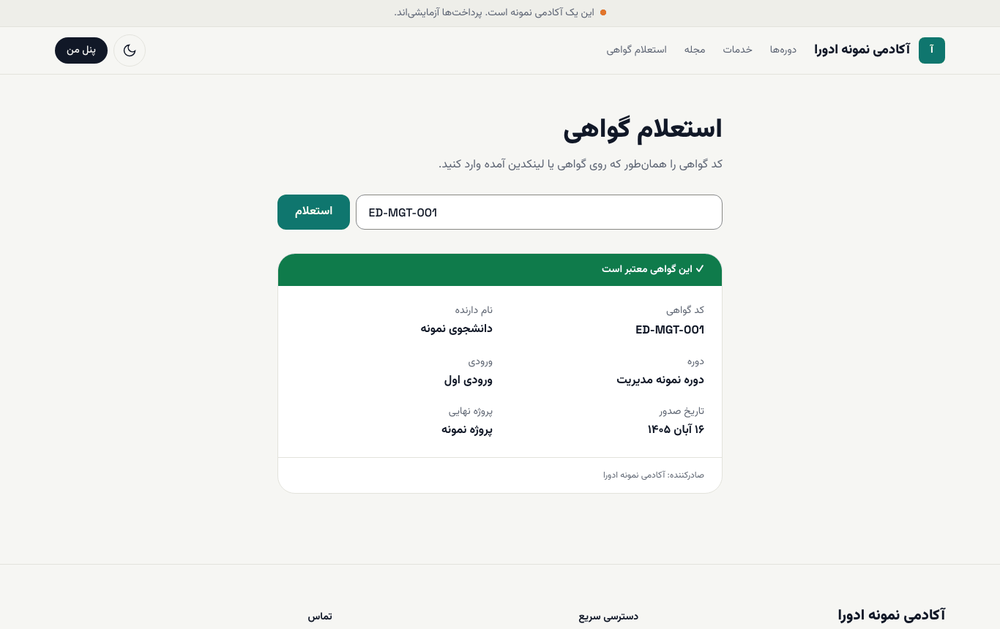
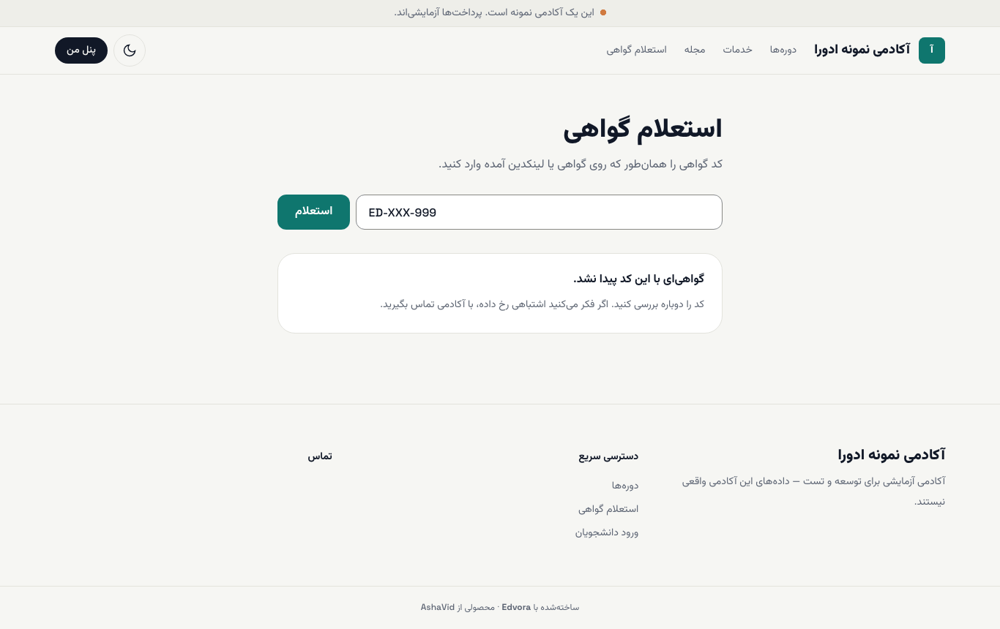

# گواهی و استعلام گواهی

وقتی شرایط دوره را کامل کردید، آکادمی گواهی شما را صادر می‌کند. هر گواهی یک کد دارد (مثل `ED-MGT-002`) که هر کسی می‌تواند در صفحهٔ **استعلام گواهی** آن را بررسی کند؛ مثلاً کارفرمای شما.

## گواهی من کجاست؟

۱. **پنل من** را باز کنید.

۲. در بخش **گواهی‌های من** نام دوره و کد گواهی را می‌بینید. این بخش فقط وقتی نمایش داده می‌شود که گواهی صادر شده باشد.

۳. **صفحه استعلام** را بزنید تا صفحهٔ عمومی گواهی باز شود. نشانی این صفحه را می‌توانید برای دیگران بفرستید یا در لینکدین بگذارید.

صدور گواهی خودکار نیست. وقتی همهٔ موارد الزامی دوره را انجام داده باشید، صفحهٔ دوره می‌نویسد «شرایط دریافت گواهی را دارید. گواهی پس از تأیید آکادمی صادر می‌شود.» ([پیشرفت و گواهی](07-progress.md))

## استعلام یک گواهی

۱. در منوی بالای سایت آکادمی **استعلام گواهی** را بزنید (نشانی: `/verify`).

۲. کد گواهی را همان‌طور که روی گواهی آمده بنویسید و **استعلام** را بزنید.

اگر گواهی معتبر باشد، **✓ این گواهی معتبر است** را می‌بینید، همراه با نام دارنده، دوره، ورودی، تاریخ صدور، پروژهٔ نهایی و نام آکادمی صادرکننده.

> **اگر … چه کنم؟**
> - **پیام «گواهی‌ای با این کد پیدا نشد.»** آمد: کد را حرف‌به‌حرف دوباره بررسی کنید؛ کد با حروف و اعداد انگلیسی است. اگر مطمئنید درست است، با آکادمی تماس بگیرید.
> - **پیام «✕ این گواهی باطل شده است»** آمد: آکادمی این گواهی را باطل کرده است. برای توضیح با آکادمی صادرکننده تماس بگیرید.
> - نام روی گواهی اشتباه است: به پشتیبانی آکادمی خبر دهید تا آن را اصلاح کند.

