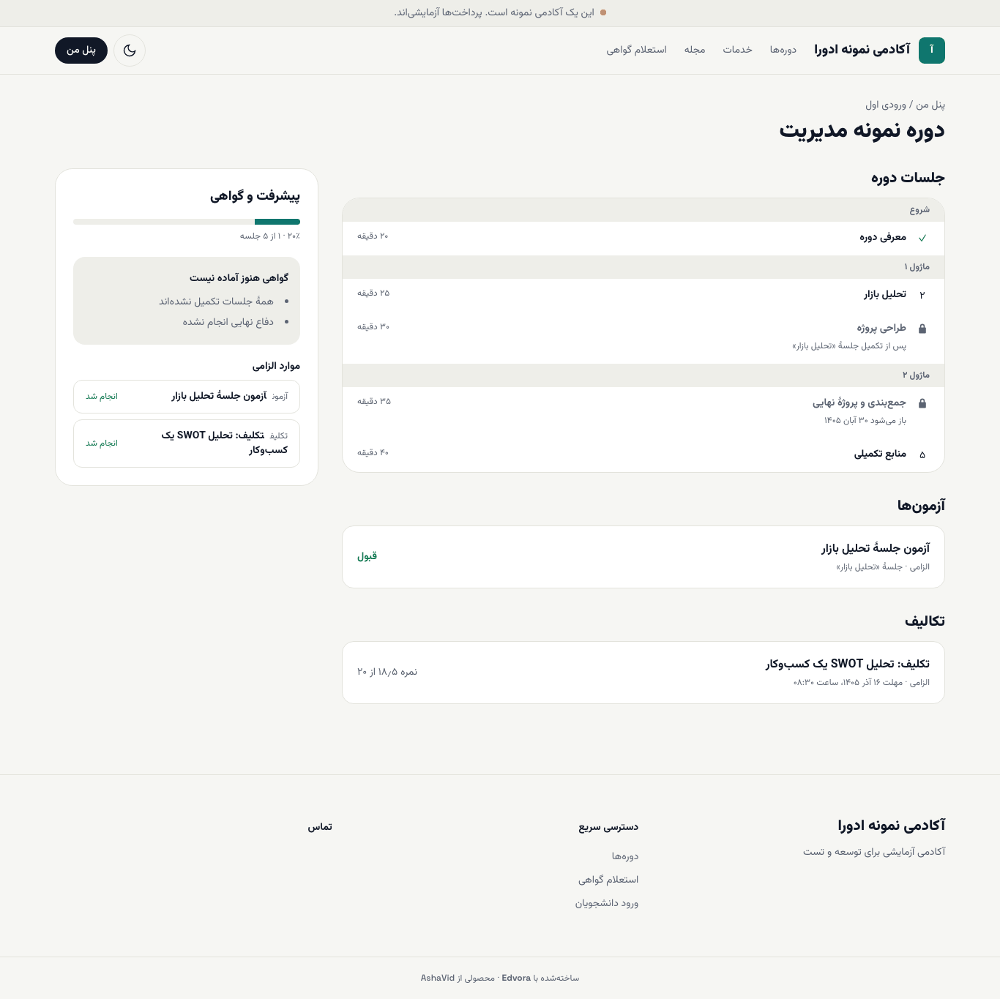

# پیشرفت و شرایط گواهی

پایین صفحهٔ هر دوره، بخش **پیشرفت و گواهی** نشان می‌دهد چقدر از دوره را گذرانده‌اید و چه کارهایی برای گواهی مانده است.

## درصد پیشرفت چطور حساب می‌شود؟

درصد پیشرفت از تعداد جلسه‌هایی به دست می‌آید که **دیده شد** خورده‌اند؛ مثلاً «۲۰٪ · ۱ از ۵ جلسه». همین درصد در **پنل من** هم کنار نام دوره دیده می‌شود. برای اینکه جلسه شمرده شود، در صفحهٔ آن **علامت‌گذاری به‌عنوان دیده‌شده** را بزنید.

## چه چیزهایی برای گواهی لازم است؟

تا وقتی شرایط کامل نشده، عنوان **گواهی هنوز آماده نیست** و زیر آن کارهای باقی‌مانده را می‌بینید. بسته به دوره، این موارد ممکن است بیاید:

- **همهٔ جلسات تکمیل نشده‌اند**
- **آزمون الزامی قبول نشده**
- **تکلیف الزامی هنوز قبول نشده**
- **دفاع نهایی انجام نشده** (فقط در دوره‌هایی که دفاع نهایی دارند؛ نتیجهٔ دفاع را آکادمی ثبت می‌کند)

زیر **موارد الزامی** هم هر آزمون و تکلیف الزامی با وضعیت **انجام شد** یا **انجام نشده** آمده است.

وقتی همه کامل شد، صفحه می‌نویسد «شرایط دریافت گواهی را دارید. گواهی پس از تأیید آکادمی صادر می‌شود.» بعد از صدور، گواهی در **پنل من** نمایش داده می‌شود. ([گواهی و استعلام](06-certificates-and-verify.md))

## نشان‌ها و ریتم هفتگی

**در نسخهٔ بعدی.** امتیاز، نشان‌ها، سطح‌ها، ریتم هفتگی یادگیری و «مسیر گواهی» هنوز در این نسخه نیستند و پس از انتشار، فقط در آکادمی‌هایی که آن را روشن کرده‌اند دیده می‌شوند. توضیح بیشتر در [به‌زودی](../coming-soon.md#badges).
